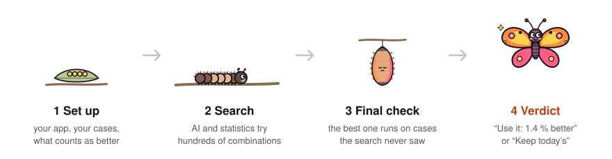
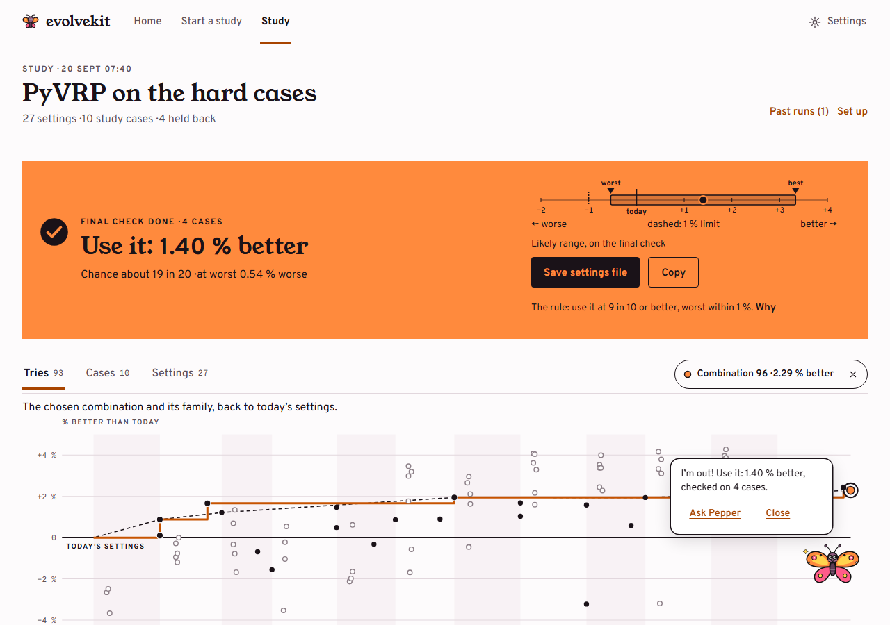
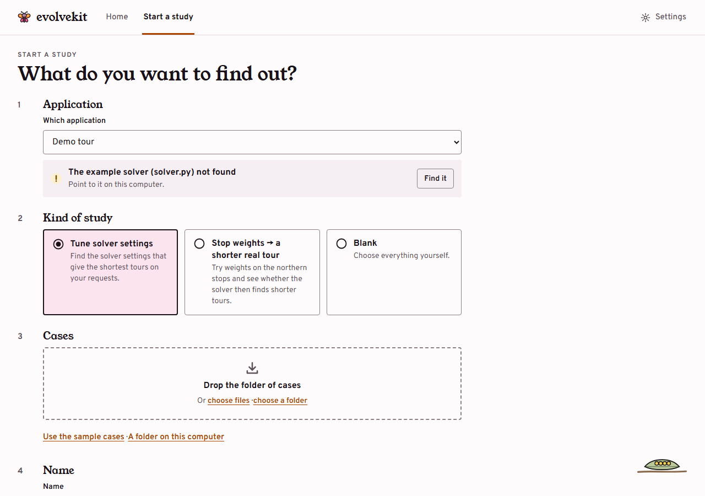
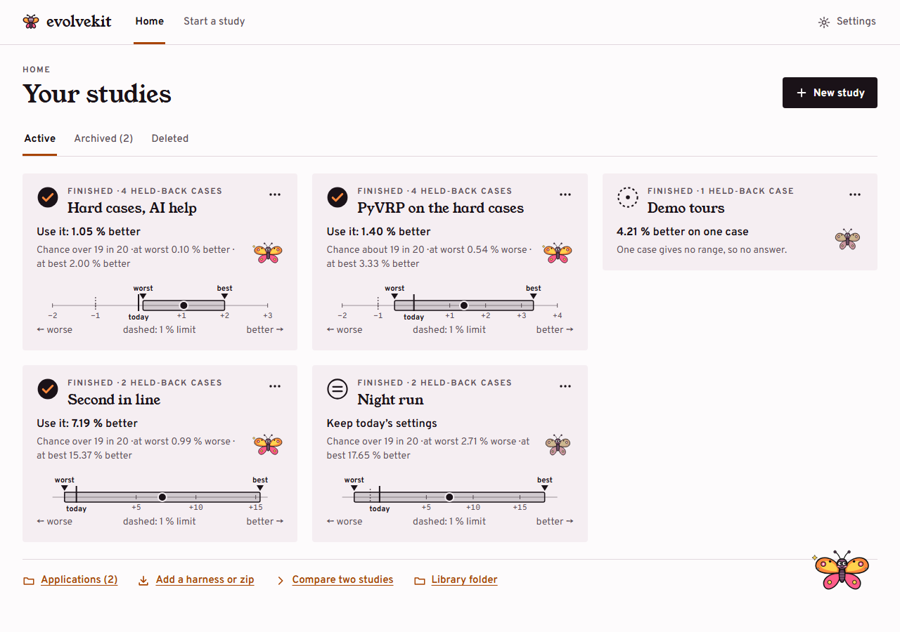
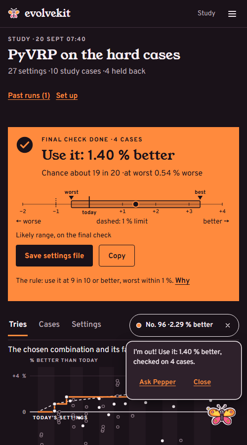
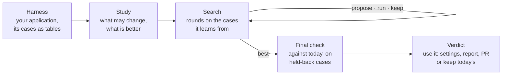

<p align="center">
  <picture>
    <source media="(prefers-color-scheme: dark)" srcset="docs/img/readme/logo-dark.svg">
    
  </picture>
</p>

<h1 align="center">evolvekit</h1>

<p align="center">
  <b>Find better settings, data and code for the programs you already run,<br>
  and know whether it is really better before you switch.</b>
</p>

<p align="center">
  
  
  
  
</p>

<p align="center">
  <picture>
    <source media="(prefers-color-scheme: dark)" srcset="docs/img/readme/lifecycle-dark.svg">
    
  </picture>
</p>

---

## What it is

You have a program that takes **settings**: a route planner, a scheduler, a
simulator, a prompt pipeline. You run it on real **cases**, and one number
says how well it did: kilometres driven, deliveries per hour, a score.

evolvekit searches for settings (and data changes, and code changes) that
make that number better. When the search ends, the best combination runs on
**cases the search never saw**, and you get one plain answer:

> **Use it: 1.40 % better.** Chance about 19 in 20 · at worst 0.54 % worse.
>
> *or* **Keep today's settings.** Not shown to beat them.

You can do all of it from a guided page in your browser, from a terminal, or
by asking your coding agent. All three see the same studies, so you can start
one way and continue another. Everything runs on your own computer, within
the time and money limits you set.

<p align="center">
  <picture>
    <source media="(prefers-color-scheme: dark)" srcset="docs/app/study-dark.png">
    
  </picture>
  <br><sub>A finished study: the verdict, its likely range, and every combination the search tried.</sub>
</p>

## What it can do

**Change what you allow, and nothing else.** A study can try other
values for the program's settings, adjust its input data (raise a cost, change
a weight), or edit the source files you name. Code changes are built and
tested like any other try, and the best one comes back as a branch you can
merge.

**Tell you honestly whether it helped.** The search learns from some of your
cases, and the final check uses the others. The answer always comes with the
chance it is right and how much worse it could be. When the evidence is thin,
it says so instead of guessing.

**Fit around your time and budget.** You set the hours and the most it may
spend on AI. Settings studies need no AI at all. A study can run only at
night or at weekends. New studies can start from what earlier ones found.

## Get started

### Install

**Windows, without Python:** the app also comes as one zip,
`evolvekit-app-<version>-win64.zip`. Whoever builds evolvekit for your team
makes it with `python tasks.py dist`. Extract it, open the `evolvekit-app`
folder inside, and double-click **`evolvekit-app.exe`**. The exe is not
signed, so Windows may say *Windows protected your PC*: choose *More info →
Run anyway*. Your studies are kept in `C:\Users\<you>\evolvekit`, never in
the app's folder. The [installer guide](docs/reference.md#for-planners-the-installer)
has the details.

**With Python 3.11 or newer** (any system):

```bash
git clone https://github.com/meaurisch/evolvekit-private.git evolvekit
```

```bash
cd evolvekit && python -m venv .venv && .venv/Scripts/activate   # macOS/Linux: source .venv/bin/activate
```

```bash
pip install -e .
```

### In your browser

```bash
evolvekit app
```

Or double-click `evolvekit-app.exe`. On Home, **New study** walks you through
seven steps: which program, which cases, what may change, what counts as
better, how long it may take. Press **Start**, and close the browser if you
like, because the study keeps running. A companion, Pepper, explains each
step and the answer when it comes. To use a harness someone shared as a zip,
choose **Add a harness or zip** on Home. The **[app guide](docs/app.md)**
covers every page.

| Start a study | Home: every study and its answer | On a phone |
|---|---|---|
|  |  |  |

### With your coding agent

If you work with a coding agent such as Claude Code or GitHub Copilot, add
evolvekit's two skills to your project:

```bash
evolvekit skill install
```

Then describe what you want in a sentence:

> *Use evolvekit to find solver settings that give shorter tours on the
> requests in `cases/`. The solver is `solver.py`. Hold three back, one hour
> in total, and today's settings are the starting point.*

The agent asks only for what you left out, shows you the plan and how long it
will take, starts the study and gives you its link in the browser. When it
ends, the agent reports the study's own answer and nothing more. If evolvekit
doesn't know your program yet, the agent writes a harness for it first (see
[below](#bring-your-own-program)).

### In a terminal: a six-minute demo, offline

The `demo-tour` harness tunes a small route solver that ships with evolvekit.
You don't need a key or an internet connection:

```bash
evolvekit doctor
```

```bash
evolvekit study new "Demo tours" --harness demo-tour --template tune --app examples/cli-solver/solver.py
```

```bash
evolvekit study cases demo-tours --hold-back 3 --add "harnesses/demo-tour/samples/*.json"
```

```bash
evolvekit study start demo-tours --wait
```

```bash
evolvekit study open demo-tours
```

`doctor` checks that this computer is ready and gives a fix for anything that
isn't. A missing AI key is fine here, because settings studies don't use AI.
`start --wait` runs the study in the background and prints the answer when it
is done. `open` shows the study in the browser. Every command is in the
**[reference](docs/reference.md)**.

## How it works



- **A harness** puts one program behind evolvekit. It says how to run the
  program, which settings and data it may change, and how to read each case
  and each result as tables. Measures are written as SQL over those tables,
  so a study can define a new measure without new code.
- **A study** is one question about that program: what may change, on which
  cases, what counts as better, and how long it may take. It lives in a
  folder of its own and keeps its own copy of the harness, so later changes to
  the harness don't affect it.
- **The search** works in rounds. Each round proposes new combinations:
  sampled settings, changes written by an AI, or edits made by a coding agent
  in a separate copy of the code. It runs them cheaply first and fully only
  when they look promising.
- **The final check** is the only claim. It runs the best combination and
  today's settings side by side on the held-back cases, several times each.
  The browser, the terminal, the report and the coding agent all show the
  same answer.

<details>
<summary><b>The words evolvekit uses</b></summary>

| Word | Means |
|---|---|
| **application** | the program being improved: a solver, a pipeline, a script |
| **harness** | the adapter that puts an application behind evolvekit, written once |
| **study** | one question about an application, in its own folder |
| **case** | one input the application runs on, such as one day's orders |
| **held-back case** | a case the search never sees, kept for the final check |
| **starting point** | what "better" must beat: today's settings, or a settings file |
| **measure** / **goal** | the number to improve, and in which direction, with any others in order of importance |
| **combination** | one set of values (and changes) the search tries |
| **round** | one batch of combinations |
| **final check** | the best combination against the starting point on held-back cases |
| **verdict** | *use it*, *keep today's*, or why there is no answer |
| **campaign** | a study that runs only in the time windows you give it |

</details>

## Connect an AI (optional)

You need an AI only for studies that let AI write changes, or that change
code. Set the provider in the app's **Settings**, or in a `.env` file in
your library home (copy [`.env.example`](.env.example)). evolvekit reads
secrets only from the environment.

| Provider | Good for | You need |
|---|---|---|
| `claude-cli` | code changes, and strong changes on a subscription | [Claude Code](https://claude.com/claude-code) signed in |
| `copilot-cli` | code changes, with a GitHub Copilot licence | the GitHub Copilot CLI signed in |
| `openrouter` | cheap, broad search | `OPENROUTER_API_KEY` |
| `azure` | Azure OpenAI and AI Foundry, with a key or Entra ID | endpoint and key, or `pip install -e ".[entra]"` |
| `fake` | tests and demos, offline | nothing |

Every study has a hard AI spending cap. The status line shows what has been
spent (`AI: $0.42 of $1.00`), and when the cap runs out, the study goes to its
final check instead of calling the AI again.

## Bring your own program

Three harnesses come with evolvekit: [`demo-tour`](harnesses/demo-tour/README.md)
(the offline demo), [`prompt-tune`](harnesses/prompt-tune/README.md) (improves
a prompt file) and [`pyvrp`](harnesses/pyvrp/README.md) (vehicle routing with
[PyVRP](https://pyvrp.org/), the open-source solver, installed separately).
For any other program:

```bash
evolvekit harness discover --program path/to/your-program   # what does it expose?
```

```bash
evolvekit harness new my-program --kind program             # a runnable starting point
```

```bash
evolvekit harness check my-program --app path/to/your-program
```

Repeat `check` until it passes, then `harness pack` makes a zip to share. A
coding agent with the skills installed can do all of this from your
program's `--help` and a couple of sentences. The
**[harness guide](docs/harness-authoring.md)** explains each part.

Under the studies is a general search engine that evolves code, in the line
of FunSearch, MAP-Elites and ShinkaEvolve. You can also use it directly on a
Python file with a marked block to evolve: see the
[bin packing](examples/binpacking/) and [circle packing](examples/circlepacking/)
examples and the [new-experiment guide](docs/new-experiment.md).

## Documentation

| Read | When you want to |
|---|---|
| **[docs/app.md](docs/app.md)** | use the app: every page, every button |
| **[docs/reference.md](docs/reference.md)** | look up every command, every `study.yaml` key, the engine's config and its outputs |
| **[docs/harness-authoring.md](docs/harness-authoring.md)** | put a new program behind evolvekit |
| **[docs/new-experiment.md](docs/new-experiment.md)** | set up an engine experiment by hand |
| **[examples/](examples/)** | start from a worked example |
| **[AGENTS.md](AGENTS.md)** | contribute with a coding agent: the house rules |

## Development

```bash
pip install -e ".[dev]"
```

```bash
python tasks.py test     # the fast offline tests
```

```bash
python tasks.py check    # lint, then every test: the gate before a PR
```

Everything else is in `tasks.py` (`full`, `run`, `lint`). Branch from
`master`, open a pull request, and run `check` first. To block pushes to
`master` and secrets in commits, run `git config core.hooksPath .githooks`
once (it needs `gitleaks`). The full test suite has timing-sensitive tests,
so don't run demo studies while it runs.

## Licence

[MIT](LICENSE) © 2026 meaurisch. evolvekit is not affiliated with or endorsed
by the projects it works with, including PyVRP.
