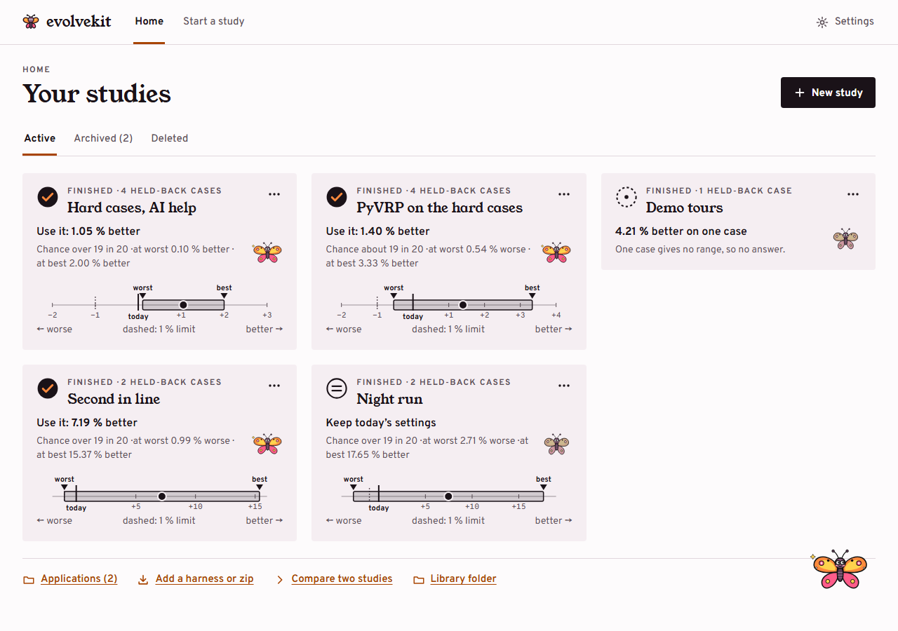
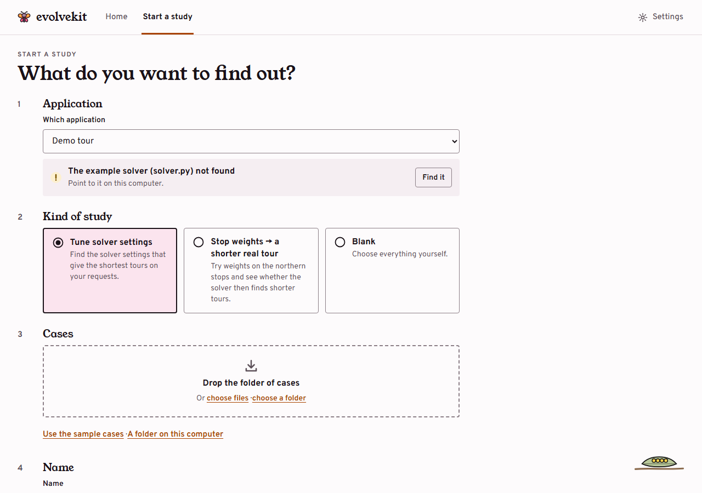
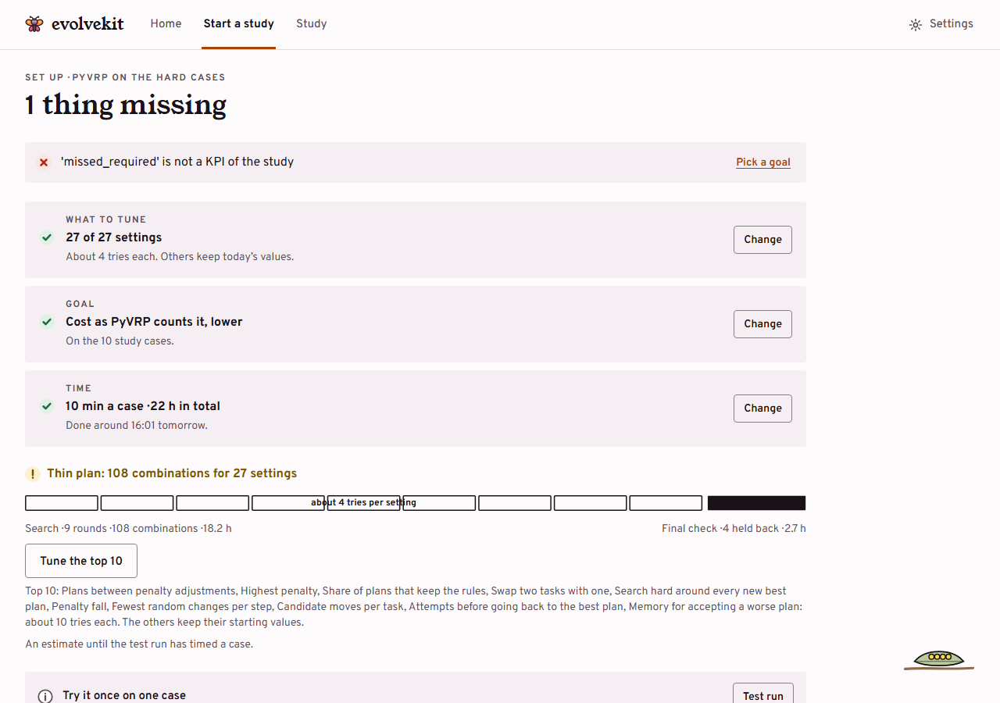
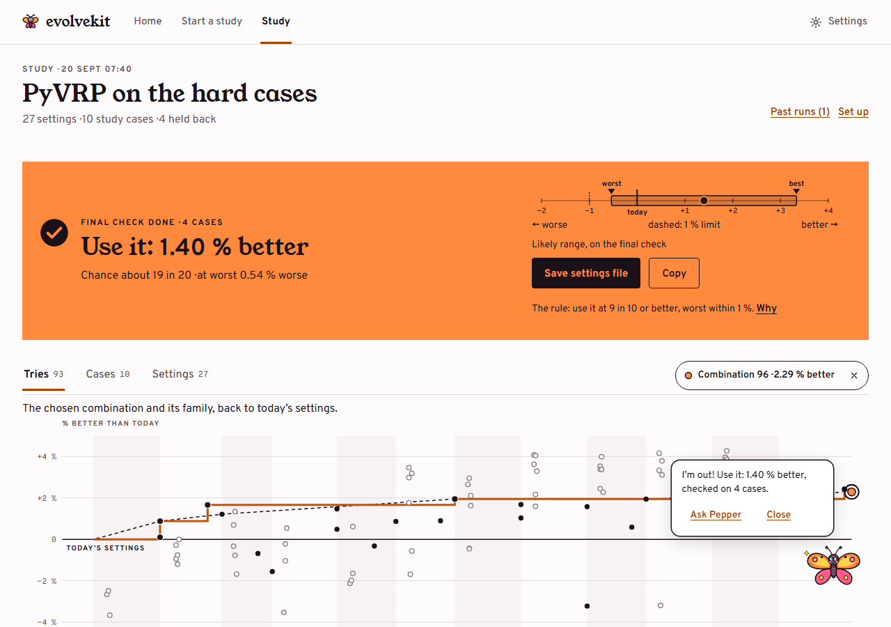
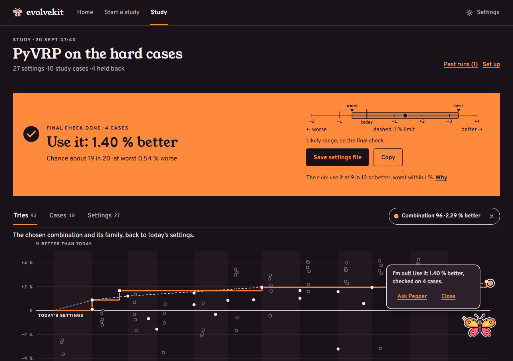
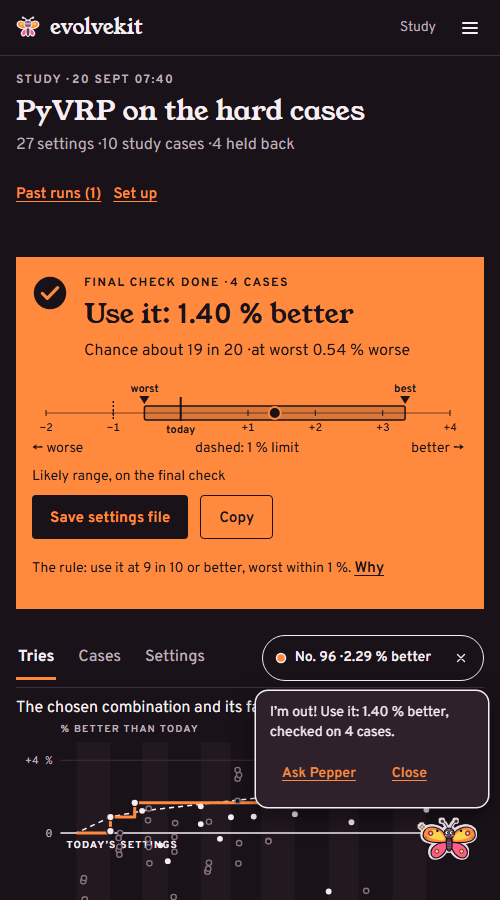
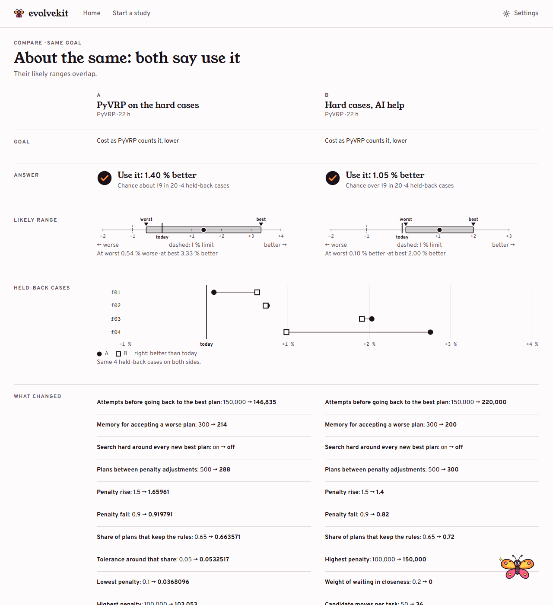

# The evolvekit app

The app is how someone who is not a programmer tunes an application with
evolvekit: pick the application, bring the cases, say what may change and
what counts as better, press Start, and read the answer — in the browser, on
your own computer. Under the hood every study is an ordinary evolvekit run
(see [Harnesses and studies](reference.md#harnesses-and-studies)); the app
asks the questions and explains the answers.



It follows the computer's light or dark setting (`?theme=light` or `?theme=dark`
in the address forces one) and works down to a phone's width.

## Starting it

```
python -m evolvekit app
```

It opens your browser at `http://127.0.0.1:8780/?token=…` and prints that
address. The address carries the key of this launch: open it as printed (a
bookmark of the bare address, or the page from an earlier launch, shows one
sentence asking you to), and the page keeps the key for as long as the tab is
open. Keep the window it runs in open while you work; closing it stops the
app, not the studies that are running — they carry on, and the app shows
them again when it is back. The app from the installer has no window: see
[From the installer](#from-the-installer-windows) for how to stop it.

| Option | Does |
|---|---|
| `--home DIR` | the library to use (default: `EVOLVEKIT_HOME`, else `~/evolvekit`) |
| `--port N` | the first port to try (default 8780) |
| `--no-browser` | print the address instead of opening a browser |
| `--shortcut` | Windows: put `evolvekit.cmd` on the desktop, which starts the app with a double-click; with the installer, the shortcut starts `evolvekit-app.exe` |
| `--service` | no browser or console: the app logs to `<home>/app.log` (rotated at 5 MB, two kept) and keeps campaigns' windows; `study open` starts it this way |
| `stop` | `evolvekit app stop`: stops the app of this library cleanly (exit 1 when it did not stop within 10 s) |
| `install-startup` / `uninstall-startup` | start `app --service` at logon, or no longer. Windows: registers (or removes) the logon task "evolvekit app" and prints what it runs; macOS and Linux: prints the launchd agent or systemd unit to install, and the commands. On Windows this is not yet tried on a real logon |
| `--clock ISO --clock-speed N` | a rehearsal clock for campaigns, from `ISO` (local when it has no zone) at `N` times real time (1 to 3600): windows follow it, runs keep real time; Home says so |

A second `evolvekit app` on the same library opens the first instead of
starting another.

### From the installer (Windows)

The installer is one zip, `evolvekit-app-<version>-win64.zip`, from whoever
builds evolvekit for your team (`python tasks.py dist`); it needs no Python.
Extract it into a folder of your own (Downloads, Desktop, Documents — never
`C:\Users\<you>\evolvekit`, which is your library) and double-click
`evolvekit-app.exe`: after Windows's *Extract All* it is in
`<zip name>\evolvekit-app\evolvekit-app.exe`, one folder further in than the
folder Extract All makes. The exe is unsigned: if SmartScreen says *Windows
protected your PC*, choose *More info*, then *Run anyway*, for a zip from your
team only; if Windows or an antivirus blocks it with no *Run anyway*, ask your
IT team. The browser opens at the app; double-clicking again opens the app
that is running. Having no window, it logs to `<home>/app.log` as the service
does. If no browser opens, run
`"<the app's folder>\evolvekit-cli.exe" --no-browser` from a terminal in a
folder of yours: it prints the address. PyVRP is not inside: install
`pyvrp-1.0.0.zip`, which comes beside the app's zip, from Home.

**Stopping it:** Settings → *Stop the app*, or `evolvekit app stop`
(`"<the app's folder>\evolvekit-cli.exe" app stop`). Runs that are going carry on. Your library stays
`C:\Users\<you>\evolvekit` (or `EVOLVEKIT_HOME`), never the app's folder.
**Updating:** never extract a new zip over a folder whose files are in use: a
study that is running holds them. When Home shows no study running, stop the
app and extract over the old folder; while one runs, extract into a new folder
and start it from there (make the shortcut and the logon task again from the
new folder if you use them). The README's
[For planners: the installer](reference.md#for-planners-the-installer) has the
rest: the command line, updating and removing.

### The app as a service

A study with a `schedule` (a *campaign*, see the README's
[Studies over time](reference.md#studies-over-time)) starts, stops and carries
on at its windows only while the app runs. For that the app can run without a
browser or a console:

```
python -m evolvekit app --service
```

It keeps the windows, and writes what it does to `<home>/app.log` (rotated at
5 MB, two kept; what the ticker prints goes there too, one line for every
start, resume, continuation and stop of a campaign). The log is private to
you (as private as your user folder, and mode 0600 where the system has
modes) and never holds the key of the launch: it says `the key is in app.json`
instead. `evolvekit study open NAME` starts the app this way when none runs. A
second `evolvekit app`, `--service` or not, finds the first and opens it (a
service says `already running` in the log and ends).

`evolvekit app stop` ends the app of this library cleanly, and exit 1 if it
did not stop within 10 seconds. To have it at every logon:

```
python -m evolvekit app install-startup
python -m evolvekit app uninstall-startup
```

On Windows the first registers the logon task "evolvekit app" (it starts
`pythonw.exe`, or the installed app's `evolvekit-app.exe`, with no console
window; it does not end after 72 hours or stop
on battery) and prints what it runs; the second removes the task. There is one
such task per user, so one library starts at logon: the last one installed.
Installing it for another library replaces the first one's task, and says so
(*it replaces the task for &lt;the other home&gt;: there is one logon task per
user, so that library no longer starts at logon*); `uninstall-startup`
removes the task whichever library it starts. On macOS and
Linux they print the launchd agent or systemd unit, and the commands to
install or remove it. The logon task is untried on a real Windows logon.

A scheduled session keeps the computer from sleeping until its window ends,
and through a final check that runs past it; `schedule: {keep_awake: false}`
in `study.yaml` turns that off, and a session you start by hand never does it.
If the app was not running when a window started, Home says so (*the window
of Sat 14 Nov was missed: the app was not running*) and the run starts late,
in what is left of the window.

### Rehearsing a campaign

A weekend takes two days. To see a campaign work, start the app with a
rehearsal clock:

```
python -m evolvekit app --service --clock 2026-11-13T17:30 --clock-speed 120
```

The windows follow a clock that starts on Friday 17:30 and runs 120 times
faster than real time (`--clock-speed` is 1 to 3600), so Monday 08:00 comes
about half an hour later. The runs keep real time: they spend real search time
(it is the windows that are speeded up), and the study's hours are real
hours. Home says the rehearsal is on (*Rehearsal clock: Fri 13 Nov 17:30, 120 ×
real time. Times of the windows follow this clock; other dates are the real
time.* — a run's *today 17:19* is real time; the Study page says it too, above
its notices), and each line in `app.log` for a campaign gives both times
(`2026-11-14T01:10:00+01:00 rehearsal · 2026-11-13T18:12:03+01:00 real · …`).
A run is given more search time only when ten real minutes of its window are
left, so windows shorter than ten real minutes never give a run more time: at
120 × a 01:00–06:00 night lasts 150 real seconds, and its runs start, stop
and resume but are never continued (a fresh run may stop before its first
round). Rehearse at a speed where a window lasts at least ten real minutes,
or rehearse a weekend (its 24-hour windows last 12 real minutes at 120 ×).
Open the app as usual (`python -m evolvekit app`) to look at it: it opens the
service already running. `evolvekit app stop` ends the service, and the
clock with it. A clock cannot be set on an app that already runs (stop it
first), and nothing sets it by accident.

The app answers only to this computer: it listens on 127.0.0.1, refuses
requests that name another host, accepts changes only from its own page, and
answers nothing but that page without the key of this launch — so another
program on the machine that knows the port cannot drive it.

## Your library

Everything the app knows is in the library home, so it can be closed and
opened again at any time:

```
~/evolvekit/
  settings.yaml        the AI provider and models, the applications used before
  .env                 API keys: written by the app, never shown again
  app.json             while the app runs: where it is, and the key of this launch
  app.log              what `app --service`, or the installer's double-clicked app, did (no key in it)
  clock.json           only during a rehearsal (`app --clock`), while that app runs
  harnesses/           harnesses you installed
  studies/<name>/      one folder per study: study.yaml, the pinned harness,
                       cases/, inputs/, preview/, runs/
```

A study folder is self-contained: copy it to another computer, point it at
the application there, and it runs.

**One library, whoever made the study.** The command line
(`evolvekit study …`, see
[A study from the command line](reference.md#a-study-from-the-command-line))
reads and writes the same library through the same code. A study made on the
command line appears on Home, with its state and its answer; a study made
here can be started, watched and read from the command line; and a study
started from either runs the same way, whether the app is open or not.
`evolvekit study open NAME` prints the study's address in the running app —
starting the app, without a browser window of its own, when none runs — and
opens it.

**`app.json`.** As soon as the app is listening it writes `app.json` in the
library home, and removes it when it stops cleanly:

```json
{"pid": 1234, "started_at": "2026-11-07T10:00:00+00:00", "host": "127.0.0.1",
 "port": 8780, "url": "http://127.0.0.1:8780/?token=…"}
```

That is how a command finds the running app. The `url` carries the key of
this launch, so the key is on disk while the app runs. That is a deliberate
choice, and acceptable for the same reasons the app is safe at all: the file
sits beside `.env`, which already holds your API keys; it is private to you
(on Linux and macOS it is made readable by you alone, mode 0600; on Windows,
which has no such mode, it is as private as the folder it is in, your user
folder by default); and the app's other protections stay —
it listens only on 127.0.0.1, accepts changes only from its own page, and
answers no API call without the key. A file left behind by an app that is no
longer running (its process is gone, or the process with that number is not
the app that wrote it) counts as "not running": it is ignored, removed, and
written again by the next app.

**Home** shows your studies as cards: each says where the study is
(*Running · round 7 of 12*, *Queued*, *Finished · 4 held-back cases*), its
answer with the likely range, and Pepper — the app's butterfly — in the
study's phase: eggs for a draft, a caterpillar early in the search, a cocoon
late in it and during the final check, and a butterfly when it is done
(bright when the answer is *use it*, in quiet colours otherwise). A draft
says what Set up still lacks by its row's name (*Set up not finished: Goal*),
or *Ready to start: not started yet* when nothing is missing; under a *keep*
whose held-back cases all improved, the card says why it is still keep
(`why_keep`), right under the verdict's line. Every card
has a menu (⋯): *Rename*; *Duplicate* — a new study with the setup and the
cases, not the runs; *Compare with…*; *Past runs*; *Save as zip*; *Archive* —
kept, but out of the way, under **Archived** until *Restore*; and *Delete*.
Nothing is deleted at once: a deleted study waits under **Deleted** for 7
days — an *Undo* bar offers it back for ten seconds, and the Deleted tab has
*Restore* for each. A study that is running, or waiting its turn, can be
neither renamed, archived nor deleted. One click away under the cards:
*Applications* (the harnesses you can tune, and installing one), *Add a
harness or zip* (a study zip dropped there becomes a study), *Compare two
studies* and the *Library folder*.

**What we learned.** One page per application, at *What we learned* on Home
(the link under the cards goes to the application of your newest finished
study) and beside each application in *Applications*. It lists the finished
studies on that application, each with its own verdict line, and then a table
with a row for every setting that was tuned: *Tuned in* (how many studies),
*How strongly it went with the measure (0 to 1, not proof)* (a bar and a figure such as
`0.42 · from 2 studies`, or *not enough tries to tell*), *The searches leaned
to* (each setting's median of the studies' search-best values, for a choice
the value most of them had and none on a tie, as `4 (search, not checked)`),
*Winning values* (`12 in Depot spring (1 Oct)`, or *none yet*) and *Winners
moved it* (*up*, *down*, *both ways*). That strength is how strongly a
setting's values went with the measure in the searches, and a sentence under
the table says so: *0 means the setting did not go with the measure in the
searches, 1 that it went with it every time. It comes from the searches, not
from final checks: it says which settings are worth tuning, not which value
wins.* It is not proof of anything, and the page claims no gain of its own;
where the searches leaned is a search figure, never a winner. A winning value comes only from a study whose
final check said *use it*. What could not be read across (a setting the
application no longer has, or one whose meaning changed) is listed under
*Left out*.

## A study, from start to answer

The app has four pages for a study: **Start a study**, **Set up**, the
**Study** page, and — one click away from it — **Compare**. Everything is
saved as you go.



**Start a study** asks four things on one page:

1. **Application** — which application (a *harness* connects evolvekit to
   one — PyVRP and a demo come with evolvekit, colleagues send others as
   `.zip` files) and where it is on this computer. The app looks in the usual
   places and asks each one, so the right one says *PyVRP 0.14.0 · Found on
   this computer*; *Other* lists what it found, browses, or takes a pasted
   path.
2. **Kind of study** — the harness's templates (better settings, better
   data, or a change to the application's code, such as the demo's
   *Shorter tours by changing the solver*), or blank.
3. **Cases** — the requests to work on: drop files or a folder, choose
   them, give a folder's path, or use the harness's samples. Every file is read
   at once; one that cannot be read is named and left out. A few cases are
   **held back**: the search never sees them, and at the end the best result
   is checked on them — the *final check*. The strip under the drop zone shows
   every case by size, held-back ones filled, with one sentence on how firm
   the answer can be (*4 held back: a fair answer for a clear, consistent
   gain*); *Which ones?* swaps any case, or removes one (with Undo).
4. **Name**.

*Next: set up* starts the **preview** in the background: the smallest case
solved once at the starting values — proof that everything works, every
measure's value today, and the timing the plan needs.



**Set up** is one screen with three summaries, each with *Change*, which
opens a drawer on the right (full screen on a phone):

- **What to tune** — the application's settings, as its harness names,
  groups and ranks them: each *Tune*, *Fixed* or *Default*, the recommended
  ones first, and an ⓘ right after each name with what the setting does in
  plain words (*More detail* for the technical text). A tuned number has
  *Change the range*. A file of the settings you use today can be imported.
- **Goal** — what counts as better, from the harness's own measures, or a
  fill-in-the-blank measure whose choices come from your cases (*Share of
  tasks done by a vehicle class*), and an optional second goal that breaks
  ties within 1 %.
- **Time** — the time per case (the application stops itself then; a run
  still going at 1.5 × that + 30 s counts as failed), the total time, runs
  per case, retries, and optional AI search help with a cap. Experts can set
  the combinations per round and the rounds here too.
- **When it runs** — as soon as you start it, or only in some hours: *Nights,
  Monday to Friday, 01:00 to 06:00*, *Weekends, all day*, or both, with an
  optional *Until* date. The study then runs only inside those hours, and only
  while the app is running then (see [The app as a
  service](#the-app-as-a-service)). *Start* does not start it but says when it
  will (*next window Sat 00:00*); the total time under **Time** is then the
  search time of the whole campaign, spread over as many windows as it takes.
  The plan bar then says when it would end on the windows (*starts Sat 00:00;
  about 18 min of search; done around Sat 00:18*), and when the total time is
  less than one week of the windows gives, *Search through the whole window
  (about 47 h; done around Sun 22:54)* sets the total time to the plan's
  `whole_window` hours: the week's window hours less the time its final check
  needs, so the search and the final check end inside the windows, at the time
  it names; under a rehearsal clock it names both times, *(about 47 h on the
  rehearsal clock, 23 min of real time; done around Sun 22:54)*, and sets the
  real one. *Save* says what it saved at once (*Saved: Weekends, all day*, or
  *Saved: your own windows*) and is disabled until the answer; the plan follows.
  Other windows are written in `study.yaml`.

A **code study** — one whose template changes the application's source —
shows **What may change: code** in place of *What to tune*: the source
folder and the commit it starts from, the files the search may change, and
the brief. Its drawer asks three things: the **source folder** (proposed from
the harness's own folder while the folder the study was made from still has
it; *Choose the folder*, or paste the full path of a folder inside a git
repository), **Start from** (a branch, a tag or a commit, or `working` for
the files as they are now, uncommitted changes included — nothing in the
folder is written), and **What the search should improve**, in your words.
The search may change those files and nothing else. A code study needs AI
search help (under **Time**): the model proposes each change, and with
*Claude Code here* as the provider (Settings) the coding agent also edits
the files itself, with shell access to a worktree of your repository (the
README's *Code studies* says what it can reach). With *GitHub Copilot CLI*
the model proposes each change only: its agent is not verified yet. A study changes code or tunes settings,
not both yet.

Under them the **plan bar** shows what the time buys — the rounds of search,
then the final check, and when it will be done. When that is thin for what
you tune it says so and offers fixes with their consequences (*Tune the top
9* — the harness's recommended ones first; *Allow 22 h*), and when it is too
little to learn anything it says why. A study with AI help says the time the
plan counts for each change the AI writes (*about 20 s*), since the AI's
writing takes a round's time too. With only one or two held-back cases a
note under the plan says that a *use* is unlikely and to hold back more cases
for a firmer answer (the plan's `notes`); it does not stop the start, and the
Study page repeats it while the run waits and runs. *Test run* tries the study once on the
smallest case before anything is spent. One click away below: the held-back
cases, runs per case, **Rules** (combinations that may not be tried),
**Measures** (your own measures in SQL, for experts, and limits a combination
must keep), **Data changes** and AI help.

## The Study page



The **status strip** at the top says the study's one answer right now —
*Searching · round 7 of 12 · Best so far: 1.9 % lower cost on the cases it
learned from · Not checked yet* — and becomes the verdict when the final check
has decided. The best so far is one figure, the one `evolvekit study status`
prints, in its words; the Home card says the same. Nothing says *use
it* before then. Once there is a verdict, the strip's headline and the
sentence under it are the verdict's own `line` and `advice`, word for word,
as `evolvekit study verdict` prints them: the page never composes its own.
While the final check runs there is no verdict yet, so the strip says *No
answer yet*. The app decides by one fixed rule, stated under the answer:
*Use when the chance of a gain is at least 95 %.* It says *worse* when
the chance of a gain is 5 % or less (as strict as use), and
never *use* for a change that failed more runs than today's settings did: that
is keep, and its line says so first (*Not proven on 3 held-back cases: it
failed 4 runs the starting point finished; …*). A keep's chance just above 5 %
reads *over 5 %*, never like worse's; one just under 95 % reads *under 95 %*. With no true gain, the worst
case (pure run noise) reads *use* in about 8.9 % of studies and *worse* in
about 5 %. The chance shown is
the chance the rule reads, so a *use* never shows a loss as its worst case.
Every estimate shows its **90 % range** (the posterior's 5 % and 95 %
quantiles) as a band through *today*, with both ends marked, the *low end* and
the *high end*, and named *90 % range* in the sentence, the caption, the Home
card, the report and the assistant's figures. Its low end is the sentence's
*at least* / *at worst* to the digit (both to one decimal): the bound the rule
reads, so a *use* reads *at least 4.5 % better … on average over 5 held-back
cases; its 90 % range is likely between 4.5 % and 8.0 % better*. *At least* is
the average over the held-back cases, so a single case below it breaks no
promise, and a *use* gives its chance in figures too (*a chance of about 97 %*,
*a chance of over 99 % (almost certain)*). The 95 % interval
stays in `comparison.json` and `.md` as `ci95`, for engineers. A study whose final check
was written before this rule keeps the rule it was decided by (*use it at a 90 %
chance or better, worst within 1 %*), with its own words, its own 95 % range and its
own decision.

While a round's changes are being written by the AI the strip says so —
*Writing changes: 7 of 12.* — until that round's runs begin; a study without
AI help writes no changes, so it never says it. Under a live
run's sentence the strip gives two facts as the status document says them:
what the AI has spent of its cap (*AI: $0.42 of $1.00*, or *AI: 4 requests*
for a provider that counts requests), and after the first round, when the
pace so far buys fewer rounds than planned, *At this pace about 2 of the 11
planned rounds will run.* Neither is a claim about the result. Details shows
the spend too, and once the run is finished the verdict's own figure among
its facts.

- **Use it** (the strip turns orange): *Probably better: 1.4 % lower cost
  on 3 held-back cases, a chance of about 96 %; …*, then *Use the new
  settings: they are probably better on cases the search never saw.*;
  *Save settings file* and *Copy* a summary.
- **Keep**: *Not proven on 3 held-back cases: …* (*a chance under 95 %*),
  then *Keep today's settings … for now: the gain is not proven.*; *Check
  with more runs* (twice the runs per case, said on the button) keeps the runs it did and adds others. It is offered
  only after a single read of the answer: the final check reads its answer
  after its first runs and, while the answer is keep and more runs can help,
  adds all its extra runs at once and reads it once more, so an answer has
  had at most two reads and the app offers no third. When only more
  held-back cases could firm the answer (`limited_by: "cases"`), the check
  adds no runs, the page says more runs would not change it (*the answer is
  set by the held-back cases, not by the runs: hold back more cases for a
  firmer answer*) and offers no *Check with more runs*. When every held-back case improved but the range still allows
  a loss, the verdict's `why_keep` stands between the line and the advice:
  *Every held-back case was lower (3.1 % and 8.2 %), but with only 2 cases
  the range is too wide to rule out a loss: hold back more cases for a firmer
  answer.* A campaign's run says among the strip's facts when it ran, on the
  window clock (*Ran in its windows: Sat 00:04 – Sun 09:27*).
- **One case**: *Not proven, one held-back case: 4.8 % lower tour length.*,
  then *Keep today's settings …: one held-back case is too few cases to tell
  (the 11 runs were all on it); a study that holds back three or more can.*;
  *Hold back more cases*.
- **Worse**, **nothing beat
  the starting point**, a **stopped** check (*Continue the check*), a study
  **stopped by you** (*Run the final check*, *Carry on*) or **by an error**
  (*Continue where it stopped*), and **queued** (*Remove from queue*).

Below the strip three linked views:

- **Tries** — every combination by when it finished and its change against
  today, on the cases it learned from (its axis: *% change vs today, on the
  cases it learned from (not checked)*); the orange line is the best so far, on full looks only (all
  study cases), so a lucky quick look on a few cases never sets it; rings at
  *now* are tries still running. The line averages each case's change, so its
  legend says so: it can differ by a few tenths from the strip's figure,
  which compares the plain averages as the verdict does.
- **Cases** — a row per study case, a dot per try, and how many tries beat
  today on it (*ahead of today*, never *better*: these are not checked).
- **Settings** — one panel per tuned setting: the value tried across, the
  result up, today's value dashed and the band of values that did well; the
  settings that moved the result most come first.

Hover, focus or tap a dot for its card; click it (or Enter) to follow that
combination across all three views. When the answer is *use it*, the checked
combination and its family — the combinations it came from, back to today's
settings — are marked on the Tries plot. *Details* shows one combination in
full: every setting it changed, its result case by case, and for a run that
failed, what it printed and how it was started.

In a code study a combination is a change to the source. Its card's last
line says how big it is — *+3 −1 lines in solver.py*, or *No change: today's
code* for the starting point — and *Details* shows the change itself under
*What it changed*: the diff as it is, in monospace, added lines on a green
tint and removed ones on a red one. The third view is **Code** in place of
Settings: every combination's change, the best first, each with *Details*.
The page speaks of code throughout: the Tries plot's zero line is *Today's
code*, and **Code to keep** (or **The code change to use**) shows the source
against today's code (*HEAD (e973d92)* → *+18 −9 lines in solver.py*) with
*Show the change*. The verdict's answer for a code study
speaks of the code (*Keep today's code …*), and the change is taken away
from the command line: `study export SLUG --diff` writes it as a patch, and
`study pr SLUG` makes a branch and a pull request of it (only with `--yes`;
see the README's [Code studies](reference.md#code-studies)).

A run per kind of case (`per_group: true`, see the README's *Settings per
kind of case*) has one search and one final check per group. Its strip says
the run's own verdict line and advice (*Per kind of case: not every group is
shown to beat today's settings (large: keep).*); under it, **Per kind of
case** lists each group — its verdict mark, its name, its cases to learn
from and held back, and its own verdict line, word for word — and then
*Which cases get which settings*, the sentences of `rule.md`. A kind whose
answer is *use* by its own chance reads *Its answer is read once every kind of
case is checked.* until all are done; the kinds are then judged together, and
one that fails says *Not proven on 3 held-back cases with 3 kinds of case
compared*. A kind with fewer than two held-back cases was joined to the
nearest kind before the run, and `rule.md` names its tag with the kind that
took it (*tagged large or small*). Over the three
views, one chip per group picks which group's tries, cases and settings they
show (`?group=` on the status, tries and results; while the run goes, the
group it is on, marked *running*, else the first); *Settings to use* or
*to keep* is then that group's, by its own verdict, and the downloads add
`settings_by_group.json` and `rule.md`. While the run goes, its card on Home
and in *Past runs* says which group it is on (*running · group 2 of 3
(large) · round 1 of 4 · 9 min left*). Such a run offers no *Continue*,
*Carry on* or *Check with more runs*: it cannot yet go on, and starts again
instead — stopped, its strip says *A run per kind of case cannot carry on
yet: start the study again.* with *Start it again*; stopped or failed, the
views show the group it stopped in. *Open the report* and *Copy a summary*
lead with the run's own line and advice and each group's own line; what
follows is the shown group's, and says so (*The final check of small*,
*Final check (small): …*). A run per kind of case is never one side of a
compare: the page, *Past runs* and Home offer none, and `/api/compare`
answers 409 *a run tuned per kind of case is compared group by group on its
own page*.

The Cases view shows each case's group as a small badge before its name:
for a run per kind of case, the group the run gave it; for any other run,
the case's group in `groups.json` (from `study groups` or the tags), when
there is one. On a phone, where the plot has no width to spare, the badges
show only when the rows are of more than one group.

Every figure for a combination is written as the report writes it: one
decimal and the measure's own direction, never *better* — the chosen
combination's chip reads *Combination 2 · 7.5 % lower on the cases it
learned from, not checked*. Once the final check has decided, the chip shows
no figure: on the combination it checked it says the decision (*Combination
17 · final check: keep*), on any other just its number. The view tabs' counts
follow the plot as the run goes. The held-back table under *Details* gives each
case's change as the verdict computes it, the mean of the paired runs.

| Dark | Phone |
|---|---|
|  |  |

Further down: **Settings to use** (or **Settings to keep**, when the answer
is keep, with today's settings first) — what changed (old value → new, with what
each setting does), *Show the settings file*, *Copy a summary*, *Open the
report* (every number on one page, to read or send as `report.html`: it
leads with the verdict's line and advice; the search's figure comes after
it, on the cases the search learned from, not checked; and when the verdict
is not use, the settings file in it is headed *Settings found, not
recommended (the verdict says keep today's)*), the
harness's files (the settings, as flags, the data changes, the changed
requests) and the study itself as one zip; **What next** — *Continue for
another 22 h* (the same run goes on: the rounds done are kept, then the final
check runs again; on a study with a schedule *Search 18 min more in the next
window (Sat 00:00)*, which waits for that window, and a smaller *Search now
instead*; neither while the campaign is armed or a new campaign waits to
start a fresh run, and both are disabled from the first click until the
app answers), *Start a new study from this*, *Compare with…*; and
**Details** — the set-up, every held-back case and every case the search
learned from, every measure, and *What went wrong*: failed runs grouped with
what to do about them, and the combinations that had them, each with its
output; a search that ran fewer rounds than planned says so there, and a
finished run's best so far is said as past (*The search's best was … The
final check's verdict is the answer on the cases the search never saw.*, or
*It was not checked …*). *Past
runs* lists every run of the study with its verdict. When the latest run
does not say use and an earlier run of the study did, the header (on the
latest run's page), Home's card and `study status` add one line: *An earlier
run (<id>) says use: <its verdict line>*. A run `study pr` made a branch for
says so in its header and in `study status`: *Branch <name> pushed to
<remote>*, or *made, not pushed* (from `runs/<id>/pr.json`). The page keeps up with
the study while it is open: a run started elsewhere (a bake-off from the
terminal) is shown as soon as it starts, when the page showed the newest run,
and *Past runs* and its list follow every run that starts or ends. It asks
for the study's runs as often as the runs route says (`poll_s`: every 5 s
while a run is live, every 10 s when none is). A
bake-off's strip lists each branch's own line under the verdict; a branch
whose every run gave today's result says *No difference in any run* and has
no band, there and on *Compare branches*.

The app runs one study at a time. A study started while another runs waits
its turn and starts by itself; a run that was continued after it died says
*Searching again* and goes on with the rounds it had left. The tab's title
says when a study is done.



**Compare** puts two studies, or two runs of one, side by side, rows aligned
by label: the goal, the answer, the likely range, the held-back cases they
share (one dot per side on one axis), what changed and the set-up. Two
studies with different goals are shown, but not ranked; a side without a
final check says its number may not hold on new cases.

**Compare branches.** A code study's Study page offers *Compare branches*
whenever no run is live (a run that is done, stopped or failed), and Set up
offers it beside *Start* before the study's first run: a drawer that takes the names of your own
branches (or tags, or commits), one per line, and checks each against the
starting point on the held-back cases, with no search and no AI — as
`study bakeoff SLUG --ref A --ref B` does. Only the open files may differ: a
branch that changes another file, or whose change does not apply on the
starting commit, is refused with a sentence saying what to do. When that run
ends, *See the branches side by side* opens the Compare page for it: the
starting point's column (*Today's code*), then one column per branch with its
commit, its mark, its own verdict line word for word, under it each
held-back case's change (the mean of the paired runs, *4.1 % lower* or *the
same*; none for a branch at the starting commit) and its likely range,
and the rule each was judged by. The headline is the run's own verdict: the
branch with the largest gain among those that pass the rule, named as one of
the branches compared, with *Chosen among k branches: it passed the stricter
check for choosing among k, but the figures are this branch's own, and picking
the best of k tends to overstate them.* when two or more branches could pass (a branch that
passes on its own but not once the branches are compared is *keep*: *Not
proven on 4 held-back cases with 3 branches compared*), or *None of the 2 branches is shown to beat the
starting point.*, and today's code stays.

## The assistant

**Pepper** floats over every page, in the phase of the study on screen.
Click it for an update; right-click it (or Shift+F10, or a long press on a
phone) for its menu: *Ask a question…*, *What's happening now?*, *Move to the
corner*, *Hide until it ends*. It can be dragged anywhere.

*Ask a question…* docks **Ask Pepper** on the right of every page (full
screen on a phone). It takes requests and questions in your own words about
the study on screen, and it sees that screen: the plan's words, a test run's
failures, and on the Study page the run's verdict and its numbers per case.
Ask a question — "why is this not proven?" — and it answers in a few plain
sentences, with the numbers. Ask for a change — "count late deliveries to
frozen customers", "try cheaper vans and dearer trucks; trucks must stay
dearer" — and it answers with proposals as cards: a setting to tune, a
measure, a data change, a rule, a goal, a limit. Each card says it is a
proposal: nothing changes until you press *Apply*. *Edit* opens the card's
fields on the card, and *Apply* then checks what you wrote exactly as it
checked the model's, with the reason on the card when it fails. An answer with
several cards has *Apply all*: the measures go in first, so a goal or a limit
may name a measure proposed in the same answer; a card that fails is left out
with its reason, and the others still go in.

The conversation is kept with the study, and so is the fate of every card:
reopen the study and each proposal still says whether it was applied,
dismissed or is still waiting, and the model is told which of its proposals
were taken when it is asked again. While it thinks — up to a minute, since
every proposal is tried on the smallest case first — you may move to another
screen (the drawer picks the answer up there) or press *Cancel*, which throws
the answer away. When the model gives no answer, the chat says why, keeps
saying it after a reload, and offers *Ask again*; *Test* in
Settings asks the model a one-line question to show that the key and the
model work.

Every proposal is checked on the preview case first: a measure must return a
number, a data change must select rows, a rule must hold at the starting
values. What fails goes back to the model with the reason, at most twice;
after that the card says honestly that it could not be expressed.

**What it sees:** the names, types and units of the tables, the harness's
settings and measures, the study so far, and summaries of the preview case —
how many rows, the smallest, average and largest numbers, and the values of
columns the harness marks as categories (tags, vehicle classes). **Never** a
row, a name, an address or a coordinate.

**Keys and cost:** Settings offers four services: OpenRouter or Azure OpenAI
with a key (kept in the library's `.env`, never shown again), or Claude Code
or GitHub Copilot CLI on this computer, which use their own sign-in. For
Copilot CLI (enterprise accounts too) run `copilot` once in a terminal and
type `/login`; *Test* then says that Copilot CLI works, that it is not signed
in, or that the organisation's Copilot policy blocks it. Copilot counts
requests in your plan rather than dollars, and the app shows them that way. A key you change or remove there counts from the next question, with
no restart. The default model costs a few cents an answer. The cost shown
under every answer is real: what OpenRouter reports, or what the price table
says for the model (Settings › Models › Prices, where you can add a model's
price per million tokens in and out). For a model with neither, the answer
says the cost is *not known* rather than showing a made-up figure, and the
study's total counts only the answers whose cost is known. Without a key the
assistant says so, and templates, the forms and the SQL box still do
everything it does.

## When something is wrong

| You see | Do |
|---|---|
| *Python 3.13, no pyvrp* for every Python found | install PyVRP into a Python (`pip install pyvrp`), or point the study at the one where it is |
| *… was already built in* after installing a `.zip` | nothing to do: that harness was there already |
| a case *cannot be read* | open it: it is not a request the harness knows, or it is damaged; remove it |
| *… is thin* under the plan | take one of the fixes it offers, or accept that the search may miss the best |
| *fewer than 3 rounds* | press one of the plan's buttons (*Give each case 19 s*, *Allow 30 minutes*): each sets its value and works the plan out again; or take the other way out it names |
| *The search did not run: …* | the time or a limit ended the run before its first round, so nothing was searched or compared: *Continue for …* gives the search its time |
| *Not proven on the held-back cases* | keep what you use now, or press *Check with more runs* (offered once; not when the cases set the answer); for a firmer answer, a new study that holds back more cases |
| *Keep today's settings* and you have time | *Continue for another …*: the search goes on from its best, and the check runs again |
| *the starting point breaks a guardrail* | the guardrail is stricter than today's plans: loosen it, or give the application more time per case |
| *It failed* after a restart of the computer | *Continue where it stopped*: the run goes on from its last round |
| *It failed* | the message says why; fix that, then *Start it again* |

## For developers

The page uses nothing but a JSON API (`evolvekit/app/api.py`), so a server
can take the app's place later. Every request to it, and to a run's dashboard,
carries the key of this launch — the `token` in the address the app printed —
in an `X-Evolvekit-Token` header or a `?token=` query; without it the answer
is 403, sent before the body is read. The routes: `/api/home` (with
`clock: {line}` while a rehearsal clock is on; a draft's card has `missing`,
the first thing Set up lacks as `{"step", "key", "text"}`, or `null`),
`/api/harnesses/{id}` (its `learned`: per setting `tuned_in`, `importance`,
`importance_n`, `winners`, `direction` and `leaned`, the median of the
settings studies' search-best values — the lower middle for a whole number,
the most common value of a choice, `null` on a tie or with none; a study
whose search did not run is listed in `studies` with `not_run: true` and
counts in none of these), `POST /api/shutdown` (what
`evolvekit app stop` sends: it answers `{"stopping": true}` and the app ends
cleanly), `/api/settings`,
`/api/harnesses`, `POST /api/detect?study=` (looks for installed copies of the
application: it searches the machine, so it is not a `GET`), `/api/studies/{name}` and its `application`, `cases`,
`import`, `samples`, `split`, `inputs`, `preview`, `kpis/try`, `choices`,
`assistant` (a `POST` with `{message, screen, run}` answers at once with a
`turn` that is thinking; `GET …/assistant?turn=` is polled until it is done
or cancelled, and `GET …/assistant` is the whole conversation with the cards'
fates folded in), `assistant/cancel`, `assistant/cards` (what became of a
card: `{turn, index, state}`), `cards` (`{card}` adds one and refuses it
with the reason; `{cards: [...], turn}` adds a whole answer in the right
order and answers with every card's `ok` and `problem`, recording the applied
ones by their `index` in the turn), `plan`, `tune-only`, `test-run`, `code`
(a `POST` with `{repo, from, brief}`: a code study's `vary.code`, answered with
`{code: {ok, message, …}, study}`), `bakeoff` (a `POST` with `{refs: [...]}`:
the branches compared with no search; 409 with the sentence when one is
refused), `start` (with
`{"resume": RUN}`: that run goes on where it stopped; while another study
runs, the run is queued and the server starts it later), `stop` (on a queued
run: it is taken out of the line), `final-check` (with `{"seeds": N}`: again,
with N runs per case), `continue` (`{"run": RUN, "hours": H}`: a finished
run searches on for H hours more, at most 48, then checks again; 409 while
anything runs; on a study with a schedule the time goes to its next window
instead, see below, and `{"now": true}` continues at once, as a session by
hand), `status` (its `best` is the best so far as `study status` says it:
`pct`, `says` in words such as "6.1 % lower tour length", and the combination's
`id`; `spent` is the AI's spend of its cap, `pace` after the first round the
rounds the pace so far buys when fewer than planned, `writing` how many of a
round's changes the AI has written, and `notes` what to hear besides the plan,
each with its `line` or sentences as the strip shows them), `runs` (every run
as it is now and the newest, `{runs, latest, poll_s, earlier, campaign}` (`campaign` the scheduled study's campaign as it is now, else `null`, so the open page follows a campaign that finishes): the open Study page asks
it again after `poll_s` seconds, 5 while a run is live and 10 when none is, so a
run started elsewhere, such as a bake-off from the terminal, or a run that
ended shows without a reload; a run's `branch` is what `study pr` made for it,
and `earlier` the newest earlier run that said use when the latest does not),
`results`, `tries` (every try of a run, digested for the
Study page's three views: `evolvekit/app/tries.py`; in a code study each
carries `diff_stat`, and `tries/{combination}` its `diff`), `download/{export}`
(`download/report?view=1` opens the report in the browser; `download/study`
is the study as a zip) and `next`. On a run per kind of case, `status`,
`tries`, `tries/{combination}`, `results` and `download/{export}` take
`?group=<name>` and read that group's folder (without it, the group the run
is on while it goes, else the first; a 404 for a group the run does not
have); `status` then has a `group` (`name`, `index`, `count`, `order`,
`current`, its own `phase`), `results` a `per_group` (the group shown, the
run's `decision`, `line`, `advice` and `rule`, each group's `name`,
`decision`, `line` and `cases`, and `case_groups`), and
`download/settings_by_group` and `download/rule` are the run's two files; a
group folder's dashboard is at `/studies/{name}/runs/{run}/groups/{folder}/dashboard/`
(the `dashboard` of `status` on such a run); and each run's dashboard at
`/studies/{name}/runs/{run}/dashboard/` (it draws the engine's status
document, `docs/reference.md` "Watching a run", whose `progress.noise` is how
much one run of a combination varies at the final stage: `stage`,
`repeatable`, `source`, and per measure `sd`, `sd_across` and `cv`, with
`runs_per_candidate`). Managing studies: `DELETE
/api/studies/{name}` moves one to the trash (409 while it runs or waits) and
`POST /api/trash/{entry}/restore` brings it back; `POST
/api/studies/{name}/duplicate` with `{name}` copies the setup and the cases;
a `PATCH` with `{"archived": true}` shelves it; `POST /api/studies` with a
zip body imports a study (refused without `study.yaml`, or with a member
outside its folder); `POST …/cases/{name}/restore` brings a removed case
back; `GET /api/compare?a=<name>[/<run>]&b=<name>[/<run>]` is two runs side
by side. A run is `python -m evolvekit.app.job STUDY RUN`, started so that it
outlives the app.

**A study with a schedule.** `GET /api/studies/{name}` then also has:

| Key | Holds |
|---|---|
| `campaign` | `scheduler.campaign_state`: `state` (`draft`, `armed`, `paused`, `complete`, `ended`), `next` and `edge` (the windows' next edge, `start` or `end`), `line` (*Campaign · next window Sat 00:00*), `tone`, `missed`; `history_line`, when the campaign's own runs ran, on the window clock (*Ran in its windows: Sat 00:04 – Sun 09:27*, one span per session joined by "; ", then *and on Sat 10:00 – … by hand* for a person's session, *…* while one goes on; `null` before any ran); `history_by_run`, `{run: line}` for every run with a session kept, for the Past runs list |
| `schedule_presets` | the windows *When it runs* offers |
| `schedule_hours` | the hours of search one week of its windows gives, in real hours: weekends about 48, weeknights 25; under a rehearsal clock that week's hours divided by its speed (a weekend at 120 × is 0.4) |
| `campaign_left_s` | the campaign's search time left on its run, in seconds (the run's plan less what its sessions used, plus the hours `budget.hours` has grown since the run was planned); `null` before its first run |
| `next_window` | `{"at", "edge", "words"}`: the windows' next edge from the home's clock even when the campaign is finished (`campaign.next` is then `null`), `words` as the engine says them (*Sat 00:00*): the scheduled *Continue*'s button; `null` when no window is left |
| `new_run_waits` | `true` while an armed campaign waits to start a fresh run after the latest one (its `after` is that run): no *Continue* is offered then |

Any study's document also has `clock: {"line", "speed"}` while a rehearsal
clock is on, so Set up can say a week of windows on both clocks (*Search
through the whole window (about 47 h on the rehearsal clock, 23 min of real
time; done around Sun 22:54)*) and the Study page shows the rehearsal notice.

`plan` then has `window`: `{"line", "starts", "done"}`, the plan on the
windows from the home's clock (a rehearsal's too), spreading the plan's hours —
or, when the campaign's run is finished and its next window would go on with
it, the campaign's search time left and a final check — *starts Sat 00:00; about
18 min of search; done around Sat 00:18* (*starts now* inside a window; *…:
more than its windows give before its Until (30 Nov)* and no `done` when they
give less; *its schedule has no window left*) — and its `summary` ends with
that line instead of *done around 17:34*. While that line spreads the study's
own hours and they are less than the windows give, `plan` also has
`whole_window`: `{"hours", "done", "done_words"}` — the real hours of the
windows that end within the week less the final check the plan makes for them
(never more than the week's hours), and where the plan line would then end
(*Sun 22:54*); absent when the study's hours are already that much. `start` arms the campaign
(`{"scheduled": true, "renewed", "words", "campaign"}`), or with
`{"now": true}` starts a session at once, by hand. `continue` raises the
campaign's search time by H hours (the study's hours when not said;
`budget.hours` grows by H in `study.yaml`), arms the campaign again and
launches nothing: `{"scheduled": true, "run", "hours", "next", "edge",
"words", "campaign"}`, `words` being *Scheduled 18 min more for the next
window (Sat 00:00)* (inside a window: *Scheduled 18 min more: its window is
open now, until Sun 23:59*). The run must be the study's latest and able to
go on (409 otherwise, or while anything of the study runs); 400 when H leaves
the campaign under 10 minutes of search. The next window's tick continues the
run, never sooner. `campaign.json` keeps `sessions`: `[{"run", "session",
"from", "to", "by_hand"}]` on the window clock — `from` the tick's time when
it launched the session (a person's: the home's clock at the launch), `to`
the campaign's last tick before the one that saw it end (its `ticked_at`, so a
span never runs on to a tick long after while the app was off; `null` until
then). `campaign_state` says an ended session ended at that last tick before
any tick writes it, so the history never shows *…* for a run that is over.

**The verdict document.** The verdict is computed in one place:
`build_verdict(root, run)` in `evolvekit/app/verdict.py`. It reads the study
folder, the run's `job.json` and its `confirm/final/` files, needs no server,
and returns one document. The Study page (through `results`), `evolvekit
study verdict`, `study wait` and the report (`study report --markdown`,
`evolvekit/app/report.py`) all render from it, so they cannot disagree;
`evolvekit study verdict NAME --json` prints it. Its keys keep the engine's
names:

| Key | Holds |
|---|---|
| `schema` | 2 (1 before the verdict read a chance of a gain); bumped when a key changes meaning |
| `study`, `run`, `phase` | the study's folder name, the run, and where the job is (`queued`, `starting`, `search`, `check`, `done`, `stopped`, `failed`) |
| `decision` | `use`, `keep` or `worse` by the rule; `none` (nothing beat the starting point), `single` (one held-back case), `pending` (no final check yet), `stopped` (the check was stopped), `skipped` (any other skip, such as no held-back cases) |
| `reason` | with `none` and `skipped`: the sentence the run recorded |
| `not_run` | `true` with `skipped` when the search stopped before its first round: `line` is "The search did not run: <why, in plain words>." (such as *there was not enough time left for its first round*), the advice says nothing was searched and to continue it; the page, its Past runs and Home's card say the same and offer *Continue*, never "found nothing better" |
| `line`, `advice` | the verdict's one sentence, as the Study page shows it, and the sentence after it |
| `measure` | `{"kpi", "label", "unit", "direction"}` of the measure that decided |
| `held_back` | `{"cases", "runs_per_case"}` |
| `mean_pct`, `ci95_pct`, `range90_pct`, `worst_pct`, `chance`, `chance_words` | the paired statistics, in percent of the starting point: the posterior mean, its 95 % credible range (for engineers), `range90_pct` its 90 % range -- the 5 % and 95 % quantiles, the range the page, the card, the report and the assistant show, named "90 % range" (`null` for a final check written before A1, which shows its 95 % range) -- `worst_pct` the 5 % bound the rule reads and `range90_pct`'s low end, the same number (the change is at least this with a 95 % chance), `chance` the chance of a gain; with goals in order of importance, those of the level the answer is read on (`numbers_from`); absent with `pending`, `stopped` and `skipped`, and on a `keep` whose every run gave exactly today's result (its `line` begins "No difference in any run"; the page shows that line and no band) |
| `levels` | with goals in order of importance: one entry per goal with the same keys (its own `chance` among them), `deciding: true` on the one that decided and `read_on: true` on the one the answer is read on (the deciding one, else the level the comparison could go no further than) |
| `numbers_from` | with goals in order of importance: `{"level", "kpi", "unit", "deciding"}`, the level whose figures `mean_pct`, `ci95_pct`, `range90_pct`, `worst_pct` and `chance` are |
| `limited_by` | `"cases"` when the final check found that only more held-back cases could firm the answer up (the runs' own noise is a small part of what keeps it open), so it added no runs; on a keep, `why_keep` then says so |
| `learned_from` | `{"cases", "pct"}`: the cases the search learned from, labelled as such |
| `rule` | the fixed rule, in words |
| `by_case` | one row per held-back case: `name`, `start`, `best`, `change_pct`, `outcome` (`better`, `worse`, `same`, `failed`) |
| `changed` | the settings and data changes of the best combination: `name`, `label`, `from`, `to` |
| `candidates` | only on a bake-off's run (`study bakeoff`): one entry per branch in the order given, `ref`, `commit`, `decision`, `line`, and with an answer `mean_pct`, `ci95_pct`, `range90_pct`, `worst_pct`, `chance` — each against the starting point by the same rule; `same: true` and no figures on a branch whose every run gave exactly today's result; `by_case`, the branch's held-back rows in the keys of `by_case` (none on a branch at the starting commit) |
| `groups` | only on a run per kind of case (`per_group: true`): `{name: document}`, each group's own verdict document built from its folder `runs/<id>/groups/<slug>/` (with `group`; a group whose search has not begun is `pending`). The run's own document then has no figures, `levels`, `learned_from` or `changed` of its own: its `decision` is `pending` or `stopped` while a group has no answer, `use` only when every group checked on two or more held-back cases says use, `single` when no group has two, else `keep`. With several groups they are judged together: a group's *use* is read only once every group is checked, Holm's step-down over the groups then decides which of those *use*s stand (until then such a group is `pending`, *Its answer is read once every kind of case is checked.*); `held_back` counts every group's cases, `by_case` holds every group's rows, each with its `group`, `rule` adds the top-level rule, `rule_lines` are the sentences of `rule.md`, and `spent` (with AI) is every group's together |
| `files` | the exports in `runs/<id>/downloads/`, relative to the study folder |
| `started_at`, `finished_at`, `elapsed_s`, `rounds`, `combinations` | how it ran |
| `planned` | `{"rounds", "combinations"}` the plan promised; not on a bake-off |
| `time_note` | only when the study's time per case is below the harness's own: "Tuned at 5 s a case; PyVRP's own time is 1 min: settings found here may not hold at a longer time limit." — Set up says it too (the Time row and the plan's notes), and the report's *How it ran* |
| `how_it_ran` | whenever fewer rounds ran than planned: one sentence, such as "Ran 2 of the 11 planned rounds (25 combinations, about 132 planned): the time ran out; …", with the reason from the stop (*the time ran out*, *the search time was used*, *stopped*, *the search stopped early (…)*, *the AI budget was used up*); when every round ran but some combinations repeated one already tried, "Ran all 17 planned rounds (176 combinations, about 204 planned): 29 of the combinations tried repeated one already tried and were not measured again." (what it knows, not a claim that it is the whole shortfall) — the Study page shows it under Details |
| `why_keep` | only on a `keep` whose held-back cases all moved the goal's way while its range still allows a loss: one sentence after `line` that says why it is still keep, "Every held-back case was lower (3.1 % and 8.2 %), but with only 2 cases the range is too wide to rule out a loss: hold back more cases for a firmer answer." (up to three cases' figures, else "Every one of the N held-back cases was lower"); never on `use`, `worse`, a keep with no difference or a goal with levels (the range there is the level the answer is read on, while the held-back rows are the first measure's), and never a gain; on a check limited by its cases (`limited_by`) a keep says that instead. `results` carries it (and its `final`, and the text to paste after its *Final check* line), a finished card's `verdict`, the report and `study verdict` say it after the line |
| `spent` | only on a run with AI help: what its AI spent, from the run's `usage.jsonl`: `{"usd", "cap_usd", "line"}` with the line "AI: $0.87 of $1.00", or `{"requests", "line"}` ("AI: 14 requests") for a provider that counts requests; a fact, not a claim |

The page is plain HTML, CSS and JavaScript with no build step, under
`evolvekit/app/static/`: `app.html` (the shell), `css/tokens.css` (every
design token as a CSS variable, light and dark), `css/app.css`, `fonts/`
(Young Serif, Overpass, Overpass Mono as woff2, SIL Open Font License 1.1,
licences beside them), and `js/`: `core.js` (markup that escapes every value,
the API client, timers, toasts, undo), `parts.js` (one function per component
of the design, named as in its hand-over pack), `pepper.js` (Pepper's phases
and the mark, the design's own SVG), `plots.js`, `words.js` (what a state
says: the verdict mark, Pepper's phase, the card's lines), `drawer.js`
(drawers, Ask Pepper, the companion), `pages/*.js` and `app.js` (the router).
The page's own files are served under `/static/` without the key; nothing
loads from the internet. `docs/app/make_screenshots.py` takes this page's
pictures.
