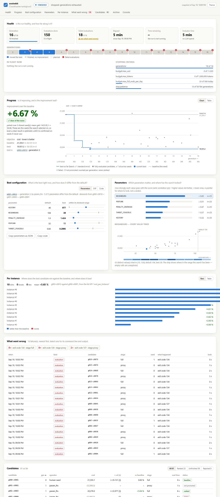
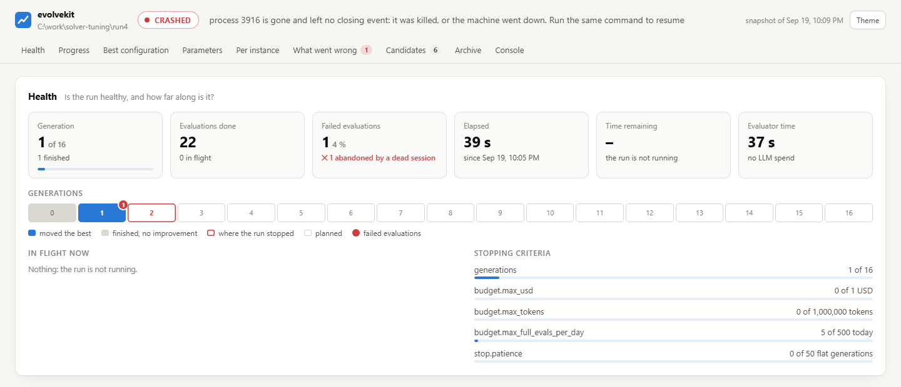
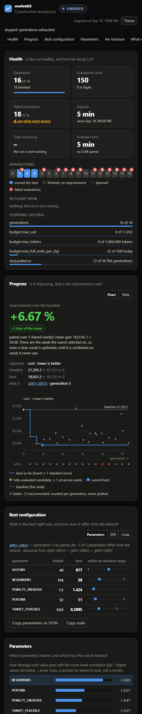
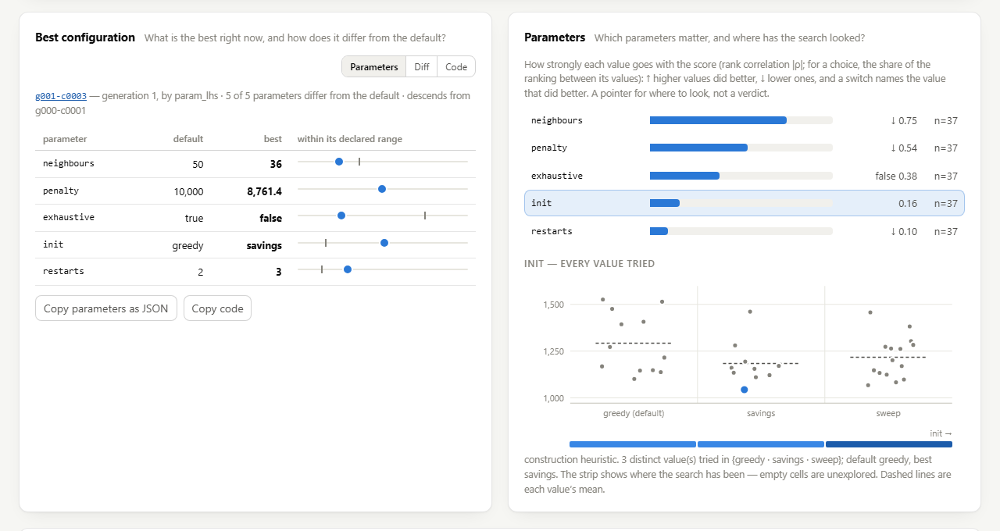
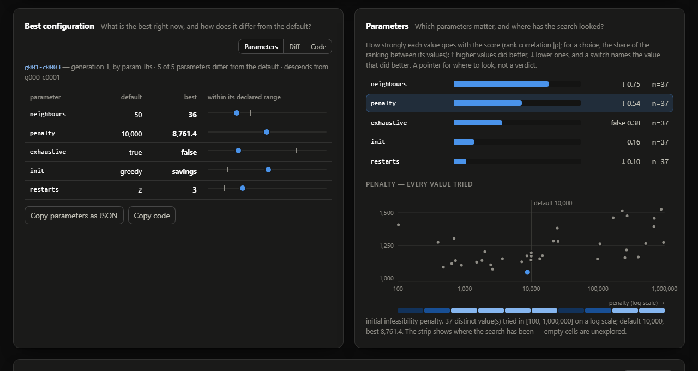
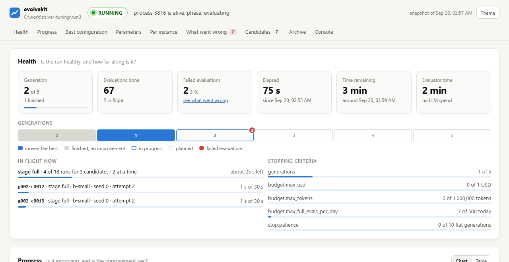
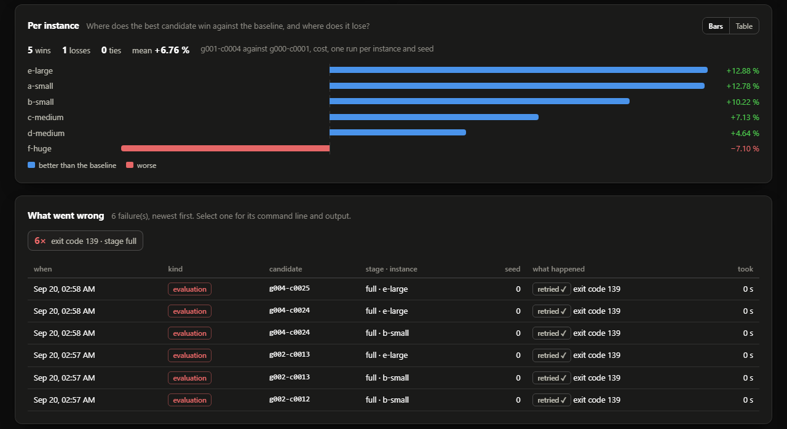

# evolvekit reference

The complete manual: every command, every `study.yaml` key, the engine's
configuration and what a run writes. For an overview, start with the
[README](../README.md); for the app, [docs/app.md](app.md).

## What & why

This repo is evolvekit: an LLM-driven evolutionary program-search loop with
staged evaluation, a lineage archive, and a hard cost budget. Its design
inverts the obvious way to use a strong model on a hard optimization problem —
one-shotting a whole design a handful of expensive times against a binary
feasibility signal, with no memory of what worked. evolvekit instead takes
hundreds of cheap steps against a dense, never-`None` score, inside an archive
that remembers who improved whom, under a USD cap that stops the run by
itself. The lineage is the same as FunSearch, MAP-Elites and ShinkaEvolve;
the additions are staged (cheap-to-expensive) evaluation, first-class cost
accounting, and a provider layer that runs equally on Azure OpenAI / AI
Foundry, OpenRouter, or a local Claude Code subscription.

## Quickstart

```
python tasks.py run
```

That runs the bin-packing example for six generations against the `fake`
provider — no network, no API keys, about ten seconds — and prints a
leaderboard, an economics table and a spend summary. The seed heuristic (best
fit) scores −5.871; the run improves twice, to −5.620 and then to −5.370,
spreads its candidates across four archive cells, and rejects ten of its
twenty: one no-op, four duplicates, two behavioural twins, one block that tried
to `import os` (stage 0, the only hard reject), one response that came back in
neither of the two formats it was asked for and one that gave back its parent
unchanged. One further child is flagged as a near-duplicate and evaluated
anyway, and two that finished are kept out of the ranking because their
hold-out score fell below the seed's. Along the way the breadth grows from
three children to four on the plateau and shrinks back to three once the search
starts climbing again.

```
python tasks.py test          # the offline tests except the slow ones
python tasks.py lint          # ruff, mistake-only rules (F, E9)
python tasks.py check         # lint, then every test; the CI gate
python tasks.py dist          # Windows: the app's zip and pyvrp-1.0.0.zip beside it (packaging/README.md)

python -m evolvekit init my-problem/                     # scaffold a config
python -m evolvekit preflight --config examples/binpacking/evolvekit.yaml
python -m evolvekit run --config examples/binpacking/evolvekit.yaml
python -m evolvekit run --config examples/circlepacking/evolvekit.yaml \
    --run-dir runs/circles                               # the second example
python -m evolvekit status --run-dir runs/demo           # add --json for a script or an agent
python -m evolvekit dashboard --run-dir runs/demo        # the live dashboard, in a browser
python -m evolvekit leaderboard --run-dir runs/demo --html board.html
```

Run `preflight` before any run you are paying for. It puts the seed through
every stage, prints what each one costs and reports, and checks the timeouts
and the budget against those measurements — see
[Before you spend anything](#before-you-spend-anything-preflight).

A run directory holds `runs.jsonl` (one row per candidate, with lineage, cell
and novelty verdict), `reevaluations.jsonl` (with
[`search.reevaluate_best_every`](#stochastic-evaluators-seeds-n): one row per
extra run of the best, pooled into its row by every reader), `usage.jsonl` (one row per LLM call, with tokens and
USD), `archive.json` (the MAP-Elites grid: cells, elites, children counts and
lineage), `scratchpad.md` (the running notes), `.lock` (the owning pid) and
`traces/<candidate-id>.json` (the exact messages sent and the response
received; framework calls live under `traces/meta/`). Under `work/` are the
spliced candidates (`candidates/<id>.py`) and, per evaluator run, the KPI file
it wrote plus its **complete** stdout and stderr
(`stage_out/<id>.<stage>.json`, `.stdout.log`, `.stderr.log`) — the prompt only
ever sees the last 2,000 characters; the files are for whoever has to debug
the solver.

### What a run says while it runs

`runs.jsonl` gets a row when a generation's whole cascade has returned — with an
hour-long evaluator, one write every few hours. Two more files in the run
directory say what is happening in between, and they are what every view of a
live run is built from:

* **`events.jsonl`** — append-only, one JSON object per line, never rewritten.
  Every event has `seq` (1, 2, 3 … across the whole directory), `ts` (UTC,
  milliseconds), `session` (one id per process that ran against the directory),
  `pid` and `type`:

  | `type` | When | Carries |
  |---|---|---|
  | `run_started` | once per session, after resume | what the run *is*: objective and direction, the stages with their timeouts and seeds, the caps and stop rules, `first_generation`, `generations_planned`, `resumed`, the config path. A run directory describes itself; no config file is needed to read it. |
  | `generation_started` / `generation_finished` | around each generation, the seed's included | `children_planned`; then `duration_s`, `children`, `rejected`, `best_id`, `best_fitness`, `spent_usd`, and the stop policy after the generation: `flat_generations` (generations without an improvement, what `status`'s `stop.patience` limit shows) and `stop_epsilon` (the epsilon in force) |
  | `candidate_bred` | one per child | `operator`, `parent_id`, `attempts`, `ok`, and the `novelty` verdict and `reason` when it was refused |
  | `eval_started` / `eval_finished` | around every evaluator run — one pair per seed, hold-out runs included | `candidate_id`, `stage`, `seed`, `private`, `timeout_s` — and on a [per-instance stage](#one-run-per-instance-instances-workers-retries) `instance` and `attempt`; then `ok`, `duration_s`, `kpis`, `argv`, `host_busy` (how busy the whole machine was meanwhile), `cached`, and the log paths relative to the run directory. A failure adds `failure`, `stderr_tail` and `stdout_tail`. |
  | `stage_started` / `stage_finished` | around each command stage of a generation, hold-out pass included | the `candidates` entering it, `runs_per_candidate` and `workers`, and on a [racing](#one-run-per-instance-instances-workers-retries) stage `race_looks` (the compared-instance counts it reads at); then `failed`, `raced_out` (stopped for being behind, not failed) and `duration_s`. What turns a two-hour stage into "14 of 60 runs, about 50 minutes left". |
  | `raced_out` | when a race stops a candidate | `candidate_id`, `stage`, `private`, `reason` (the sentence, with its margin), `runs_done`, `looks` (the stage's look counts) and `margin_pct` (the margin it was stopped by, percent, to two places) |
  | `noise_checked` | once per run and per command stage with `{seed}`, after the seed has passed that stage and been [run again](#stochastic-evaluators-seeds-n) | `stage`, `instance` (the one the seed ran again on; `null` without instances), `repeatable`, `runs` (the seed's runs compared there) and `cv` (the objective's relative noise the search now reads; 0 on a repeatable stage at `seeds: 1`) |
  | `screening_changed` | when a stage with [`promote.adapt`](#how-it-works) changes after a round (*A screen that checks itself*) | `stage`, `k` (how many it promotes a round from now on), `off` (passed over for the rest of the run), `rho` (the rank correlation read; `null` when the cap alone switched it off before one could be read) and `n` (the candidates it was read over) |
  | `log` | every line the run printed | `message` — stdout is block-buffered when redirected and gone with its terminal; this is not |
  | `run_finished` / `run_interrupted` / `run_crashed` | how the session ended | `stop_reason` and the best candidate; or the exception. A session with none of the three did not get the chance to write one. |

* **`heartbeat.json`** — rewritten every five seconds while the run is alive:
  `ts`, `pid`, `phase` (`starting`, `breeding`, `evaluating`, then `finished`,
  `interrupted` or `crashed`), `generation`, and the candidate and stage being
  evaluated. A beat older than a few intervals while its pid is alive means the
  process is suspended or the machine slept — which, on a wall-clock-limited
  evaluator, also means the evaluation in flight at the time cannot be trusted.

### Watching a run: `status` and `status --json`

```
python -m evolvekit status --run-dir runs/demo           # for a person
python -m evolvekit status --run-dir runs/demo --json    # for a script or an agent
```

Both print the same thing, because there is only one thing to print:
`evolvekit.status.build_status(run_dir)` reads the run directory and returns one
JSON document, and every view — the text, `--json`, the dashboard — renders it.
It reads only (a mistyped `--run-dir` is an error with exit code 1, and is not
created), needs no config file, and works on a run that is live, finished,
interrupted or dead.

| Section | Answers |
|---|---|
| `health` | `state`: `running`, `stalled` (alive, but the heartbeat went quiet or an evaluation is far past its timeout), `finished`, `interrupted`, `crashed` (a closing `run_crashed`, or a process that vanished without a word), `empty`, `missing`, `unknown` (a directory from before the event log). Then `detail` in a sentence, `stop_reason`, the generation of how many, evaluations `done` / `in_flight` / `failed` / `abandoned`, what is in flight and for how long against which timeout, the `stage` in progress (runs done of planned, candidates out, time left), `elapsed_s` across sessions, an `eta` that names its own basis, and how far along every stopping criterion is (`limits`). |
| `progress` | The baseline (the seed), the best, and the improvement **in percent of the baseline, in the objective's own units** — with `n`, `sd` and `sem` from the individual evaluator runs, and a `verdict`: `clear`, `worse`, `within noise`, or `unknown`. The verdict is a paired comparison over the runs both candidates made, averaged within each case (instance) first, and judged on the 95 % interval over those per-case mean gains — `clear` when it lies above zero, `worse` below, `within noise` when it includes zero (the search's own reading, not `confirm`'s rule, which is a chance of a gain) — with `ci95`, `mean_gain` and `n`, the number of cases — on a stage that runs once per instance `mean_gain` and `ci95` are in percent of the baseline (from log ratios, the same unit as `confirm`) and the spread is under `log` (`mean_gain`, `sd_gain`, `ci95` on the log scale), so no log spread sits beside a percent mean; `unknown` with fewer than two cases (one instance run on many seeds is one case). It says in words that those are the cases and seeds the search selected on. With [goals in order of importance](#goals-in-order-of-importance-evaluatescorelevels), `levels` gives every level's baseline, best, change and verdict, and names the level that decides. `noise` is the run's [noise estimate](#stochastic-evaluators-seeds-n) at the final `stage` (`work/noise.json`): `repeatable` (`null` until measured), `source` (`replicates`, `calibration`, `paired` or `none`: where `sd` came from), and per measure `sd` (the noise of one run, one side of a comparison, that the search reads), `sd_across` (the across-seed estimate, always), `cv` (relative), with `runs_per_candidate` (the stage's `seeds`); `source: none` with empty maps when nothing was measured. |
| `best` | The best candidate's code, its unified diff against the seed, its lineage, its KPIs, `replicates` (how many final-stage runs its values are the mean of: the stage's `seeds`, plus one per [re-evaluation](#stochastic-evaluators-seeds-n); 0 for a row written before it), and each declared parameter's value beside its default. |
| `parameters` | For every name on the seed's `# PARAMS:` line: every value tried with its score, a ten-bin coverage of the declared range, and an importance (absolute Spearman correlation with the ranking score, with its `n`) — a pointer to where to look, labelled as such. |
| `instances` | When the evaluator reports a per-instance list KPI: baseline against best per instance, wins, losses and ties. |
| `failures` | Every failed evaluator run, newest first, with its stage, seed, hold-out flag, exit status, duration, **command line**, stderr tail and the path of the full log; plus responses that could not be applied and candidates the static stage refused. |
| `candidates`, `archive`, `spend`, `log_tail` | One light row per candidate (no code), the grid snapshot, USD / tokens / evaluator seconds, and the run's last console lines. |

`schema` is bumped when a key changes meaning or disappears; adding keys does not
bump it. It is 2 since `progress.improvement` lost `t` and its `n` came to
count cases rather than runs. The document never contains `NaN` or `Infinity`. A view that fails is
listed under `errors` and leaves the other sections intact.

### The live dashboard

```
python -m evolvekit run --config ... --run-dir runs/x --dashboard    # while it runs
python -m evolvekit dashboard --run-dir runs/x                       # any run: live, finished, killed
python -m evolvekit dashboard --run-dir runs/x --export report.html  # one file, opens from disk
```



`--dashboard` prints a localhost URL and serves the page for as long as the run
lives; `evolvekit dashboard` is a separate, read-only process that can be
pointed at any run directory at any time — including one whose run was killed
an hour ago, which is when you most want to look. Both draw exactly one thing:
the [status document](#watching-a-run-status-and-status---json), fetched from
`/api/status`. There is no second implementation, so the page and
`status --json` cannot disagree. From top to bottom it answers:

| | |
|---|---|
| **Is the run healthy?** | `RUNNING` / `STALLED` / `FINISHED` / `INTERRUPTED` / `CRASHED` with the reason in a sentence; generation *k of N*; evaluations done, in flight and failed; elapsed and remaining time; one cell per generation showing which ones moved the best and where evaluations failed; what is in flight against its timeout; every stopping criterion against its cap |
| **Is it improving?** | improvement over the baseline in percent of the baseline, with a verdict — *clear of the noise*, *within the noise*, or *noise unknown* — and its reasoning; best-so-far as a step line with a ± 1 standard-error band; every fully evaluated candidate with its seed-to-seed spread; failed and not-promoted candidates counted per generation but never plotted against a scale they were not measured on |
| **What is the best, and how does it differ from the default?** | each declared parameter beside its default, placed within its declared range; the unified diff against the seed; the code; *Copy parameters as JSON* |
| **Which parameters matter?** | importance (rank correlation with the score, with its sample size), and for the selected parameter every value tried against the objective plus a ten-cell strip of where in the range the search has and has not been |
| **Where does it win and lose?** | a bar per instance, better or worse than the baseline, with wins / losses / ties |
| **What went wrong?** | failures counted by reason, then one row each; one click opens the stage, seed, exit status, the **command line to reproduce it** (with a copy button), stderr and stdout tails, links to the full logs, and the configuration that was being evaluated |

Every candidate, every failure and every parameter's view has an address
(`#candidate=g003-c0012`, `#failure=0`, `#parameter=penalty`) that can be pasted
into a ticket. `?theme=dark` forces a theme.

It is built to stay out of the way. The server is `http.server` from the
standard library, bound to `127.0.0.1`, read-only, and can read nothing outside
the run directory — a requested path is judged as text before the filesystem
sees it, so a network path cannot make Windows connect anywhere. Bound to this
machine it answers only to `127.0.0.1`, `localhost` or `[::1]` in `Host` and
refuses cross-site requests, so another web page open in the same browser can
neither read the run nor make the server fetch anything. The page is **one HTML file with its styles and scripts
inline**: no build step, no package manager, no CDN, so it renders on a machine
that is offline. The document is rebuilt at most once a second and only while a
page is open (about 12 ms for a run of 80 candidates and 150 evaluations). On
the worst case for overhead — the five-second offline demo, polled every second
— a run went from 5.35 s to 5.85 s, nearly all of it server start-up; against
an evaluator that takes minutes it is not measurable. Candidate source and
stderr are untrusted text: they reach the page through `textContent` only, and
the exported file escapes every `<` in the data it embeds.

| Killed mid-generation | At phone width, dark |
|---|---|
|  |  |

### How it works

```
seed = the skeleton's EVOLVE-BLOCK
  │
  ├─ generation g       C children; C adapts on stagnation (optional)
  │    sample P parents from the archive's elites
  │                  weight = sigmoid(z(fitness)/τ) × 1/(1 + c)
  │                  τ = search.selection_temperature (default 1)
  │                  c = the parent's evaluated children, halved every generation
  │    draw 1 to `search.inspirations` (default 2) elites from *other* cells
  │                  weight = sigmoid(z(fitness)/τ), without the 1/(1 + c)
  │
  │    operators   diff (SEARCH/REPLACE) · rewrite · crossover → small model
  │                big_step, every K gens or on plateau        → strong model
  │                param_lhs, sweeps the block's # PARAMS      → no LLM call
  │
  ├─ novelty filter   AST-normalised hash, before any evaluation
  │                   = parent → no-op · = any archived block → duplicate
  │                   one re-prompt, then the child is written off
  │                   ≥ threshold similar → near: re-prompted once, then
  │                   evaluated anyway and flagged
  │
  ├─ stage 0  static   AST + import check      ms      the only hard reject
  ├─ stage 1  proxy    small instance subset   seconds top-k promote
  ├─ stage 2  full     everything + hold-out   longer  budget-metered
  │      after each command stage: hash the KPIs it reported
  │      = anything seen at that stage → behavioural duplicate, stop here
  │
  ├─ hold-out below the seed's → does not compete (holdout_veto)
  ├─ insert into the archive: one elite per cell, ranked by
  │     public − holdout_penalty × max(0, public − private)
  │     (holdout_penalty is 0 by default)
  │
  ├─ economics: cumulative USD, best, USD since the last improvement,
  │             USD per unit of gain over a sliding window
  │
  └─ stop on budget.max_usd / max_tokens / max_hours, stop.patience
     (flat: no gain > stop.epsilon), stop.target, stop.max_usd_since_improvement, stop.min_gain_per_usd,
     or a stop request
```

Every score is a finite float. A gate violation is a penalty term; a crash
below stage 0 is `evaluate.failure_score`; only stage 0 and the two novelty
filters reject outright. The structural filter's rejections cost no evaluator
time at all; the behavioural one costs exactly the stage that caught it.
There is one LLM call per child and one attempt at applying its response — the
single exception is the novelty re-prompt, bounded to one extra call, because
v1's nested 3×3 retry was the largest single multiplier on its token bill.

**Promotion past a cheaper stage.** A stage's `promote` rule takes
`top_k_per_generation: k`, `archive_percentile: p`, or both (a candidate needs
to pass one). `top_k_per_generation` promotes the generation's k best at that
stage and, when the stage's noise is known
([Stochastic evaluators](#stochastic-evaluators-seeds-n)), every candidate within a
**noise band** of the k-th score: twice one candidate's score noise at that
stage (`2 · score_sd`, a mean over the stage's `seeds`). The top k and the band
together are capped at `2k`, by score (ties by id). A candidate exactly as
good as the k-th falls below the band in about 8 % of rounds, whether the
noise is well measured or rests on the seed's three runs: the band's normal
quantile becomes Student's t at the estimate's degrees of freedom (on a
calibration's two, the band is 1.57 times as wide). With k = 2 of eight
candidates and the noise well measured, one truly one noise sd better than the
other seven is left out about 18 % of the time (about 41 % with the top k
alone). The behaviour-twin
rule compares a child only with earlier rounds
([The novelty filters](#the-novelty-filters--structural-near-and-behavioural)),
so it does not empty the band: a child just below the k-th of its own round is
not that candidate's twin. With no noise
estimate — a stage of one run that is never calibrated, as a study's screen —
the band is 0 and the rule is the top k exactly. `archive_percentile: p`
promotes every candidate whose score at that stage is at least the p-th
percentile of the competing archive members' **own scores at that stage**
(like with like: a proxy score against proxy scores, not against the final
fitness); members recorded without a score there are left out, and with none
the members' fitness is used, as before. Whatever this promotes is promoted
whatever the cap.

**A screen that checks itself: `promote.adapt`.** With
`promote: {top_k_per_generation: 2, adapt: true}` (a config error without
`top_k_per_generation`) on a command stage followed by another command stage,
the run checks after every round whether the cheaper stage still ranks
candidates as the next one does: the Spearman rank correlation ρ between the
two stages' scores, over every candidate that has both (the seed included, not
rejected, not failed), cumulative over the run. With fewer than 8 such
candidates, or no ρ (a side that does not vary), nothing changes. Otherwise:

- ρ < 0 at two checks running: the stage is **switched off** for the rest of
  the run — passed over, its candidates go straight to the next stage, with no
  score of their own at it;
- else ρ < 0.2: `k` grows by one (one more promoted a round), up to the
  round's children; when `k` would reach them — every child promoted, no screen
  left — the stage is switched off instead.

The run log says each change in a sentence (`screening promotes 3 a round from
now on: it agrees with the full stage only weakly (rho = 0.10 over 9
candidates)`, `screening off for the rest of the run: …`), and `events.jsonl`
has `screening_changed` with `stage`, `k`, `off`, `rho` and `n`. The state is
`work/screening.json` (`stage`, `k`, `off`, `below_zero` — consecutive checks
with ρ < 0 — and `history`, one entry per check: `generation`, `n`, `rho`, `k`,
`off`, `said`), saved after every check; a resumed run keeps its `k` and its
off, and a run from before the file starts from the configured `k`. ρ is over
promoted candidates only, the best by the screen, so the range is restricted
and ρ reads low: a screen whose scores correlate 0.8 with the next stage's
shows about 0.65. The thresholds allow for that: in a seeded simulation of ten
rounds of six children, an agreeing screen (0.8) is switched off in about 1 %
of runs, and one that does not predict the next stage at all grows `k` in about
91 %. A longer round after `k` grows shows in the next pace line, which is
re-planned from the measured round durations. A study's screen sets `adapt`.

**A finite score is not a comparable score.** A candidate *competes* — is
ranked, archived, sampled as a parent, reported as `best` — only when it got
through the final stage, hold-out included, without a failure. Four kinds of
candidate keep their finite score in `runs.jsonl` (`competes: false`) and are
never ranked: one whose evaluation failed or timed out, one that was not
promoted past a cheaper stage, one whose final stage was skipped by
`budget.max_full_evals_per_day`, and one whose hold-out run failed — a hold-out
run that does not report the measures the score is computed from fails too,
rather than borrowing them from the public run. The reason is arithmetic rather
than taste: a proxy score comes from a different input set, and the default
`failure_score: -1000` *outranks* every healthy candidate whose minimised cost
is above 1000. `run` and `status` report the count as `unfinished`; a number
that keeps climbing is an evaluator problem, not a search problem. A fifth kind
finished: with `evaluate.holdout_veto` on, a candidate whose hold-out score is
below the starting point's is kept out by the veto. It is counted apart, as
`kept out`.

### The archive

`search.archive.descriptors` is a list of axes, each naming a KPI the evaluator
already emits (`kpi:`) or one of `problem.parameters` (`param:`), a bin count,
and for a KPI either an explicit `range: [lo, hi]` or `range: auto` (bins drawn
from the values the run has seen):

```yaml
search:
  archive:
    top_k: 20
    descriptors:
      - kpi: complexity          # free: the static stage emits it
        bins: 4
        range: auto
      - kpi: mean_openness       # behaviour, from your evaluator
        bins: 4
        range: [0.0, 0.25]
```

*Bins.* An explicit `range` is cut into `bins` equal widths; a value outside it
lands in the end bin. A `range: auto` axis is cut at the **quantiles** of its
members' values (`statistics.quantiles(..., method="inclusive")`), so each bin
holds about as many members and one outlier cannot squash every other
candidate into the bottom bin. Each cut sits halfway between two neighbouring
distinct values, so tied values — a count such as `complexity` repeats a lot —
never put two distinct values in one bin while there are no more distinct
values than bins; with fewer distinct values than bins every one has a bin of
its own, and quantiles that tie are replaced by a cut through the fullest bin.
The cut points move only when the member count doubles — at 2, 4, 8, 16 …
members — and every member is then placed again (and when a re-evaluation
changes a member's value, the last cut is made again with it, as a resumed run
makes it); until a re-bin has seen two distinct values, everything is in bin 0.
`archive.json` lists each auto axis's cut points under `edges`, and a cell's
label gives its range. A parameter axis's label is in the parameter's own
values (`0.25..0.5`; the choices in it, `fast/slow`).

*Parameter axes.* With `problem.parameters` declared and no `descriptors`
written, the grid's axes are the **first two declared parameters** (one when
the space has one), 4 bins each — a tuning candidate's `complexity` hardly
changes, so the default axis would put every candidate in one cell. Name
others with `{param: name, bins: 4}`; a name that is not a declared parameter
is a config error that lists them. A parameter's range is known, so its axis
is fixed: `bins` equal parts (quarters at 4) of the parameter's range on its own scale (its unit
scale — logarithmic for `log: true`; a choice by its position in the list),
never quantile-binned and never re-binned. A study (`evolvekit study`) writes
its axes explicitly: two of its tuned values, the harness's recommended
settings first in the harness's order, else the first two the study tunes.

```yaml
search:
  archive:
    descriptors:
      - param: max_iterations    # fixed quarters of its range
        bins: 4
      - kpi: mean_openness       # quantile bins
        bins: 4
```

Each cell keeps one elite — the best candidate that landed in it — and the
archive keeps a global top-k besides. A candidate only ever displaces the elite
of its own cell, which is what stops a run collapsing onto a single lineage.

*The elite rule.* A challenger takes its cell when its fitness beats the
elite's by more than the noise of one finished candidate's score (`Noise.score_sd`
at the final stage — see [Stochastic evaluators](#stochastic-evaluators-seeds-n)),
or on any gain when its score is the mean of more runs than the elite's
(`replicates` on the row; 0, a row written before it, counts as equal). With no
noise estimate — a repeatable evaluator, or `seeds: 1` without `{seed}` — that is
a strict `>`, as it always was. A challenger exactly as good as the elite, both
measured with noise sd σ, takes the cell in about 24 % of trials (50 % without
the margin), whether σ is well measured or estimated from the seed's three
runs: the margin's normal quantile becomes Student's t at the estimate's
degrees of freedom (1.22 σ̂ on a calibration's two). A re-bin of the auto axes applies the same rule, in id
order; a resumed run rebuilds the grid with the noise as it is when it resumes.

*Parent selection: `search.selection_temperature`.* Each generation's parents
are drawn from the elites with weight `sigmoid(z(fitness)/τ) × 1/(1 + c)`: `z`
is the elite's fitness as a z-score over the elites, `τ` is
`search.selection_temperature` (default `1`; any number > 0 — below 1 the
fitter elites are drawn harder, `0.25` turns the 0.27 : 0.73 of `z = ∓1` into
0.02 : 0.98; above 1 softer), and `c` is the parent's **pressure**: one for each
of its children that was handed to the cascade, halved at the start of every
generation, so a parent that has just been used a lot rests for a while and
then recovers. A child the novelty filter refused before evaluation (no-op,
duplicate) or whose proposal did not apply costs its parent nothing; a child
rejected by the static stage or caught as a behavioural twin was evaluated and
counts. Inspirations are drawn by `sigmoid(z(fitness)/τ)` alone, without the
`1/(1 + c)`. `archive.json`'s `children` (and each cell's) still counts every
attempt, failed applies and duplicates included. A resumed run replays the
pressure from `runs.jsonl` — halved once per generation, then the generation's
evaluated children — so it is what the uninterrupted run had. The weight is
never below 10⁻⁶.

Choose the second axis for *behaviour*, not quality. The bin-packing example
uses `mean_openness`: where the chosen bin sat between the tightest and the
emptiest feasible one, 0 for always-tightest (best fit) and 1 for
always-emptiest. Two rules can score identically and sit at opposite ends of
it. `bins_used` or a mean fill ratio would have been monotone in the objective
and would have made the grid a second copy of the leaderboard.

The grid is persisted to `archive.json` and rebuilt from `runs.jsonl` when a
run resumes — the snapshot is a convenience, the log is the record. `status`
and `leaderboard` print cell occupancy; the HTML dashboard draws the grid.

The `cells=` figure printed each generation is the occupancy *after* that
generation's inserts, and it can go **down**: an axis with `range: auto` moves
its cut points when its members double, which re-bins every member the grid
already holds and can merge two cells into one. A falling count is the grid
rescaling, not candidates being lost.

### Operators

| Operator | Model | What it sees |
|---|---|---|
| `diff` | small | the parent block, its score breakdown, delta summaries of 1 to `search.inspirations` (default 2) inspirations |
| `rewrite` | small | the same, and asks for the whole block back |
| `crossover` | small | the parent **and** one inspiration's block, both with score breakdowns |
| `big_step` | strong | scheduled every `big_step_every` generations, or on plateau |
| `param_lhs` | none | the next row of the run's Latin hypercube over the block's own constants |
| `param_local` | none | a good configuration; moves one to three of its parameters a little |
| `param_cross` | none | two good configurations; each parameter from one of them |
| `param_tpe` | none | every configuration evaluated so far, the failed ones included |

Shares come from `search.operators`. Inspirations are drawn from cells other
than the parent's and are shown as one-line delta summaries — a unified-diff
stat against their own parent plus the first line of their docstring, both
computed locally. Crossover is the one operator that also sees an inspiration's
code, because it cannot combine two candidates otherwise.

Each inspiration adds a summary and a score line to the prompt, and on a tree
problem its whole diff, so raising `search.inspirations` raises the cost of
every prompt. Crossover is always shown exactly one.

`param_lhs` costs no tokens. It needs a declaration inside the evolve block:

```python
# PARAMS: {"BONUS": [0.0, 40.0], "WIDTH": [4.0, 400.0]}
BONUS = 20.0
WIDTH = 128.0
```

Blocks without that line are never routed to it, so listing it in
`search.operators` against a skeleton that declares nothing is harmless.

**One hypercube for the run.** The `param_lhs` children of a run take the rows
of one Latin hypercube in turn, so the first K of them cover K strata of every
parameter — however the children fall across generations (with the default
shares a generation has none, one or two). The cube is sized from the run's
expected number of `param_lhs` children (`search.generations ×
children_per_generation × its share / the sum of shares`), at least 4 rows and
at most 64, and a new one is built when it is used up. A row that breaks a
[constraint](#constraints-between-parameters-problemparameter_constraints), or
equals the parent's configuration, is passed over; a child the novelty filter
finds a duplicate is asked once more and takes the next row. A typed
`problem.parameters` space has one cube; a `# PARAMS` block one per declaration
(a parent that declares other ranges gets its own). The cubes and the next row
of each are kept in `work/lhs.json` (`{"cubes": {"typed" | "params:<ranges as
JSON>": {"K", "built", "next", "rows"}}}`, with `prior` beside `rows` when a
parameter has one), so a resumed run hands out the rows the uninterrupted run
would have; a run without the file builds a cube at its next `param_lhs` child.
A cube is used up before a new one is built when only the run's size changes
(generations, children, shares), and is built anew when a resumed run declares
the space differently (names, types, ranges, scales, choices or priors).
Building a cube takes one number from the run's random stream; a child takes
none.

`param_local`, `param_cross` and `param_tpe` work on a declared
[`problem.parameters`](#tuning-a-command-problemparameters) space and are what
makes a model-free run a *search* rather than a sweep. `param_lhs` fills the box
evenly and never looks at a score — the right first move and the wrong tenth
one. `param_local` starts from one of the best four configurations (the best
most often, not always: on a noisy objective the single best is partly luck)
and moves one parameter twice as often as two, two twice as often as three; an
integer moves by at least one, a boolean flips. A number takes a Gaussian step
on its own 0..1 scale, and a step past an end of the range is **reflected**
back inside rather than clamped onto the end (clamping put about 45 % of the
steps from 0.98 on 1.0 exactly, the same configuration again and again); how
large the step is, is below. A step from the starting point first moves each
parameter that has a `prior` to the prior's value, with the prior's weight as
its chance (the record's `prior` names them), and steps from
there. `param_cross` tries gains
together that were found separately. `param_tpe` is a Tree-structured Parzen
Estimator: it models, parameter by parameter, where good configurations are
dense relative to bad ones and proposes where that ratio is highest. The good
set is the best tenth of the observations, rounded up, at least 2 and at most
25 (Optuna's split); a number's density is one Gaussian per observation on the
parameter's own 0..1 scale, each as wide as the larger gap to its neighbours
(the ends of the range count as neighbours), kept between 0.02 and 0.5, cut to
the range and renormalised so no mass is lost at an end, plus the range itself
as one more observation spread evenly. Of the 48 candidates it rates, 24 are
drawn from the good density and 24 evenly from the whole box, so the ratio can
find a region the good set has not reached; the best ratio is proposed. A
parameter's [`prior`](#studies-over-time) is part of both densities: a prior of
weight *w* adds 4*w* observations at its value (a bump 0.1 wide on the unit
scale, for a bool or a choice 4*w* counts on the value) beside the range's
one, so it pulls the proposals towards an earlier winner without ruling out
any value. It reads
**ranks**, not scores, in four tiers, best first: finished candidates by
fitness; candidates screened out by a cheaper stage, by the deepest stage they
reached and that stage's score (on any scale: only the order counts, and they
rank below every finished one); raced-out candidates and those kept out by the
hold-out veto, one shared rank (whatever their screening score); and failed or
gated candidates, one shared rank, the worst — so a region that kills the
solver is not proposed again. Ties share the mean position. A candidate whose
final stage was cut short with nothing wrong (a stop request, the time limit,
the daily cap) is not an observation at all. The siblings
already proposed in the same generation (by any operator) count as bad
observations until they are evaluated (a "constant liar"), so several
`param_tpe` children of one generation spread out instead of proposing the same
neighbourhood. Until there are eight observations it takes a local step
instead, and the record says so.

**The step's size follows the 1/5 rule.** It starts at 0.15 of the range (the
sd of the step) and is adapted after every round that had local steps — those
of `param_local` and the local-step fallbacks of `param_cross` and `param_tpe`
whose parent has a fitness. Children refused before evaluation (a constraint,
the novelty filter) are not counted: they say nothing about the step's size. A
child counts as an improvement when it competes and beats its parent's fitness
by more than the noise margin the [elite rule](#the-archive) uses (0 without a
noise estimate). The rule is applied per trial: of `tried` local steps of which
`improved` improved, the step is multiplied by `1.2 ** (improved − 0.2 × tried)`
and kept between 0.03 and 0.4, so it grows while more than one step in five
improves, shrinks while fewer do, and balances at exactly 20 % however many
local children a round has (one success in five leaves it as it was). A round
without local steps leaves it. The size and one line per round are kept in
`work/perturb.json` (`{"scale": 0.161, "history": [{"generation": 3,
"improved": 1, "tried": 3, "scale": 0.161}]}`), so a resumed run takes the size
up where it was; a round whose rows were recorded but whose line is missing (the
run died between the two) is counted when the run resumes. A run without the
file starts at 0.15.

Which to use depends on how good the defaults already are. Measured at equal
budget, five search seeds each, on two stand-in solvers
(`python benchmarks/operator_mixes.py` reproduces it): with defaults far from
the optimum and 36 evaluations, `param_lhs` alone does as well as any mix (mean
best 1031.6 vs 1034.3; defaults 1225, optimum 1000) and `param_local` alone is
clearly worse (1106.4). With a *mature* solver — 25 parameters, defaults close
to good, most random settings harmful, noisy, 78 evaluations — `param_lhs`
alone returned the defaults in three runs of five (mean true cost of the
reported best 102.20, defaults 102.57), while `param_local` alone reached
100.05 and `{param_lhs: 0.15, param_local: 0.45, param_tpe: 0.3, param_cross:
0.1}` reached 100.30, of a possible 98.20. For a solver somebody has already
tuned, lead with `param_local`; keep some `param_lhs` when you do not know which
of the two cases you are in.

**A run without any model.** When only model-free operators (`param_*`) have a share,
nothing in the run calls a model, and nothing may: no big steps are planned
(scheduled or on a plateau), the scratchpad is not refreshed, `stop.patience`
does not wait for `stop.min_big_steps`, and the `models` section can be left out
altogether — no provider, no key, no network:

```yaml
search:
  operators: {param_lhs: 1.0}     # in an `extends` child: {diff: 0, rewrite: 0, crossover: 0, param_lhs: 1}
```

`extends` merges `search.operators` key by key, so a child config switches an
inherited operator off by giving it a share of `0`. Independently of that,
`search.big_step_every: 0` switches big steps off in a run that does use a
model.

### Tuning a command: `problem.parameters`

When what you want tuned is the *configuration* of a program — a solver
written in C++, Java, Rust, anything with a command line — there is no code to
evolve and you should not have to write any. Declare the parameters instead of
a skeleton, and say where they go on the command line:

```yaml
problem:
  description: Minimise the mean cost over the test set within the time limit.
  parameters:
    neighbours: {type: int, low: 10, high: 120, default: 50, help: arcs kept per client}
    penalty:    {type: float, low: 1.0e+2, high: 1.0e+6, default: 1.0e+4, log: true}
    exhaustive: {type: bool, default: true}
    init:       {type: choice, choices: [greedy, savings, sweep], default: greedy}

evaluate:
  stages:
    - {id: static, kind: builtin-static}
    - id: full
      kind: command
      command: ./solver --instance data/a.vrp --out {out} --seed {seed} {params}
      timeout: 900
  score: {objective: cost, direction: minimize}

search:
  operators: {param_lhs: 1.0}      # no `models` section: nothing here calls one
```

`1e4` works as well as `1.0e+4`: YAML reads the short form as a string, and a
range or default that is a numeric string is taken as its number.

| Placeholder | What the command receives |
|---|---|
| `{params}` | one `--name value` pair per parameter: `--neighbours 40 --penalty 5000.0 --exhaustive false --init savings`. An underscore in a name becomes a dash; a boolean is `true`/`false`; `flag: "-n"` on a declaration replaces the generated flag. It has to be an argument of its own: `--opts={params}` is refused, because several arguments cannot be pasted into one |
| `{params_json}` | the path of a JSON file with the same values, for a program that would rather read a file |

`{candidate}` is no longer required — there is no module the command would
want — but a command that mentions neither of the two is refused, because it
would never see what it is supposed to be tuned with.

What happens to a declaration:

- **The defaults are the baseline.** The seed candidate *is* the declared
  defaults, so "improvement" always reads "against what the program does out of
  the box".
- **The static stage validates every configuration before it costs anything.**
  An unknown name, a value outside its range, `"yes"` for a boolean: the
  candidate is rejected with a sentence saying which, and the solver is never
  started. A parameter a configuration leaves out takes its default.
- **The configuration is recorded as data.** Each row of `runs.jsonl` carries
  `params`; `status`, `status --json` and the dashboard read that — the best
  configuration beside the defaults, the importance of each parameter, where in
  each range (along a log scale where declared, per value for a boolean or a
  choice) the search has been — and "Copy parameters as JSON" is the file you
  hand to your program.
- **`param_lhs` samples the declared space**: integers stay integers, a
  log-scale range is covered decade by decade, booleans and choices are swept
  rather than frozen.
- **A model can still take part.** Behind the scenes the configuration is a
  generated `configure()` function that returns a dict, so `diff`, `rewrite`
  and `big_step` work on it like on any other block, and the prompt lists every
  parameter with its type, range and `help`. Whatever a model writes, what
  counts is the dict it returns — validated like any other.

`parameters` and `skeleton` are alternatives: a config names one of them.

`python -m evolvekit init my-tuning/ --template tune` writes such a setup, complete —
a stand-in solver, three instances, a commented config — that runs as it is (into a
directory that already holds an `evolvekit.yaml` it writes nothing and exits 1, unless
`--force`);
[`examples/cli-solver/`](../examples/cli-solver/README.md) walks through the whole path:
preflight, run and watch, `confirm` on seeds and instances the search never saw, `export`.

**A solver that reports in its own way.** The result does not have to be
written for evolvekit either. Three ways to read it, per stage:

| The program … | Stage keys | What is read |
|---|---|---|
| writes a JSON file | `{out}` in the command (the default, `kpis_from: file`) | that file |
| prints a JSON object | `kpis_from: stdout` — no `{out}` needed | the **last** line of stdout that is a JSON object, however long it is and wherever it is in the log; progress lines and other output around it are ignored |
| prints text | `kpi_patterns: {cost: 'best cost: ([-+0-9.eE]+)'}` | per KPI, a regular expression with one capturing group; the **last** match counts, because a solver logs its progress before its result. `^` and `$` are the start and end of a *line* (`re.MULTILINE`), so `'^Cost: (\d+)$'` works. The patterns see the last 64 KB of what the program printed. Can be combined with either JSON source |

The JSON object may be the solver's own. With an explicit `"kpis"` key every
value has to be a number or a list of numbers, as before. Without one, the
object is taken for what it is — a result with metadata in it: numbers are
KPIs, booleans are KPIs (`"feasible": true` → `1.0`), lists of numbers are
per-instance KPIs, and names, nested objects and lists with holes in them are
left alone. `NaN`, a result with no number in it, a pattern that matched
nothing, or a missing objective fail the run, with the tail of what the program
did print in the failure report.

| A three-way choice: a slot per value, its mean dashed | A log-scale range, decade by decade |
|---|---|
|  |  |

### Constraints between parameters: `problem.parameter_constraints`

A range says what each value may be on its own. A constraint says what the values must be
together:

```yaml
problem:
  parameters:
    van_km_cost:   {type: float, low: 0.5, high: 2.0, default: 1.0}
    truck_km_cost: {type: float, low: 0.5, high: 2.0, default: 1.2}
    init:          {type: choice, choices: [greedy, savings], default: greedy}
  parameter_constraints:
    - truck_km_cost >= van_km_cost
    - {expr: "init == 'savings' or van_km_cost < 1.5", says: Greedy starts only with cheap vans}
```

Each is an expression over parameter names: numbers, `'text'` for a choice, `+ - * / ** %`,
comparisons (chained as in Python: `0 <= a - b <= 5`), `and or not`, and `abs min max round`. It is
read with Python's `ast` against a whitelist and computed by walking the tree -- never `eval` -- so
nothing can be called, imported or reached through an attribute (`evolvekit/expressions.py`).

- **Checked before anything runs.** An expression that cannot be read, a name that is not a
  parameter, one that is not a condition, and a constraint the *defaults* break are config errors:
  the seed is the defaults, and every candidate is compared with it.
- **Refused before any solving.** The static stage refuses a configuration that breaks a
  constraint -- with its sentence (`says`) and the values -- and the command never starts. One that
  cannot be computed for a configuration (a division by zero) counts as broken.
- **Not proposed in the first place.** `param_local`, `param_cross` and `param_tpe` draw
  again, up to 100 times, rather than propose a configuration that breaks one; after that the last
  draw is left to the static stage. `param_lhs` passes over the rows of the run's hypercube that
  break one; after a whole cube's worth of such rows the last is left to the static stage. A model
  sees the constraints in the prompt, under the parameter list.

Prefer a space in which every value is valid: tune a truck *premium* of 0 or more rather than two
costs that must stay ordered, a scale within ±20 % rather than "no more than 20 % from today". A
constraint that most of the box breaks makes the samplers draw for nothing.

### Gates: conditions every candidate has to meet (`evaluate.gates`)

A penalty makes a violation expensive. A gate makes it disqualifying:

```yaml
evaluate:
  gates:
    - {kpi: missed_required, max: 0}
    - {kpi: on_time_share, min: 0.95}
```

Every gate is checked after every command stage, on the stage's aggregated KPIs (and on the
hold-out). A candidate that breaks one keeps its score in `runs.jsonl`, with the reason in `gated`
(`"missed_required = 2 > 0"`); it is not promoted, never competes and is never the one a race is
run against. It is not a failure either: `status` and the dashboard show it as *broke a gate*, never
among the failures, and the model-free operators count it as the worst observation there is, so the
region is not proposed again.

- A gate's KPI has to be reported by every command-stage run, like the objective: a run that leaves
  it out fails with a sentence naming it. A gate on a KPI nobody reports would pass everything.
- A seed that breaks a gate aborts the run (exit code 4) with the gate and the value, before
  anything is bred, and `preflight` reports it as a failure.
- The gates are part of what a run directory is a run of: changing them on resume is refused.

### Goals in order of importance: `evaluate.score.levels`

"First the most deliveries per hour, two plans within 1 % counting as equal; then the least
waiting; then the lowest cost":

```yaml
evaluate:
  score:
    levels:
      - {kpi: deliveries_per_hour, direction: maximize, tolerance: 0.01, relative: true}
      - {kpi: waiting_h, direction: minimize, tolerance: 0.5}
      - {kpi: cost, direction: minimize}
```

*A is better than B if, at the first level where they differ by more than that level's tolerance, A
is better.* A tolerance is required on every level but the last, which decides whatever the levels
above it leave equal; `relative: true` makes it a fraction of the seed's value (used as an absolute
one when that value is 0). `objective` and `direction` default to level 1's.

The levels compile to one finite score, anchored at the seed, so everything that compares scores --
ranking, the archive, promotion, parent sampling, patience, the estimator -- works unchanged. With
the seed's values `b`, a candidate's `v`, `s` = +1 to maximise and −1 to minimise, and `t` a level's
tolerance in its KPI's units (`evolvekit/evaluate/levels.py`):

```
q_i   = clamp(round(s_i · (v_i − b_i) / t_i), −K, K)       levels 1 … L−1, K = 10 000
x_L   = 0.5 · tanh(s_L · (v_L − b_L) / scale_L)             scale_L = max(10 % of |b_L|, range of the seed's values of that measure over its instances)
score = Σ q_i · (2K + 2)^(L−1−i)  +  x_L
```

The seed scores exactly 0, and its values are kept in `work/levels.json` (per stage, like
`reference.json`), so a resumed run measures from the same anchor. What that means, precisely:

- Values are compared in steps of the tolerance, counted from the seed's value. Two values in the
  same step count as equal -- so two values just either side of a step boundary count as different,
  however close they are.
- The last level's scale is the larger of a tenth of the seed's value and the seed's own range of
  that measure over its instances (a tenth alone with one instance; 1 when both are 0), so a 40 %
  and a 30 % gain are different numbers: a tenth of the value alone saturated near ±30 %.
- A difference of more than K steps saturates; `status` warns when a candidate's does. Widen that
  level's tolerance.
- At most four levels: the integer part then stays exact in double precision, and the last level
  keeps a resolution finer than a thousandth of its range. The weight between levels is 2K + 2
  rather than 2K + 1 because `tanh` of a large difference is exactly 1.0 in floating point.
- Levels do not combine with `weights`, `penalties` (make the penalised KPI a level, or a gate),
  `stop.target`, or `race`; the config error names the level or gate to use instead of a penalty. A per-instance stage compares plain means (`normalize: none`, the
  default with levels): `baseline` would restate level 1 alone as a percentage.

`status` reports each level's baseline, best, change and verdict and names the deciding level
(`progress.levels`); the dashboard's Progress card shows a row per level instead of one
percentage; [`confirm`](#after-the-run-is-the-improvement-real-confirm-and-export) compares level by
level.

### The problem description, in named sections

`problem.description` is prose and stays prose. Three optional fields beside it
are *structure*, and each becomes its own heading in the cacheable half of the
system prompt:

```yaml
problem:
  description: |
    ...what the problem is, what the fixed part does, how it is scored...
  tools:
    - >
      repair(centers, radii) -> (centers, radii): the referee, callable from
      your block. sum_radii(repair(c, r)) is exactly the score that
      arrangement would earn, so you can score your own moves.
    - >
      deadline(seconds) and expired(when): the stop condition for a
      time-bounded loop. Write `until = deadline(TIME_BUDGET_S)` once and
      `while not expired(until):` around your search.
  constraints:
    - Standard library only, and no numpy.
    - Stop at TIME_BUDGET_S. The stage timeout is a hard kill, not a curve.
  what_counts_as_new: >
    A new candidate ends up with a different arrangement of the 26 circles.
    Re-typing the same grid with different literals produces the same 26 radii
    and is worth nothing.
```

`tools` is what the evolve block may call or rely on — helpers in the fixed
part, time-budget constants, allowed imports. `constraints` is what it must
not do. `what_counts_as_new` is the problem-specific half of a sentence the
framework can only say generically: the behavioural filter below can tell a
model that it re-expressed the same rule, but only the problem's author can say
what a genuinely different rule *looks like* here. Bin packing's answer is
"only a change to which bin wins is a change, because the skeleton takes the
argmax"; circle packing's is "a different arrangement of the 26 circles".

Both accept a YAML list or a `|` block. All three come from the config, so the
prompt's stable prefix stays byte-identical across a run and prefix caching
keeps working. An unset field renders nothing at all — no empty heading, no
"none".

**These exist because of the second circle-packing run.** Fifteen candidates,
every one of them a hand-placed arrangement scoring 1.82–2.48 against a 2.54
seed, including the Sonnet big step, which reproduced the seed's own 5×5 grid.
The skeleton had offered `deadline()`, `expired()` and `TIME_BUDGET_S = 2.0`
from the first commit, and the evolve block's docstring even mentioned them.
Nothing in a place the model would land said *use them*. The example now says
so under its own heading, in as many words, with a five-line sketch of the
perturb / repair / accept loop.

### Evaluator notes: what the KPIs cannot say

A command stage's output JSON may carry a `text_feedback` string beside its
`kpis`:

```json
{
  "kpis": {"excess_pct": 5.871, "priority_errors": 0},
  "text_feedback": "or_like: 5.913% excess over L1 across 12 instance(s)\nweibull: 5.808% across 8\nworst single instance: full-or-8 at 8.571%"
}
```

The framework truncates it to 2,000 characters, keeps it per stage on the
candidate (`feedback`), and puts the parent's **deepest non-empty** note into
the next prompt as an `## Evaluator notes` section directly under the score
breakdown, bounded again to twenty lines. Deepest, because the proxy stage's
note is about five instances and the full stage's is about twenty. Both bounds
are the framework's rather than the evaluator's: the size of a run's prompts
must not depend on how chatty somebody's evaluator is feeling.

Stage artefacts are the single most useful thing a prompt can carry, and
before `text_feedback` existed the loop only had them for stages that
*failed*. A vector of numbers is a poor channel for "you are losing on the
Weibull instances and winning on the uniform ones" and a hopeless one for "you
used 0.02 % of your time budget". Both example evaluators emit something worth
reading:

| Example | What it says |
|---|---|
| bin packing | excess split by distribution, the worst single instance by name, where the rule sat between the tightest and emptiest feasible bin, and any `priority()` incidents |
| circle packing | minimum pairwise gap after repair, how many circles are pressed against a wall, and **what fraction of `TIME_BUDGET_S` the candidate actually spent** — with a sentence naming the fix when that fraction is under 5 % |

### Stochastic evaluators: `seeds: N`

A command stage may declare `seeds: N` (default 1) alongside a `{seed}`
placeholder in its command:

```yaml
- id: full
  kind: command
  command: "{python} evaluate.py --candidate {candidate} --inputs {inputs} --out {out} --seed {seed}"
  inputs: [full]
  timeout: 9000     # per run, not per stage
  seeds: 3
```

The stage then runs three times with `{seed}` as 0, 1, 2 — each under its own
`timeout`, each writing its own output file. Scalar KPIs are averaged, vector
KPIs are averaged element by element, the **first** run's `text_feedback` is
kept (three notes about one program is three times the prompt for one fact),
and the spread of each KPI is recorded as `kpi_cv`, a coefficient of variation,
on the outcome, the result and the candidate row. It is never scored: the
search ranks by the mean, and `kpi_cv` is there so a human can see when the
mean was a coin toss. The first failing run ends the stage and the failure names
the seed it happened on — a mean over whichever runs survived would report a
number the candidate never achieved.

`seeds: N > 1` without a `{seed}` placeholder is a config error, because N
identical runs is N times the bill for one sample.

**The run's noise estimate: `work/noise.json`.** Every command stage's outcome
adds to one estimate the whole run shares, per stage (and per hold-out, as
`<stage>/private`) and per measure: each candidate with two or more runs
contributes its own sample variance over its seeds, and the estimate is their
pool (per element for a per-instance list, in that list's own units; under
`normalize: baseline` the objective's is in percent of the seed, its
`_per_instance` list's raw). A candidate that failed, was raced out or was
abandoned contributes nothing. The file is saved after every generation and read
back on resume; a run written before it starts with no noise.

*Is the evaluator repeatable?* Once per run and per command stage, after the
seed has passed that stage, and only when the stage's command has a `{seed}`
(a screen as well as the final stage): the seed is run
**once more on seed 0**, with the cache bypassed (a lookup would read the first
run back), on the instance whose seed run took the median time (without
`instances`, on the whole input set). If every measure equals the first run to
`evaluate.signature_digits` (the ones in `evaluate.signature_ignore`, a run
time, left out), the stage is *repeatable*: same program, same seed, same
numbers. Every candidate runs on the same seeds, so on such a stage what matters
is how far two candidates' *difference* on matching seeds moves, not how far
the seeds spread: the noise a comparison reads is the **paired** one — the
two-way (candidate × seed) residual over every candidate that ran the stage's
seeds, the seed's own runs included: each run minus its candidate's mean,
minus that seed's mean over the candidates, plus the grand mean, with
(C − 1)(S − 1) degrees of freedom for C candidates on S seeds. That is the
noise of one side (half the residual variance of a difference); every
candidate's own level and every seed's own effect drop out, so the estimate
sharpens as candidates come in (`work/noise.json` keeps each candidate's
per-seed runs; a file written before them keeps its differences to the seed,
which still count). At `seeds: 1` it is 0: a repeatable evaluator is compared
exactly, as before. On a stage that is not repeatable (a wall-clock solver)
the noise is the across-seed one.

*When nothing replicates* (`seeds: 1`, not repeatable): the same check also
runs the seed on **seed 1**, one more run in all, and the three runs of the
seed on that instance calibrate the noise: their relative spread is taken to
hold on every instance, independently, so one run of the stage has variance
`cv² · Σ seed_mean_i² / M²` over the M instances. Three runs are two degrees of
freedom, so a calibrated noise is quoted to **one significant digit** ("about
2 %"). The first candidate with replicates of its own replaces the calibration;
on a repeatable stage it is measured and reported (`sd_across`) but never read.
The extra runs are not evaluations of the search (no `eval_started` /
`eval_finished`, not cached, not counted against `budget.max_full_evals_per_day`); the run logs one
line per stage (`noise: the seed run again on i2: one run varies by about 2 %
(the search's comparisons allow for it)`, or `… the evaluator gives the same
numbers for the same seed (comparisons are paired by seed)`; for a stage before
the final one, `noise at stage <id>: …`) and the event log one
`noise_checked`. A failed extra run is logged and leaves the stage unmeasured.
Until a stage's repeatability is measured, its behaviour twins are compared by
the exact fingerprint: a screen that is deterministic per seed has an
across-seed spread that is the seeds', not noise.

*No `{seed}`*: with `seeds: 1` nothing is run again and the noise is 0 —
every comparison is made as if the evaluator were exact, which is how every
rule read before this estimate existed. (`seeds > 1` without `{seed}` is a
config error, above.)

*Few degrees of freedom.* The estimate is read as it is from the first
candidates on — two degrees of freedom after a calibration, or from the seed's
own runs at `seeds: 3` — and every rule that reads it allows for how little
that is: its normal quantile becomes Student's t at the same tail probability,
with the estimate's degrees of freedom (across seeds Σ(nᵢ − 1) over the
candidates pooled; paired (C − 1)(S − 1); a calibration 2). Each rate quoted
below then holds whether the noise rests on three runs or three hundred: an
equal candidate is kept out by the veto in about 8 % either way, not 15 %, and
a true twin is caught in about 84 %, not 70 %. A limit: a run resumed from a
`noise.json` written before the per-seed runs were kept pools its old
differences to the seed with their full degrees of freedom, though they share
the seed's runs, so its estimate is a little less certain than its df say. It is shown by `status` (`progress.noise`) and
[`preflight`](#before-you-spend-anything-preflight). Each rule that reads the
estimate says so in its own section and is listed here:

- the hold-out veto's margin ([The hold-out penalty](#the-hold-out-penalty));
- behaviour twins on a stage that is not repeatable
  ([The novelty filters](#the-novelty-filters--structural-near-and-behavioural),
  *Behavioural*): within the noise of a candidate of an earlier round that scored at
  least as well, instead of equal to nine digits;
- the race's margin ([One run per instance](#one-run-per-instance-instances-workers-retries),
  `race`): at least twice the objective's relative noise of one run, read at
  fixed looks;
- promotion's noise band beside `top_k_per_generation`
  ([How it works](#how-it-works), *Promotion past a cheaper stage*): every
  candidate within twice one candidate's score noise of the k-th, capped at `2k`;
- the automatic `stop.epsilon` ([Adaptive breadth](#adaptive-breadth),
  *What counts as an improvement*): half one finished candidate's score noise;
- the archive's elite rule ([The archive](#the-archive)): a challenger takes a
  cell when it beats the elite by more than one finished candidate's score noise.

**Re-evaluating the best: `search.reevaluate_best_every`.** The best of a
noisy run is selected *because* it measured high, so part of its lead is luck:
the best of eight equal candidates, one run each, measures about 1.4 run-sd
above the truth. With `search.reevaluate_best_every: N` (default `0`, off),
after every N-th round the archive's best runs **once more at the final
stage**, on the public inputs only (no hold-out run, no race), on a fresh seed:
`2000 + k`, k the run's re-evaluations so far — never one of the final
check's seeds (1001 … 1012) and never one the search runs a candidate on. Its
runs are then pooled: with n the runs its value stood for (the stage's `seeds`
at first), every measure and the score become `(n · old + new) / (n + 1)` (the
score is the mean of the runs' scores, not the score of the pooled measures),
the public score follows, the ranking score is recomputed with
`evaluate.holdout_penalty`, the hold-out veto is applied after, and the row's
`replicates` counts the runs (`n + 1`). After three re-evaluations the lucky
lead above is a quarter of what it was (a seeded simulation: 0.35 run-sd). Every
view reads the pooled value — the archive (every member re-placed by the elite
rule, where `replicates` counts), the run's best, `status`, the leaderboard,
`export`, `confirm --candidates best|top:N`, a study's exports and final check,
and the app. **A re-evaluation is never search progress.** The round it was
made in is judged by what its own candidates measured; then the stop policy's
bar becomes the pooled best, down (a lucky best regressed: a real gain has to
clear the lower bar) or up (an unlucky one), with `stop.patience`'s flat count
and the big-step counts left as they are. The economics series (and so the
stop rules, `status`'s rounds and the dashboard) reads it the same way: from
the round a re-evaluation was made in, the best is the pooled value, not an
improvement either way, and earlier rounds keep the values they had. The hold-out
veto's reference stays the starting point's hold-out score as first written,
even when the starting point is the best that is run again. The Study page's
*Tries* view draws each try from its own evaluator runs, so a re-evaluated best
shows there with its first measurement. `runs.jsonl` keeps the row as it was written; each re-evaluation is one
row of `reevaluations.jsonl` beside it (`id`, `generation`, `seed`, `stage`,
`prior_runs` — the n above —, `kpis` and `score` of the new run alone,
normalised against the run's reference like any other, and `at`), read back on
resume. The new run joins the candidate's own runs in the noise estimate when it
has some (`seeds > 1`); at `seeds: 1` it adds nothing there (its first run was
selected as the best, and paired with a fresh one would overstate the noise —
about 1.7 times the variance for the best of eight). A limit: at `seeds > 1` the
merged entry overstates it a little too, since the best's mean was selected
(about 11 % in the variance, 5 % in the sd, for the best of eight at `seeds: 3`).

What it costs: one final-stage run per N rounds, counted against
`budget.max_full_evals_per_day`; skipped, with a line in the run log (`the best
… was not run again on seed …: why`), when the cap is reached, the run is
stopping, or less of `budget.max_hours` is left than one run of the seed took.
It needs a final command stage with `{seed}` (a config error otherwise) and is
not available on a source tree (`problem.tree`). `confirm` warns when it is
given one of the seeds a best was re-evaluated on, as for the search's own.

### One run per instance: `instances`, `workers`, `retries`

A classic stage hands the evaluator a whole input set and gets one JSON object
back; what happened on which instance stays inside the evaluator. For a solver
with a test set — and above all for a slow, time-limited one — list the
instances on the stage instead, and let the command solve **one**:

```yaml
- id: full
  kind: command
  command: ./solver --instance {instance} --seed {seed} --time-limit 600 --out {out} {params}
  instances: ["data/*.vrp"]        # a pattern, a list of files, or names the solver resolves itself
  seeds: 1                         # runs per instance
  timeout: 700                     # per run
  workers: 3                       # runs in flight at once
  pin_cpus: [2, 4, 6]              # one logical CPU per worker
  retries: 1                       # run a crashed or timed-out run once more
  normalize: baseline              # the default; `none` for the plain mean
  race: {after: 4, margin_pct: 1}  # optional: stop a candidate that is clearly behind
```

The stage is then run once per instance and seed, each run a process of its
own, and the framework knows what it could not know before:

- **Parallelism that does not distort the objective.** For a time-limited
  solver `workers` is a statement about the *score*: two runs sharing a core
  each get less done in their time limit than one would alone. `pin_cpus` gives
  every worker a logical CPU of its own (on a machine with simultaneous
  multithreading, name one per *physical* core and leave a core to everything
  else); the whole process tree of a run is pinned from its first instruction.
  The CPUs are checked against the machine when the stage is about to run, not
  when the config is read, so a config written for a bigger machine still loads
  and fails only if you run it; a run that cannot be pinned all the same says
  so on stderr instead of silently sharing a core.
  The pool spans the generation, not one candidate — six candidates on ten
  instances are sixty runs for three workers, and no worker idles while another
  finishes a candidate's last instance. `preflight` warns when there are more
  workers than physical cores. Measure, do not guess: run 1, 2, 3 … copies of
  your solver side by side and stay where the per-run throughput is still flat.
  **And leave the machine alone while it runs.** Pinning keeps other work off
  the solver's cores; it does not keep it from slowing them down — on a laptop
  all cores share one power budget, and a test suite pinned to the one *free*
  core cost three pinned solver runs 15–30 % of their iterations. Every
  evaluator run therefore records `host_busy`, the share of all logical CPUs
  that were busy with *anything* while it ran; `status` and the dashboard say
  how many runs shared the machine with something the run's own workers do not
  explain (Windows and Linux; elsewhere nothing is recorded or flagged). Runs
  shorter than 5 s are not judged: over a fraction of a second, starting the
  process says more than the machine does.
- **A failure with an address.** A crash is *this* instance, *this* seed, *this*
  attempt, with log files of its own (`work/stage_out/<id>.<stage>.<instance>.seed0[.try1].*`;
  when two instance names would make the same file name, such as `a b` and `a_b`,
  every instance's position in the list is appended: `a_b-0`, `a_b-1`).
  With `retries: 1` it is run once more before the candidate's stage fails —
  the right setting for a solver that crashes once in a hundred runs — and a
  candidate that has failed for good stops costing anything: its remaining
  runs are never started. `status` and the dashboard list the failure with its
  instance and say when a retry went through.
- **Every instance has the same say.** The plain mean over instances is a mean
  over *scales*: one instance with ten times the cost of the others decides the
  search by itself. With `normalize: baseline` each instance counts as a
  percentage of what the seed candidate — the defaults — reached on it. The seed
  scores exactly 100, a candidate that is 2 % better on every instance scores
  98, and the improvement the dashboard shows is that percentage. The divisor
  is fixed for the whole run (kept in `work/reference.json`, so a resumed run
  uses the same one): it is a weight, not a measurement, and a lucky baseline
  run shifts where 100 lies but never which of two candidates is ahead. The
  plain mean stays available as the KPI `<objective>_raw`.
- **A candidate that is clearly behind stops costing** (`race`, off unless
  configured). Every candidate is measured on the same instances in the same
  order, so after `after` of them a candidate can be compared with the best so
  far *on exactly those*. The race reads at fixed *looks*: after `after`
  instances, then every quarter of them (⌈n/4⌉), never at the last one — with
  `after: 4` of ten, after 4 and after 7 — and each look once per candidate, so
  a later seed's run or a parallel worker landing in between never reads the
  same look twice. Further behind than the margin at a look, and it is raced
  out: its remaining runs are never started, it keeps the score of the stage
  before, and it does not compete — the standing of a candidate that was not
  promoted, not of one that failed. With ten-minute runs, `after: 4` of ten
  instances saves an hour of solver time per losing candidate. The margin is
  the largest of three: `margin_pct`; the run-to-run noise term
  `100 · t_ν(0.9975) · √2 · cv/√m` percent at a look over m cases — the 99.75 %
  quantile of the mean ratio's noise, 0.25 % a look (`cv` the objective's
  relative noise from [the run's estimate](#stochastic-evaluators-seeds-n),
  measured by the run, ν its degrees of freedom; about 2·cv at m = 4 with the
  noise well measured; 0 without an estimate, which leaves `margin_pct`); and twice
  the standard error of the per-case differences seen so far, shrinking to
  nothing as the last cases come in (the factor √(1 − m/n) over the m of n
  instances compared). The race asks whether a candidate is behind *on this
  stage's own cases* — their mean is its score — so those n cases are the whole
  population. At `seeds > 1` a candidate's first cases are its seed-0 runs,
  and they are compared with the incumbent's own values **on the same seeds**
  (`work/incumbent.json` keeps them per seed), so on a repeatable evaluator the
  seed's own effect is the same on both sides and the paired noise is the right
  one; an incumbent file from before that keeps only its means over its S
  seeds, and the race then reads the across-seed noise scaled by
  √((1 + 1/S)/2). With 2 % run noise, a candidate exactly as good as the
  incumbent is raced out in under 1 % of runs against a fresh incumbent (about
  0.5 % with the noise well measured, 0.2 % on a calibration's three runs, and
  none in 4000 on a repeatable evaluator at `seeds: 3`), and in under 3 %
  against the best of eight (about 2.7 %; 0.8 % calibrated), rising to about
  7 % against the best of 50. One that trades cases (per-case differences of
  3 %, no run noise) and is not behind on the mean over the stage's cases is
  raced out in about 3 %; over all such candidates the rate is about 19 %,
  nearly all of them really behind on the stage's cases. A candidate 5 %
  behind is stopped in about 97 % with the noise well measured. At `seeds: 1`,
  where the noise rests on the seed's three runs, the race can only stop large
  deficits: 5 % behind is stopped in about 11 %, 10 % in about 36 %, 20 % in
  about 82 %. The reason names the margin it used, and the `raced_out` event
  the `looks`. The baseline always finishes (it is the yardstick),
  so does the first candidate through a stage, and the best so far is kept in
  `work/incumbent.json` for a resumed run. `confirm` never races. `after` must be
  below the stage's number of instances — a candidate with nothing left to run
  cannot be raced out — and `preflight` and `run` warn when it is not.
- **A per-instance picture without a list KPI.** The dashboard's per-instance
  card, the noise estimate and the paired "is this more than the dice?" verdict
  are built from the runs themselves — paired by instance and seed, in percent,
  so a large instance and a small one count alike.

| A generation in progress: runs done of planned, two retries in flight | Where the best wins and loses; every failure with its instance |
|---|---|
|  |  |

`private_instances` is the hold-out counterpart (`private_inputs` for a
per-instance stage); its baseline is the seed's own hold-out run. Every other
scalar KPI a run reports is averaged the same way (seeds within an instance,
then instances), and reaches the behaviour signature as `<kpi>_per_instance`.

### The novelty filters — structural, near, and behavioural

Three of them, because a child can repeat itself in three different ways.

**Structural**, before a child is evaluated. Its block is parsed, stripped of
docstrings and comments, the names it binds (arguments, assignment and loop
targets, nested defs) canonicalised to `v0, v1, …`; builtins, the skeleton's
helpers and imports keep their names, so `max` and `min` are different
programs; and the result hashed. A child whose hash matches its parent's is a
**no-op**; one that matches any archived candidate is a **duplicate**. Both are
written to `runs.jsonl` with `rejected: true`, a `reject_reason` naming the
twin and a `twin_id`, and neither enters the archive, the parent pool, or the
evaluator.

With `search.novelty_retry: true` (the default) the model gets exactly one
re-prompt — "that was identical to `<id>`; propose something different" — before
the child is written off.

**Near-duplicate**, between the structural hash and the evaluator. The exact
hash is all-or-nothing, and the second real run kept paying full evaluations
for children that were an earlier candidate with one constant moved — a
different AST dump, a different hash, and nothing new. So a *similarity* gate
sits in front of the cascade:

```yaml
search:
  novelty:
    near:
      method: local       # local | embedding | off   (default: local)
      threshold: 0.97
      # model: text-embedding-3-small   # embedding only; defaults to models.embed.model
```

| Method | How | Cost |
|---|---|---|
| `local` (default) | cosine over the 3-grams the change added and removed (child versus parent, node types of the canonicalised AST). Adding a branch to a long block is not a near twin of that block; making the same change another child already made to the same parent is. A change that moved nothing but constants is near its parent at **1.00**. A change that moved no node type but swapped a name (`max` for `min`) is near nothing. | nothing: no call, no key, no dependency |
| `embedding` | cosine over vectors from `Provider.embed`, for when a semantic judgement beats a syntactic one | one embedding call per new block, billed |
| `off` | — | the Phase B behaviour |

**A near-duplicate is never rejected.** It gets the same single re-prompt a
structural duplicate gets — "closest to `<id>` at similarity 0.98", then
"change the decision rule, not the constants" when the twin is its parent (only
constants moved), or "`<id>` already made this change — try a different one"
when another candidate made the same change — and if the retry is *still* near,
the child is **evaluated anyway** and flagged: `novelty: "near"`,
`near_twin_id`, `similarity`. That asymmetry is deliberate. Run 2 found nothing at all in twelve
novel samples; a filter that can starve a twelve-sample search is worse than one
that occasionally pays for a cousin. The counts appear in the run summary,
`status`, and both leaderboards, separately from the rejections, because a
near-duplicate costs an evaluation rather than wasting one.

`param_lhs` skips the gate entirely: varying constants and nothing else is that
operator's whole job, and calling its output a near-duplicate would be a
category error.

**Behavioural twins become dead ends in every later prompt.** A twin first
leaves a one-off note for its own parent; it also adds a one-line fingerprint
(its last line of code, the parent it came from, the program it matched) to an
"Already tried" section that every subsequent prompt carries, capped at the six
most recent. The second real Phase C bin-packing run is why: nine twins of
best-fit from four different parents — `** 0.9`, `sqrt`, `+ 0.01 * b`, tie-break
epsilons — each a re-scaling that cannot change which bin wins. The list
survives a resume (it is rebuilt from `runs.jsonl`).

The `embedding` method needs a third model slot. `openrouter` and `azure`
implement `embed()` through the OpenAI embeddings API; `fake` returns
deterministic hash-seeded vectors; `claude-cli` has no embeddings endpoint and
says so, and `load_config` rejects that combination before a run starts rather
than three generations in:

```yaml
models:
  embed:
    provider: openrouter
    model: text-embedding-3-small
    price_in_per_mtok: 0.02     # only the input price is ever read
```

Every embedding call lands in `usage.jsonl` as an `operator: "embed"` row with
its tokens and its USD, so the budget guard, the totals and the economics
series all pick the spend up without knowing embeddings exist.

**Behavioural**, after every *command* stage. The stage's KPIs are rounded to
`evaluate.signature_digits` significant digits (default `9`), the KPIs named in
`evaluate.signature_ignore` (default `[runtime_s, complexity, static_problems]`
— anything timing- or size-related) are dropped, and what is left is hashed into
a **behaviour signature**. If any candidate in the run, the seed included, has
the same signature at the same stage, the child is a **behavioural duplicate**:
`rejected: true`, a `behaviour_twin_id`, and `reject_reason: "behavioural
duplicate of <id> at stage <stage>"`. Its KPIs and its score stay in
`runs.jsonl` for the record, but it is not promoted to the next stage, it never
enters the archive's elites or the parent pool, and the parent's *next* prompt
carries a one-line artefact saying the previous child re-expressed the same rule
rather than changing it. A list-valued KPI (the example evaluator emits
`bins_per_instance`) is folded into the signature element by element, so the
fingerprint is per-instance rather than per-mean; an evaluator that emits only
scalars is unaffected.

*On a noisy evaluator* a fingerprint is no use — a different random restart, a
solver that stopped a microsecond later, and the eighth digit has moved — and
fewer digits are no answer either: three significant digits call two
candidates 0.3 % apart twins under a 0.1 % noise, and 1.5 % apart novel under a
2 % one. So on a stage whose evaluator was measured **not repeatable** (the
seed run again) and that has a
[noise estimate](#stochastic-evaluators-seeds-n) (`work/noise.json`), a child is
a twin of an earlier candidate when every measure the evaluator reports — per
case on a stage with `instances` (the `<kpi>_per_instance` values, in the
evaluator's own units; nothing derived, no percent of the seed), every scalar
and list otherwise, minus `signature_ignore` — is within
`c · σ̂ · √(2/seeds)` of that candidate's, **and** that candidate scored at
least as well at the stage. It is then a twin *of the best such* (ties: the
first seen). A child within the noise of everything it resembles but ahead of
all of it is evaluated: on a noisy stage that is the only way to find out
whether it is better, so a child is stopped only when it measures no better
than something already paid for. A child is compared only with candidates of
**earlier rounds**: two children of the same round are never each other's
noise twin, so which of them was evaluated first decides nothing (with
parallel workers that order is arbitrary), and promotion's noise band sees
every child of the round the rule kept. A round's children become targets for
the next round's; a resumed run rebuilds the same targets from the rows'
`generation`. Within a round a child is still the twin of one that reported the
same numbers, as measured (nine digits): an exact duplicate behaves alike in
any order.

- `σ̂` is one run's noise of that measure (per case: that case's); where a
  case's is unknown — a calibration measured one case — the relative noise
  times the value. A measure with no noise (a `vehicles` count beside a noisy
  `cost`) must be equal at `signature_digits`; one missing on either side, or
  a list of another length, is never a twin.
- `c` is √2 for one noisy number with a well-measured σ̂ (the margin is then
  `2·σ̂/√seeds`) and grows with their count (about 2.4 for ten), so that a true
  twin is caught at least about **84 %** of the time however many cases the
  stage has; at `2·σ̂` per case, ten cases would catch one 18 % of the time.
  σ̂ is estimated, so `c` is Student's t quantile at the same probability with
  σ̂'s degrees of freedom: one number is then caught in about 84 % on a
  calibration's two degrees of freedom too, and ten cases whose noise is one
  calibrated estimate in about 94 % (measures whose noise is one estimate
  miss together, which is why the catch is *at least* 84 %).
- A real difference of four noise sd (twice the margin) is still called a twin
  about **8 %** of the time when σ̂ is well measured. On few degrees of freedom
  the margin is wider, and where many numbers share one estimate they miss
  together: a real gain of four run-sd on every one of ten cases is called a
  twin in about **70 %** of trials when the noise is a calibration's (three
  runs, 2 degrees of freedom) — the one estimate sometimes comes out large
  enough to cover every case at once. More replicates (`seeds: 3`, or more
  candidates with their own runs) shrink it.
- Where many earlier candidates sit close together, a child truly one run-sd
  better than all of them is evaluated about 95 % of the time at `seeds: 3`
  (about 84 % at `seeds: 1`), with the noise well measured. When those candidates' own scores are noisy, the
  luckiest of them can measure above a better child, which then counts as its
  twin far more often; that is selection on measured scores, not this rule.

On a **repeatable** evaluator (same program, same seed, same numbers, which the
seed run again establishes) two programs that behave alike give equal numbers
on the same seeds, so the nine-digit fingerprint stays the rule, as it does
with no noise estimate. Every candidate's fingerprint and compared numbers,
with its stage score, are kept (`behaviour_signatures`, `behaviour_values` on
its row), so the seed is a twin target under either rule and a resumed run
compares with what its rows kept; a row written before `behaviour_values` is a
target by its fingerprint only. `evaluate.signature_digits_stochastic`, the
three-digit rounding this replaces, is a config error.

`search.novelty.behavioural`: `on` (default) checks every command stage, `off`
none. `auto` does not check a stage with `seeds > 1` while it says nothing a
twin could be judged by — its noise is still 0 and it is not known to be
repeatable — but keeps what each candidate did there, so the check starts,
seed included, once the seed run again or the runs' spread has said; the noise
rule itself waits for the seed run again to find the stage not repeatable.

That last filter exists because of the 2026-08-22/23 run: five paid children
were monotone re-expressions of best fit — `-(b - item) ** 1.01`, `item - b`
and friends — which the AST filter passes and which score the seed's score to
the last digit. All five were promoted to the full stage and entered the
archive. On this example that costs milliseconds; on the VRP target problem a
full-stage evaluation costs hours.

`status`, the run summary and both leaderboards report the three rejection
counts as `rejected: N (x no-op, y duplicate, z behavioural)` and the flagged
near-duplicates on a line of their own. In the first real run about 40 % of the
paid calls bought nothing; that is the number these are here to drive down.

### The hold-out penalty

The hold-out acts in two ways. By default only the first is on.

**The veto.** `evaluate.holdout_veto` (default `true`): a candidate whose
private score is below the **seed's** private score by more than a noise margin
does not compete. It is not ranked, archived or bred from, and its row carries
`competes: false` and `veto: "holdout below the seed's …"` with the seed's
value (and, when the margin is not 0, `"… by more than its noise margin …"`).
The leaderboard lists these candidates under its table, each with the `!` flag
— the flag and the veto are one condition — and counts them as "kept out by the
hold-out", apart from the candidates that did not finish; `status` and the
dashboard label them the same way. A row written before the veto existed is judged by it when
it is read back, by the resumed run and by every view alike.

The comparison is `private < seed's private − margin`. The margin is twice the
sd of one candidate's hold-out score as the run's noise estimate
(`work/noise.json`) gives it: `2 · σ̂/√seeds`, σ̂ the sd of one run of the
score and `seeds` the final stage's, the seed's own runs included. With
`score.weights` over several measures, σ̂ is the spread of the score's own
per-run values (Σ wₖ·xₖ of each run), so measures that move together, or
against each other, count as they do; where the runs are not kept (a
calibration) it is `√(Σ wₖ² σ̂ₖ²)` on the smallest of the measures' degrees of
freedom. When the
hold-out has no estimate of its own (it replicates nothing, e.g. at `seeds: 1`),
the public stage's noise stands in, rescaled by `|seed's private / seed's
public|` — only when both are non-zero and of one sign; otherwise the margin is
0. On a repeatable evaluator (same program and same seed give the same numbers)
the margin uses the paired noise, which is 0 at `seeds: 1`: the literal rule.
It is 0 with `score.levels`. One margin is computed per generation, read after
that generation's own hold-out runs, so early in a run the candidates' own
replicates are part of the estimate they are judged by. Every
row that finished with a hold-out score records the one it was judged with as
`holdout_margin` (`0.0` with no noise estimate; absent on rows from before the
margin, which are judged by the literal rule). The `!` flag follows the same
margin.

With the margin, a candidate exactly as good as the seed is kept out in about
8 % of cases, whether σ̂ is well measured or rests on the seed's three runs
(the margin's normal quantile is Student's t at σ̂'s degrees of freedom: on a
calibration's two, 1.57 times `2 · σ̂/√seeds`; with the normal one it was
15 %); without a noise estimate (σ̂ = 0, an evaluator with neither
`seeds: N` nor `{seed}`) the comparison is literal, and on a hold-out that
varies from run to run about half of them are. The 8 % is an average over runs:
the seed's hold-out score is one draw, so in one run the rate for an equal
candidate can be well above or below it. A candidate truly worse by three times
one run's sd is still kept out in about 99 % of cases at `seeds: 3`. When the
seed's own hold-out run failed there is nothing to compare with, and nobody is
vetoed. A resumed run reads the seed's private (and public) score back from
`runs.jsonl`: the last seed row's, and none when that row has none.

**The penalty.** `evaluate.holdout_penalty` (default `0.0`) defines the score
everything ranks by:

```
ranking = public − penalty × max(0, public − private)
```

The archive, parent sampling, the leaderboard and `summary.best` all use it. At
the default 0 the ranking score is the public score, so all of them order by
the public score. The raw `public_score`, `private_score` and
`generalization_gap` stay in the record untouched — the penalty changes what
wins, never what is reported. A resumed run computes the ranking score of every
row again with the penalty it is run with, so rows written under another value
do not put two scales in one order.

**Why the veto and not the penalty.** The 2026-08-22 failure was a winner that
improved the public set while its hold-out went backwards from where it
started. The veto catches exactly that, and the search learns one bit per
candidate from the hold-out: in or out. At a penalty of 1 the hold-out was a
continuous term of the fitness instead. The search selected on it for
generation after generation, until it was no longer held out, and
`generalization_gap` stopped meaning what its name says. A non-zero penalty is
still available — set it when you want the search to prefer candidates whose
hold-out keeps up with their public score — at that cost: the hold-out then
trains the search, and its score is no longer an independent check.

### Adaptive breadth

How many children a generation gets can be left to the run:

```yaml
search:
  children_per_generation: 3      # the starting point
  adaptive_children:              # absent by default
    min: 3
    max: 6
    grow_after: 2                 # flat generations before adding a child
    shrink_after: 1               # improving generations before giving one back
```

After `grow_after` consecutive generations without an improvement the breadth
grows by one, up to `max`; after `shrink_after` consecutive improving
generations it shrinks by one, down to `min`. The two counters are mutually
exclusive and each resets the other, and every generation logs the decision and
its reason:

```
gen 3  3 child(ren)  best=-5.61986  cells=4  spent=$0.0036
        breadth 3 -> 4 (grow: 2 generation(s) without improvement; ceiling 6)
gen 4  4 child(ren)  best=-5.37031  cells=5  spent=$0.0124
        breadth 4 -> 3 (shrink: 1 improving generation(s); floor 3)
```

This is TurboEvolve's K-adaptation, reduced to the smallest rule that keeps the
property worth having: breadth is worth little while the search is climbing —
one good child per generation is enough and the rest of the budget is spent on
also-rans — and it is the only way out of a plateau. `search.children_per_generation`
is the starting point, clamped into `[min, max]`; without the block, the
breadth is fixed and nothing is logged.

*What counts as an improvement.* An improving generation is one whose best
beats the run's best by more than `stop.epsilon`; every other generation is
flat, for `adaptive_children`, `stop.patience`, the economics series' "USD
since improvement" (and so `stop.max_usd_since_improvement`) and `status`'s
patience count alike. The run's best
moves only on an improvement: a step inside epsilon leaves the bar where it was
(no ratchet), so slow steady progress adds up: with an epsilon of 0.5, a best
of 1.0, then 1.3 (flat), then 1.6 (an improvement over 1.0).

```yaml
stop:
  epsilon: null      # the default (absent means the same): automatic
  # epsilon: 0.001   # an explicit number is used as it is
```

Automatic is `max(1e-6, 1e-9 × |best|, half the noise of one finished
candidate's score)`: with no noise estimate (see
[Stochastic evaluators](#stochastic-evaluators-seeds-n)) it is `1e-6`, the old
default. On a noisy final stage, a generation whose best is exactly as good as
the run's best, both measured once with noise sd σ, reads as an improvement in
about 36 % of generations instead of 50 %, whether σ is well measured or
estimated from the seed's three runs (the half is widened to Student's t at the
estimate's degrees of freedom: 0.58 σ̂ on a calibration's two). The noise is that of the public
score: with `evaluate.holdout_penalty > 0` and a candidate whose hold-out falls
short of its public score, its fitness also carries the hold-out's noise, so
its real noise differs from the one this rule and the elite rule read. On a resumed run the recorded
generations are replayed with the noise as it is when the run resumes.
`stop.target` is checked against the generation's best itself, not the gated
best: a target reached by a step inside epsilon is reached. The patience stop
says the epsilon it used: `stop.patience reached: no improvement > 0.25 for 5
generation(s)`.

### Economics: USD per unit of improvement

`evolvekit/economics.py` projects `runs.jsonl` and `usage.jsonl` into one point
per generation. It is a pure view — no state, no calls — and it is what answers
the question neither real run could answer while it was running. Run 1 paid
$0.83 for +0.345; run 2 paid $0.83 for nothing. That difference is a ratio, and
a ratio needs a denominator per generation.

Per generation: cumulative USD and calls, the best *ranking* score so far, the
delta, the USD spent since the best last moved, and the gain per USD over a
sliding window `W`. It appears in three places — a compact table under the
markdown leaderboard, a dependency-free inline-SVG chart of best score against
cumulative USD in the HTML dashboard (one dot per generation, improving ones in
the warning colour, generation ticks under the axis), and the tail printed by
`run` and `status`:

```
 gen  calls      cum $         best      d best  $ since imp     $/unit (w3)
----------------------------------------------------------------------------
   0      0     0.0000       -5.871           .       0.0000         no gain
   1      4     0.0011     -5.61986     +0.2511       0.0000    $0.0044/unit
   2      9     0.0024     -5.61986           .       0.0013    $0.0097/unit
   3     13     0.0036     -5.61986           .       0.0025    $0.0145/unit
   4     18     0.0124     -5.37031     +0.2495       0.0000    $0.0452/unit
```

Two stop rules read the last point of that series. Both are off by default:

```yaml
stop:
  max_usd_since_improvement: 0.30    # patience, denominated in money
  min_gain_per_usd:                  # score units per USD over a window
    window: 3
    threshold: 0.5
```

Neither may fire until at least **one big step has applied since the last
improvement** (its reply parsed into a candidate; a reply that never did is not
counted). A plateau's first answer is the strong model, not the exit — a guard
like the one `stop.min_big_steps` puts on `stop.patience`, hard-wired to one
here; `stop.min_big_steps` counts big steps tried, applied or not. In a run
that takes no big steps (`big_step_every: 0`, or no model) the guard does not
apply. `stop.patience` still wins when both would fire, so the reason printed
is always the first one that became true.

`stop.min_gain_per_usd.window` also sets the window the whole series is
computed over; without it the window is three generations, which is
TurboEvolve's stagnation window and the same judgement for the same reason.

### The meta-scratchpad

Every `search.scratchpad_every` generations (default 5, `0` turns it off) the
small model is shown the current elites' delta summaries and score lines — never
their source — and asked for at most 40 lines of lessons. The result is cached
in `<run_dir>/scratchpad.md` and pasted into every prompt body until the next
refresh. It is the only part of the prompt that carries memory across
generations, which is exactly why it is capped in lines.

### Sharing one config between two runs

A config may declare `extends: <path>` — a sibling YAML it folds itself onto.
Mappings merge key by key; anything else replaces outright, and an explicit
`null` clears an inherited mapping (`options: null` drops the base file's fake
provider options). Relative paths such as `problem.skeleton` always resolve
against the file you *loaded*, so a base and its variant belong in the same
directory.

`examples/binpacking/evolvekit.claude.yaml` is the whole point: it is the same
example run through a real backend, so it declares `models` and `budget` and
inherits `problem`, `evaluate`, `stop` and `search` from `evolvekit.yaml`. The
Phase B evidence run was bought against a *stale copy* of that file — no
hold-out penalty, no crossover, no archive descriptors — and the run silently
searched a Phase A landscape. `extends` makes that impossible, and
`tests/test_config.py` asserts the three shared sections parse identically
either way.

### One run directory, one problem

A run directory remembers what it is a run *of*: the skeleton (or the declared parameters), the
objective and its direction, and every stage's command, seeds, inputs and instances. Starting
`run` against it with any of those changed is refused — before anything is bred or recorded —
with a sentence that names the difference: its candidates were scored under the old definition,
and `runs.jsonl` would otherwise rank scores against each other that do not mean the same thing.
Search settings, the budget, `workers` and the like may change between sessions. Use a new
`--run-dir`, or `--allow-changed-problem` if the change does not affect what a score means.
Each session is compared with the one before it, so a change let through once is the problem
from then on; commands are compared word by word, so spacing alone is no change.

### Exit codes of `run`

`0` the run ended as planned (generations exhausted, a stop rule, the budget — including
`budget.max_full_evals_per_day`, which *stops* the run once no candidate can reach the final stage
any more today; run the same command again tomorrow, or raise the cap — the time limit, or a stop
request). `1` an error.
`2` a config error. `3` the run directory is locked by a live run. `4` **aborted**: the seed
failed its own evaluation (nothing was searched), or the model backend kept failing (the search
stopped wherever it was, possibly mid-run) — a wrapper script, a CI step or an agent must not
take either for a finished search. The reason is in the last lines of the output and in
`status`. Running the same command again after a seed failure evaluates the seed again before
anything is bred — the evaluator may have been fixed in between — and aborts with `4` again if
it still fails, so a wrapper that retries never breeds past a broken harness.

### The run lock

`run` takes `<run_dir>/.lock` and holds it for the duration. A second run
against the same directory refuses, naming the pid that owns it and exiting 3.
A lock whose owner is no longer alive is reclaimed automatically, so a crashed
run never needs manual cleanup.

### A run that died mid-generation

Run the same command again, against the same `--run-dir`. A generation is only
recorded once its whole cascade has returned — hours, for a slow solver — so
two things keep a power cut from costing those hours:

- **Every successful evaluator run is kept** under `work/cache/`, keyed by what
  was run: the candidate's source, the stage and its command, the instance,
  the seed, public or hold-out — and the *contents* of every file among them
  (the instance file, input files and directories, the solver script and
  interpreter named in the command), so a regenerated instance or a fixed
  `solve.py` is a new run, not an old result. Running the same thing again is a
  lookup (`eval_finished` with `cached: true` and no evaluator time; `status`
  counts them). A kept result that took longer than the stage's current
  `timeout` is not reused. Failures are never kept — a crash may have been the
  machine's fault, and a retry has to be a real one. The same configuration
  under a second candidate id is the same run, too. The key cannot see a
  program found on `PATH`, or files the solver opens by itself: swap those
  under a new `--run-dir`, or set `evaluate.cache: false`.
- **A generation's children are written down before they are evaluated**
  (`pending.json`). The resumed run evaluates *those* children, under the same
  ids — so their finished runs are in the cache and the model calls that bred
  them were not wasted — instead of breeding new ones that start from nothing.
  The event log says `generation_adopted`.

What is lost is what was in flight when the run died.

`search.generations` is the plan for the run *directory*, not for the session: a twelve-generation
run that died in generation 9 is resumed to finish the twelve, and a run directory that already
holds them says so and does nothing. `run --generations K` means K *more*, whatever the plan was.

### A time limit, and stopping on request

```yaml
budget:
  max_hours: 2.0        # off unless set
```

`budget.max_hours` is the run's *active* time across sessions: a run resumed the next morning counts
the hours it had already used, not the night in between (per session, from its first event to its
last). It is enforced twice:

- **Before each generation**, one that would not finish in time is not started: "time limit:
  another round would not finish within 2 h". How long one takes is projected from the longest of
  the last two; with only the seed done, from the seed's own stages, as the plan counts a round:
  each stage's waves of runs on its workers, every child on the first stage and at most
  `top_k_per_generation` after a stage that promotes so few, plus the AI's time per child. Then the
  reason says it is a projection: "time limit: its first round would not finish within 0.124 h
  (0.01 h used; its first round would take about 0.12 h)".
- **During a generation**, a watcher looks every second. When the limit is reached, evaluations in
  flight are stopped and counted as *abandoned* -- not failed: nothing went wrong -- and none is
  started. The generation is not recorded (its children stay in `pending.json`), and the run ends
  with "time limit reached". The best so far is the answer.

A file named `stop-request` in the run directory has the same effect, with the reason "stopped on
request":

```
python -m evolvekit stop --run-dir runs/x
```

It is how a program that started the run as a detached process stops it -- on Windows such a
process cannot be sent Ctrl+C reliably -- and the run removes it once it has acted on it. Either
way the exit code is 0, and the run resumes cleanly: run the same command with more
`--generations`, or with a larger `max_hours`, and the cut generation is finished first, its
finished evaluations looked up in the cache. With the same `max_hours` a run that used them up stays
stopped. `status` shows the limit under `health.limits` and counts abandoned evaluations apart from
failed ones.

## Before you spend anything: `preflight`

```
python -m evolvekit preflight --config examples/binpacking/evolvekit.yaml
```

It runs the **seed candidate** through every stage — private hold-out included
— in a temporary directory, with no run lock, no run directory and no LLM
calls, and prints each stage's KPIs, its evaluator note and how long it took.
Then it checks the config against what it just measured:

* a stage whose `timeout` is under **1.5×** the seed's own duration is a
  warning. A child that does more work than the seed is the normal case, and a
  timeout with no headroom starts killing the search's better ideas;
* `budget.max_full_evals_per_day` × the observed full-stage duration over 24 h
  is a warning that names the number which *would* fit. Twenty full evaluations
  a day at 2.5 hours each is fifty hours;
* a run whose `generations` × promoted candidates exceeds the daily cap is told
  how many days of calendar time it spans;
* projected evaluator wall clock for the whole run — a note under a day, a
  warning over it;
* on a `seeds: N` stage, how much the noisiest KPI moved between the runs;
* at the final stage, the run-to-run noise, measured as a run measures it
  ([the seed run again](#stochastic-evaluators-seeds-n): seed 0 once more, and
  seed 1 at `seeds: 1`, on the median-time instance) — one line of four:
  `run-to-run noise at stage full: one run varies by about 2 % (3 runs of the
  seed on i3)` (one significant digit: three runs), the same with `(seeds: 3)`
  when the stage's own runs give it, `stage full: the evaluator gives the same
  numbers for the same seed; comparisons are paired by seed`, or `stage full:
  the command has no {seed}, so the noise cannot be measured; every comparison
  is made as if the evaluator were exact`. An extra run that fails is a warning.

`--provider-check` is the only part that spends anything: one minimal call per
configured model role, `embed` included when a slot exists, with the prompt
`Reply with the single word OK`, reporting tokens, USD and latency. Use it once
against a new key or a new deployment, not before every run.

Exit codes are **0 clean / 1 warnings / 2 failures**, so a wrapper script can
gate on it. Output a console cannot encode (a solver's non-ASCII last words on
a Windows pipe) is written as escapes, never an error that changes the code:

```
stage static               ok      0.2s  (timeout 30s per run)
    kpis    : complexity=427, static_problems=0

stage full                 ok      0.3s  (timeout 300s per run)
    kpis    : bins_used=2144, excess_pct=5.871, instances=20, ... 4 more
    | or_like: 5.913% excess over L1 across 12 instance(s), best 3.922%, worst 8.571%
    | weibull: 5.808% excess over L1 across 8 instance(s), best 4.762%, worst 6.931%
    | worst single instance: full-or-8 at 8.571% excess

note    : stage full: the evaluator gives the same numbers for the same seed; comparisons are paired by seed
note    : projected evaluator wall clock for the whole run: about 19.3s, excluding model latency.

verdict : clean (0 failure(s), 0 warning(s))
```

## After the run: is the improvement real? `confirm`, and `export`

A search selects on noise. Whatever it reports as its best was, among other
things, lucky on the seeds it was evaluated on — so the run's own "improvement"
is optimistic by construction, and `status` says so next to the number.
`confirm` is the measurement that is not:

```
python -m evolvekit confirm --config tuning.yaml --run-dir runs/x --seeds 1001,1002,1003
python -m evolvekit confirm --config tuning.yaml --run-dir runs/x --seeds 1001,1002,1003 \
    --instances "fresh/*.vrp" --label fresh          # instances the search never saw
python -m evolvekit confirm ... --candidates top:3 --seeds 101,102 --label validation
```

It takes the run's baseline (its seed candidate: the defaults) and its best
candidate — or `top:N`, or ids you name — and runs the final stage's command
for each of them on every instance and every seed you give it. Needs a final
stage that [runs once per instance](#one-run-per-instance-instances-workers-retries).

- **Same conditions.** The stage's own `workers`, `pin_cpus`, `timeout` and
  `retries`; and the runs are *interleaved* — the configurations' runs for one
  (instance, seed) are queued next to each other — so whatever the machine does
  over the hours happens to all of them alike.
- **The instance is the unit, and a pair is a log ratio.** Per (instance, seed)
  pair the difference to the baseline is the log of the ratio of the two values,
  averaged over the seeds of an instance, so a large instance and a small one
  count alike and halving and doubling are one step either way. It is shown in
  percent of the baseline's value: `100·(e^d − 1)` when the objective is
  maximised, `100·(1 − e^−d)` when it is minimised (the share of the baseline's
  value that was saved). A pair with a value of 0 or below on either side has
  no log ratio and is left out; it is counted (`nonpositive_pairs`).
- **The rule is one posterior.** Under the reference prior p(μ, σ²) ∝ 1/σ² the
  true mean gain is Student's t with n − 1 degrees of freedom around the mean
  of the instances' gains, with scale s/√n. The `chance` is P(gain > 0). The
  rule: **use when the chance is at least 0.95** ("95 %"), **worse** when it
  is 0.05 or less ("5 %", as strict as use), **keep** between. A
  candidate that failed more runs than the baseline failed (pairs only the
  candidate failed outnumber pairs only the baseline failed) is never *use*:
  it is keep, and its sentence says *it failed N runs the starting point
  finished*. A crash costs at most a lost pair the size of the best finished
  gain, so without this a program that crashes on a third of its runs could
  read *use* at a chance of 0.99996. The chance is printed to two places and
  never on the far side of a threshold: a keep never prints 0.95 or 0.05. `worst` is the posterior's 5 % quantile,
  so a *use* never shows a loss as its worst case; `ci95` is its 95 % interval
  (for engineers), `range90` its 90 % interval (the 5 % and 95 % quantiles,
  whose low end is `worst`: the range a person is shown, named *90 % range*
  in the sentence, on the Study page and in the report, and the verdict
  document's `range90_pct`) and `mean` the mean of the instances' gains, all in
  percent of the baseline.
  The sentence (`verdict`) is built from the same numbers, so it and the
  decision cannot disagree. The frequentist interval and the exact Wilcoxon
  signed-rank test are kept under `frequentist`, labelled as the engineers'
  view, and `chance_margin` (the chance of losing no more than 1 %) is recorded
  and does not decide. `comparison.json` also holds `prior: "reference"`, the
  `log` scale of the summary (`mean`, `sd`, `ci95`, `range90`, `worst`) and `run_noise`
  (the baseline's run-to-run noise as the search measured it: recorded, not a
  prior). One instance has no chance (`single`); none gives `none`. A
  `comparison.json` written before this rule has no `posterior` and keeps the
  rule it was decided by (a chance of 0.9 and a 95 % lower bound within 1 %),
  its words and its decision.
- **Exit code 0 only when the rule says use for every candidate**, so a script
  can gate on it. A candidate that fails the multiplicity step below, or whose
  every run gave exactly the baseline's result, does not say use.
- **The answer is read once, or twice.** The final check of a study reads its
  answer after its first runs. If the answer is keep and more runs could help,
  it adds all the extra runs the seeds and the time allow, at once, and reads
  the answer once more; then it stops. A look at every step would say *use* for
  a change that is no better more often than the rule promises. `looks` in
  `comparison.json` counts the reads of a label (a comparison run again or
  extended under one label reads it again), and `comparison.md` says how many.
  With no true gain, the share of studies that read *use* under these two looks
  was measured in a seeded simulation (6000 studies per setting, 4 held-back
  cases of 3 runs): 8.5 % when runs are noisier than cases, 5.0 % when cases
  are noisier than runs, 4.6 % with no repeated runs, 7.6 % when time stops the
  extension at 4 runs. The worst case is pure run noise (every case's true gain
  exactly 0, only the runs vary; the rule is scale-free): **about 8.9 %** read
  *use* (20 000 studies), the bound to quote. The same null read *worse* in
  about 5 % of studies (4.9 % on 8000, 5.3 % on 4000: a worse read once is
  rechecked, a use is not); at the old 0.10 it was about 11 % with the recheck
  and 17.8 % without. A 3 % true gain on 4 held-back cases reads *use* in about
  96 % of studies. A campaign's recheck and a continued study ask a new
  question (later data, another candidate) and are outside that rate. The app
  offers a second read (*Check with more runs*, twice the runs per case) only after a single read,
  never beside an answer set by the cases, and refuses a third.
- **More runs, or more cases.** At the first read the check splits the spread
  of the instances' gains into the part the runs explain (the pooled
  run-to-run variance times the mean of 1/runs per instance) and the part the
  instances themselves differ by. It adds runs only while the runs explain at
  least a quarter. Otherwise it adds none, its log says *the answer is set by
  the held-back cases, not by the runs: hold back more cases for a firmer
  answer*, and `job.json` has `check.limited_by: "cases"`. With goals in order
  of importance the split is made on the level the answer is read on.
- **Choosing among several pays for it (Holm).** `--candidates top:N` with
  N > 1, and the branches of a bake-off, are a family. Each candidate that is
  *use* by its own chance keeps it only when Holm's step-down over the family
  passes on p = 1 − chance at 0.05 (one leg: the rule's own chance). One that
  fails becomes keep, and `comparison.md` and the verdict say *not proven among
  k candidates (Holm)*. Each member gets `holm: {k, what, own, passed}` in
  `comparison.json`; `own` is its decision before Holm. Candidates every run of
  which gave exactly the baseline's result are not in the family, and with
  fewer than two members nothing changes. In a seeded simulation, 4 branches
  with no true gain read *use* for 3.7 % of studies (18 % without Holm).
- **Two searches, one comparison.** `ID@OTHER_RUN_DIR` names a candidate of
  another run of the same problem, and `--against` names what the candidates
  are compared with instead of the seed — a different operator mix, a model
  among the operators, last month's winner:
  `confirm --run-dir runs/b --candidates g011-c0085 --against g012-c0096@runs/a --seeds 2001,2002,2003`.
  The other run's candidate has to be valid under *this* config's
  `problem.parameters`; it is checked before anything runs. It is reported as
  `ID@<its directory's name>`, with parent directories added when two
  directories share a name (`ID@a/run`, `ID@b/run`).
- **A failure is a result.** When only one side of an (instance, seed) pair
  failed or timed out, that side lost the pair: it counts as a log ratio as
  large as the largest one measured on the candidate's own finished pairs —
  a loss when the candidate failed, a win when the baseline did. When those
  pairs barely differ from the baseline and the candidate failed a pair the
  baseline finished, both are sized at least 1 % (the largest of any candidate
  in the comparison, or 1 %): a crash is never a loss of 0 %, and a crash of
  the baseline is a win of the same size, so failures that strike both alike
  (timeouts, a flaky machine) cancel out. When the candidate failed no such
  pair, a win keeps its own size, so a change that does nothing gains nothing
  from the baseline's crashes alone. A
  candidate that failed more runs than the baseline is never *use* (see the
  rule above), so a configuration that
  crashes or hangs often cannot be judged on its lucky runs, and a failure
  never weighs less than a real result. It is said as the loss or win it
  counted as in percent (`failure_counted_as_pct`, `{loss, win}`: twice the
  cost is 100 % more, half of it 50 % less, so the two differ). A pair in which
  both failed, or with a value of 0 or below on either side (a log of it is no
  number), says nothing about either and is left out. Every kind is counted
  per candidate and per instance (`candidate_failed_pairs`,
  `baseline_failed_pairs`, `both_failed_pairs`, `nonpositive_pairs`) in
  `comparison.json` and `comparison.md`, the verdict names them, and
  `finished_only` keeps what the comparison would say if failures cost
  nothing. A
  seed given twice in `--seeds` is refused. Finished runs are cached, so an
  interrupted confirmation — or one extended by more seeds — pays only for
  what is new.
- Everything lands in `<run-dir>/confirm/<label>/`: `comparison.md`,
  `comparison.json`, every run in `results.json`, all logs, and an event log
  and heartbeat of its own, so `status --run-dir <run-dir>/confirm/<label>` and
  the dashboard can watch a five-hour confirmation like any other run.

With [goals in order of importance](#goals-in-order-of-importance-evaluatescorelevels) every
level is compared as well -- paired per (instance, seed), averaged over the seeds of an instance,
with a 95 % interval per level. A level is compared as a log ratio shown in percent of the
baseline, like the objective, unless some value is 0 or below (a count of late tasks, say): then as
a plain difference in the KPI's own units, and it says so (`unit`). A level with a tolerance is
judged on its 95 % interval (two one-sided tests, 1 in 40 per side): *equal* when the interval lies
within the tolerance, *better* or *worse* when it lies wholly beyond it, and *undecided* when it
straddles a tolerance edge, or when there are fewer than two instances. The first level that is
not equal decides, and an undecided level decides keep: "level 1 (deliveries_per_hour) is not yet
decided within 1 %". (Measured, a difference at the tolerance edge was called equal 2.7 % of the
time; the earlier rule, on the point estimate, 49 %.) The last level has no tolerance: its state is
the sign of its mean. A level that decides better or worse is read by the same rule as without
levels, on that level's posterior, so *use* means the same with and without them: "equal on level 1
(deliveries_per_hour within 1 %), better on level 2 (waiting_h): clear". The numbers the verdict
shows are those of that level (`numbers_from` in the verdict names it), and levels join Holm when
several candidates are compared. The exit code is 0 only when every candidate's decision is *use*.

Use seeds the search never saw (it uses `0 … seeds-1`). If you compare several
candidates to *choose* one, spend other seeds on the choice than on the final
claim — choosing is selecting on noise again.

`export` hands the winner to whatever runs next:

```
python -m evolvekit export --run-dir runs/x                          # the best, as JSON
python -m evolvekit export --run-dir runs/x --format yaml --out tuned.yaml
python -m evolvekit export --run-dir runs/x --format flags --config tuning.yaml
    --neighbours 36 --penalty 8761.42 --exhaustive false --init savings
python -m evolvekit export --run-dir runs/x --candidate g004-c0025 --format code
```

## Configuring a provider

Secrets are read from environment variables only. Copy `.env.example` to `.env`
(gitignored) and fill in what you need: every command loads the nearest `.env`
going up from the config file's directory, and the nearest going up from the
working directory — up to the project root (the first directory with `.git` or
`pyproject.toml`) and never into your home directory from below; outside a
project only the directory itself counts. Every evaluator inherits what is
loaded, so a stray `.env` in a parent directory is not read, and a `.env` may
not set variables that decide which program runs or what it loads first
(`PATH`, `PYTHON*`, `LD_*`, `DYLD_*`, `NODE_OPTIONS`, …): those are refused
and named on stderr. A variable that is already set in the environment is never
overridden, an empty value sets nothing, and values are never printed —
`preflight` and `run` name the file and the *variables* it set, which is the
first thing to look at when a key is wrong. `EVOLVEKIT_NO_DOTENV=1` switches the loading off. Each `models.small` / `models.strong`
slot names a backend, a model, and its prices, which is what the ledger uses to
turn tokens into USD.

| Backend | Environment | Notes |
|---|---|---|
| `azure` | `AZURE_OPENAI_ENDPOINT`, `AZURE_OPENAI_API_KEY` (or `AZURE_OPENAI_KEY`; leave empty for keyless Entra ID via `evolvekit[entra]`), `AZURE_OPENAI_API_VERSION` (optional, defaults `2024-10-21`) | `openai.AzureOpenAI`, against classic Azure OpenAI **and** Azure AI Foundry resources — any of the `openai.azure.com` / `cognitiveservices.azure.com` / `services.ai.azure.com` endpoint forms; pasted portal paths are stripped. `models.<role>.model` is the **deployment** name. Sends `max_completion_tokens`, falling back once to `max_tokens` on older API versions. Implements `embed()`. Contract-tested against recorded responses in `tests/test_azure_contract.py`. |
| `openrouter` | `OPENROUTER_API_KEY`, `OPENROUTER_BASE_URL` (optional) | `openai.OpenAI` with `base_url=https://openrouter.ai/api/v1`. Implements `embed()`. |
| `claude-cli` | none; `CLAUDE_CLI_PATH` only if the binary is off `PATH` | Runs `claude -p --output-format json` as a subprocess on the local subscription's own auth. **No `embed()`** — the CLI is completions only, and config validation rejects `search.novelty.near.method: embedding` against it. The prompt goes in on stdin, so a long big-step prompt cannot hit the Windows argv limit. Reports real spend via `total_cost_usd`, which the ledger prefers over the price table. Its own system context costs ~13k cached input tokens per call even with `--system-prompt` set. |
| `copilot-cli` | none; `COPILOT_CLI_PATH` only if the binary is off `PATH`; a token in `COPILOT_GITHUB_TOKEN` / `GH_TOKEN` / `GITHUB_TOKEN` instead of signing in | Runs `copilot -p <prompt> -s --no-ask-user --deny-tool=shell --deny-tool=write [--model=<model>]` as a subprocess on the user's own GitHub Copilot sign-in (`copilot`, then `/login`; enterprise accounts too). An empty model is the CLI's default. **No `embed()`**, like `claude-cli`. The CLI has no system-prompt flag, so the system prompt is folded into the prompt, which goes on the command line: on Windows the npm shim `copilot.cmd` is looked behind and the package's script is run with `node` directly (cmd.exe's 8191-character limit and quoting never apply), and a prompt over ~30000 characters is refused. Copilot counts requests, not dollars: `usd` is 0.0 and `Completion.requests` is 1 per call (or the premium requests that `options.output_format: json` reports). Failures carry a `kind`: `missing`, `not_signed_in`, `policy_blocked`, `failed`. |
| `fake` | none | Replays a scripted list of responses from `options.responses` or `options.responses_path`. `embed()` returns deterministic hash-seeded vectors. Used by the tests and by `python tasks.py run`. |

```yaml
models:
  small:
    provider: openrouter
    model: anthropic/claude-haiku-4.5
    price_in_per_mtok: 1.00
    price_out_per_mtok: 5.00
  strong:
    provider: claude-cli
    model: sonnet
    price_in_per_mtok: 3.00     # ignored: the CLI reports actual spend
    price_out_per_mtok: 15.00
```

### When a backend says no

The two OpenAI-shaped backends share one client (`providers/openai_shape.py`)
with a **bounded retry: three attempts, sleeping 2 s then 4 s, on HTTP 429 and
5xx only**. Nothing else is retried — a 401 will still be a 401 in eight
seconds, and a content filter will still be a content filter. A `Retry-After`
from the backend wins over the ladder but is capped at its tail (8 s), so a
server asking for five minutes cannot silently park the run; past that the
error surfaces and `budget.max_consecutive_provider_errors` takes over. The
bound is the design: v1's largest single multiplier on its token bill was a
nested 3×3 retry.

Failures are classified before they are raised, so the message names the cause
rather than the exception class:

| What happened | What the run prints |
|---|---|
| HTTP 429 | `rate limited (HTTP 429) after 3 attempt(s); the backend asked for 30s: …` |
| HTTP 5xx | `the backend returned a server error (HTTP 503) after 3 attempt(s): …` |
| bad key | `authentication failed (HTTP 401) — check the API key and endpoint in the environment: …` |
| content filter | `the request was blocked by the content filter (HTTP 400): …` |
| a filtered 200 | `the response was blocked by the content filter (finish_reason=content_filter)` |
| unknown model | `the request was rejected as invalid (HTTP 404) — check the model or deployment name: …` |

## Running for real

Two patterns, both of them worked examples you can copy.

### 1. Cheapest breadth: `openrouter` for small and embed, `claude-cli` for strong

`examples/binpacking/evolvekit.openrouter.yaml` and
`examples/circlepacking/evolvekit.openrouter.yaml`. Both `extends` the offline
config, so the problem, the evaluator and the search are identical and cannot
drift; only the backends and the money differ. Fill in the two model ids —
they are `<openrouter-model-id>` placeholders on purpose — and the real prices,
because the ledger bills from that table and a wrong price silently breaks
`budget.max_usd`.

```
OPENROUTER_API_KEY=...        # models.small and models.embed
                              # claude-cli needs nothing: it carries the
                              # subscription's own auth
```

Roughly 90 % of a run's calls go to `small`, so that slot's price *is* the
run's price. The strong model is called on a schedule and on plateau, which is
few enough calls that the CLI's overhead does not dominate.

> **Never run two `claude-cli` jobs at once.** The subscription's five-hour
> session window is shared, so a second job does not queue behind the first: it
> eats the same allowance, and both runs hit the cap together, halfway through.
> The first Phase C run met the cap after one call and then bred 22 children
> into a dead backend before `budget.max_consecutive_provider_errors` existed.
> One job, one window.

> **`claude-cli` carries ~13k tokens of CLI context per call**, cached, whatever
> your prompt says and even with `--system-prompt` set. On a 6k-token prompt
> that is two thirds of the input bill. It is why the small slot belongs on a
> key and the strong slot on the subscription, and why `budget.max_tokens` on a
> CLI run needs headroom that a token count of your own prompts would not
> suggest.

### 2. Everything on `azure` (Azure OpenAI / Azure AI Foundry)

The all-Azure form for a machine where Azure is the only route out — a
locked-down corporate laptop with an Azure AI Foundry resource, say. Both
slots are Azure deployments; `models.<role>.model` is the **deployment**
name, not the model name.

```
# the resource root — openai.azure.com, cognitiveservices.azure.com and
# services.ai.azure.com all work, pasted portal paths are stripped
AZURE_OPENAI_ENDPOINT=https://<resource>.cognitiveservices.azure.com
AZURE_OPENAI_API_KEY=...               # or AZURE_OPENAI_KEY; leave empty
                                       # for keyless Entra ID auth
AZURE_OPENAI_API_VERSION=2024-10-21    # optional
```

On a Foundry resource with key auth disabled, set only the endpoint and
`pip install 'evolvekit[entra]'`: the provider authenticates through
`DefaultAzureCredential` (`az login`, managed identity, whatever the machine's
policy provides).

```yaml
extends: evolvekit.yaml

models:
  small:
    provider: azure
    model: <your-cheap-deployment>
    price_in_per_mtok: 0.15
    price_out_per_mtok: 0.60
    max_tokens: 2048
    options: null
  strong:
    provider: azure
    model: <your-strong-deployment>
    price_in_per_mtok: 2.50
    price_out_per_mtok: 10.00
    max_tokens: 4096
    options: null
  embed:                      # only for search.novelty.near.method: embedding
    provider: azure
    model: <your-embedding-deployment>
    price_in_per_mtok: 0.02
    options: null
```

Azure reports no cost, so the price table above is what the ledger bills from.
Run `preflight --config … --provider-check` once after setting the deployments
up: a deployment name that does not exist comes back as `the request was
rejected as invalid (HTTP 404)`, and that is much cheaper to find out now.

### Economics for an hour-long evaluator

The defaults are tuned for an evaluator that costs milliseconds. When one full
evaluation is hours rather than milliseconds, the arithmetic changes: LLM spend
stops being the binding constraint and *calendar time* becomes it. A candidate
that buys nothing has cost a slot in a 24-hour day, not a fraction of a cent.

```yaml
budget:
  max_usd: 20.00
  max_tokens: 5000000
  # The real cap. Set it from what `preflight` measured, not from a guess:
  # this many x one full evaluation must fit inside a day.
  max_full_evals_per_day: 8

stop:
  patience: 8            # NOT the default 5. See below.
  epsilon: 0.001
  min_big_steps: 1       # a plateau's first answer is the strong model
  max_usd_since_improvement: 2.00
  # min_gain_per_usd: {window: 3, threshold: 0.5}   # once you know the units

search:
  children_per_generation: 3
  adaptive_children: {min: 3, max: 8, grow_after: 2, shrink_after: 1}

evaluate:
  stages:
    - id: static
      kind: builtin-static
      timeout: 60
    - id: proxy
      kind: command
      command: "... --seed {seed}"
      timeout: 600          # >= 1.5x what preflight measured
      promote: {top_k_per_generation: 2}
    - id: full
      kind: command
      command: "... --seed {seed}"
      timeout: 12000        # per run
      seeds: 2              # a noisy objective needs a mean, not a sample
      private_inputs: [holdout]
```

**`patience ≥ 8`.** The second real Phase C run gave up on `patience: 4` after
twelve novel samples. Twelve samples is not a search, it is a sighting. An
hour-long evaluator gets fewer samples per unit of wall clock than anything
else this framework has been pointed at, so the patience counter has to be
generous and the *money* caps have to be the real stop.

**`adaptive_children`.** Breadth is worth little while the search is climbing —
one good child per generation is enough — and it is the only way out of a
plateau. Letting the run move it means the plateau gets the extra samples and
the climb does not pay for them.

**`max_usd_since_improvement`.** Patience denominated in money, which is the
unit a plateau actually costs. It refuses to fire until at least one big step
has applied since the last improvement, so it can never end a run on the
generation before the strong model would have been tried. In a run that takes
no big steps (`big_step_every: 0`, or no model) the guard does not apply.

**`max_full_evals_per_day`.** A hard stop, not a warning, and the one number
`preflight` will argue with you about.

**Stage timeouts.** At least 1.5× what `preflight` measured on the seed, and
remember that a `seeds: N` stage's timeout is **per run**: `seeds: 2` with a
`timeout: 12000` is up to six and a half hours of wall clock for one candidate.

## Harnesses and studies

Everything above sets evolvekit up for one problem by hand. A **harness** does
that work once for one application — a solver, a simulator, any program with
settings — so that tuning it becomes a set of choices instead of a config
file; a **study** is one such set of choices, in a folder of its own.
`evolvekit study run` compiles a study into an ordinary run directory, so
everything in this README applies to it. A study that tunes values spreads its
archive over two of them (`search.archive.descriptors`, the harness's
recommended settings first; see [The archive](#the-archive)).

Three harnesses come with evolvekit:

| Harness | Application | Study templates |
|---|---|---|
| [`pyvrp`](../harnesses/pyvrp/README.md) | PyVRP 0.14: the Python that has it installed | Tune solver settings · Route cost sets → deliveries per hour |
| [`demo-tour`](../harnesses/demo-tour/README.md) | `examples/cli-solver/solver.py` | Tune solver settings · Stop weights → a shorter real tour · Shorter tours by changing the solver ([a code study](#code-studies)) |
| [`prompt-tune`](../harnesses/prompt-tune/README.md) | `examples/prompt-pipeline/pipeline.py` | Higher scores by changing the prompt (a code study whose "code" is a prompt file) |

A harness shows every case, and every solution, as **tables** — for PyVRP
`tasks`, `vehicle_types`, `routes`, `visits` and a few more — and everything a
study says is written against them: a KPI is SQL that returns one number, a
data change selects its rows with an SQL condition (`class = 'van'`), a
constraint is an expression over the tuned values or SQL over the changed
request. The harness declares its settings (plain help for people, a longer
explanation for a model), its **levers** — the data changes a study may make,
scaling, setting or adding to a column — ready KPIs and KPI templates, exports
and study templates. [docs/harness-authoring.md](harness-authoring.md) is
how to write one.

### A study from the command line

The command line and the app are one world: they share the library home
(`EVOLVEKIT_HOME`, else `~/evolvekit`) and the same runner. A study you make
here shows on the app's Home, with its state and its answer; a study made in
the app can be driven from here. It does not matter whether the app is open.

**Start here.** `doctor` says whether this computer is ready, with a fix for
every ✗:

```
python -m evolvekit doctor
```

```
✓ python: 3.13.14 at C:\work\evolvekit\.venv\Scripts\python.exe
✓ evolvekit: 0.3.0
✓ home: C:\Users\you\evolvekit, writable
✓ app: not running (start it with: evolvekit app)
✓ provider: openrouter, key set
✓ harnesses: demo-tour, prompt-tune, pyvrp
✓ git: git 2.50.1.windows.1
```

It never prints a key. The git line is for [code studies](#code-studies)
only: without git it says `not found: only code studies need it` and is
still ✓. `--app PATH` also asks every harness whether that
application is its own; `--json` prints the checks as a list of `{"ok",
"name", "message", "fix"}`. Exit 0 when every line is ✓, else 1.

**Make the study.** On the demo tour, whose application is the example solver
in this repository:

```
python -m evolvekit study new "Depot A" --harness demo-tour --template tune
```

prints the study's short name, `depot-a`, and writes
`~/evolvekit/studies/depot-a/`: `study.yaml`, the harness pinned in
`harness/` (an updated harness never changes a study that already exists),
and empty `cases/` and `inputs/`. Without `--template` the study starts
blank. `--dir PATH` writes a standalone study folder there instead, outside
the library home.

`--warm` starts the study from what the home's finished studies on this
harness learned ([Studies over time](#studies-over-time)).

**Say where the application is.** From the terminal a relative path works
and is recorded as the full path (the app's API still wants the full path).
The harness asks the
program whether it is its application and records its version:

```
python -m evolvekit study application depot-a C:/work/evolvekit/examples/cli-solver/solver.py
python -m evolvekit study application depot-a --detect      # or: list the ones found on this computer
```

(`study new … --app PATH` does the same in one step.)

**Bring the cases**, and hold some back for the final check:

```
python -m evolvekit study cases depot-a --hold-back 1 --add harnesses/demo-tour/samples/north-south-30.json harnesses/demo-tour/samples/town-40.json harnesses/demo-tour/samples/region-60.json harnesses/demo-tour/samples/county-50.json
```

says `4 cases added, 1 held back`. A file the harness cannot read is refused
with the reason, and the others still go in. Without `--hold-back` the app's
suggestion is used. A pattern works too, in any shell (quote it, and
evolvekit expands it): `--add "harnesses/demo-tour/samples/*.json"`.

**Check it.** `study check` names what is still missing, one line each, and
exits 2 while anything is; it says `ready: no problems` and exits 0 when the
study can run, then the plan it will run (from study.yaml as written). Here,
with the application and the cases in:

```
python -m evolvekit study check depot-a
```

```
ready: no problems
plan: automatic (budget 0.1 h)
```

With a manual plan it says the rounds and combinations instead, e.g.
`plan: 2 rounds × 2 combinations, budget 0.05 h`. With fewer than three
held-back cases (but at least one) it adds a note, which leaves the exit code
as it is:

```
note: With 2 held-back cases a 'use' is unlikely: the worst case stays wide. Hold back more cases for a firmer answer.
```

Three is the number [examples/cli-solver](../examples/cli-solver/README.md#4-find-out-whether-it-is-real)
gives: with two, "not proven" is the likely answer even for a real
gain. `study compile` ends its plan line with the same note, and the app
shows it before the start and on the Study page (`notes` in the study's and
the run's status documents).

On a fresh study, before either, it says:

```
application: say where the application is
cases.training: the search needs at least one case to learn from
```

The rest of the study is in its `study.yaml` (in the study's folder; the
template has filled it in). Edit it for the time per case and the hours:

```yaml
limits:
  time_per_case_s: 2.0     # the application's time limit on each case
budget:
  hours: 0.1               # the whole study, final check included
plan: {auto: true}         # or {auto: false, children: 2, generations: 2}: children = combinations per round, generations = rounds
```

A manual plan (`auto: false`) sets the rounds: the search stops when they
are done, and the hours are only the most it may take.

**Go:**

```
python -m evolvekit study preview depot-a           # one solve at the starting values
python -m evolvekit study start depot-a             # the run, as the app's Start does
python -m evolvekit study wait depot-a              # returns when the run has ended, with the verdict
python -m evolvekit study verdict depot-a           # the verdict again, and what to do about it
python -m evolvekit study report depot-a --markdown # the report, for a pull request or a note
python -m evolvekit study open depot-a              # the study in the app (started if none runs)
```

`study start` runs the study in the background, exactly as pressing Start in
the app does, so closing the terminal does not stop it. While another study
runs, it is queued: it says `queued behind <name>`, and the app, `study
wait` or `study watch` starts it when that study finishes. `study watch
depot-a` prints the state line each time it changes; `study status depot-a`
prints it once; `study stop depot-a` asks the run to stop. While a study with
AI help searches, `study status` also says what its AI has spent (`AI: $0.42
of $1.00`), and after the first round, when the time will not buy every
planned round, how many will run (`At this pace about 2 of the 11 planned
rounds will run.`). When the latest run does not say use and an earlier run
did, `study status` adds `An earlier run (<id>) says use: <its verdict
line>`, and for a run `study pr` made a branch for, `Branch <name> pushed to
<remote>` (or `made, not pushed`). `study verdict` prints the verdict's own sentence and its
advice, then how much of the plan ran when less of it did, and for a study
with AI help what its AI spent (`AI: $0.87 of $1.00`, from the run's
`usage.jsonl`; `AI: 14 requests` for a provider that counts requests); the
report's *How it ran* says the same. Nothing else; `--json` prints the whole
verdict document (see [docs/app.md](app.md#for-developers)).

**Run it in windows.** A study may run only at certain hours, in local
wall-clock time — at night, at weekends: see [Studies over time](#studies-over-time).

The AI spend stays within its cap, give or take one call. Every claude call,
a reply or a coding agent's run, is told what is left (`--max-budget-usd`, when
the installed claude lists it in its `--help`); other providers and embedding
calls get no per-call limit. Before each AI call the run checks that what is
left covers the largest call it has seen so far ($0.05 before the first). When
it does not, the run starts no more AI calls and writes no more AI changes: the
round ends, the run goes to its final check, and its log and *How it ran* say
"the AI budget was used up". A call larger than any before it can still cross
the cap, so the spend can exceed it by at most that one call.

`study preview`, `study compile` and `study run` take a study folder or a
study's name: a value that is a folder on disk is a folder, anything else is
a study in the library home. `study compile` shows the automatic plan and
writes nothing; with `--run-id ID` it keeps the plan in a run folder,
`runs/ID/evolvekit.yaml`, for `evolvekit run` (`study start` does not need
it), so `runs/` holds only runs that were started. `study run` compiles, searches and runs the
final check in the foreground of this terminal, for scripts and for a
standalone `--dir` folder; the other `study` commands take a study in the
library home.

Every command:

| Command | Does |
|---|---|
| `doctor [--app PATH] [--json]` | is this computer ready: Python, evolvekit, the library home, the app, the AI provider, the harnesses |
| `study new NAME --harness ID [--template T] [--app PATH] [--dir DIR] [--warm] [--json]` | a new study in the library home; prints its short name (`--json`: `{"slug", "root"}`); `--dir` writes a standalone folder instead; `--warm`: start from what finished studies on this harness learned: the latest `use` winner's values as the starting point, and a prior around them for the search that halves with every study since |
| `study application SLUG PATH` / `study application SLUG --detect` (`--json`) | where the study's application is, checked by the harness; or the ones found on this computer |
| `study code SLUG [--repo PATH] [--from REF] [--brief TEXT] [--json]` | a code study: where the source is (default: the harness's own folder, while it is there), the commit it starts from (`working`: the files as they are), what to improve; exit 1 when the folder or the ref is not found |
| `study list [--json]` | every study in the library home: its name, harness and the state line its card shows (`draft · step 3 of 7`, `running · round 2 of 6`, …) |
| `study cases SLUG --add FILE... [--hold-back N] [--json]` | copies cases into the study, refuses the files the harness cannot read, and holds `N` back for the final check |
| `study groups SLUG [--k N] [--json]` | groups the cases by their features (or by the tags given in the app's Cases list) and writes `groups.json`; a group needs at least two cases to learn from. `--k` (2 to 5) asks for that many groups; without it, 2 or 3, whichever has the best silhouette. The first time, each case is solved once at the starting values to read its tables (one line per case on stderr). Exit 1 when a case cannot be solved (as `study preview`) or a run of the study is going; 2 when `--k` is outside 2 to 5 |
| `study check SLUG` | what is still missing; exit 2 while anything is |
| `study start SLUG [--now] [--more H] [--wait [--timeout S]] [--json]` | starts the run, or queues it behind the study that is running; a study with a `schedule` is scheduled instead (`scheduled: next window Sat 00:00`, `--json` `{"scheduled": true, "next", "edge"}`: `edge` `start`, or `end` while a window is open), and `--now` starts it at once, as a session no window's end stops; after a finished campaign, a new one. `--more H` (a scheduled study): its finished run gets H hours more search time (`budget.hours` grows by H), spent in its next window, never now: `Scheduled 18 min more for the next window (Sat 00:00)`, `--json` `{"scheduled", "run", "hours", "next", "edge", "words"}` |
| `study bakeoff SLUG --ref REF [--ref REF ...] [--wait [--timeout S]] [--json]` | a code study: each branch against the starting point on the held-back cases, with no search; exit 2 when a branch or the study is refused |
| `study stop SLUG [--json]` | asks the running run to stop, or takes a queued one out of the line; on a scheduled study it also pauses the campaign (`study start` resumes it) |
| `study status SLUG [--run ID] [--json]` | the state line; `--json` the document the app's Running screen reads |
| `study watch SLUG [--every S] [--json]` | the status every `S` seconds (default 5) until the run ends; starts a queued run |
| `study wait SLUG [--timeout S] [--json]` | returns when the run has ended: exit 0 with the verdict when it is done, 1 when it stopped or failed, 4 on timeout; starts a queued run. On a scheduled study, when the campaign has its answer: 0 with the verdict, 1 when it paused or ended without a finished run |
| `study verdict SLUG [--run ID] [--json]` | the verdict and what to do about it; `--json` the verdict document |
| `study report SLUG [--run ID] [--markdown \| --json]` | the report: Markdown for people, else the verdict document |
| `study export SLUG --diff [--run ID] [--json]` | a code study: the best combination's change as `runs/<id>/best.patch`, and its path; exit 2 for a settings study, or when the starting point stayed the best or the search did not run |
| `study pr SLUG [--run ID] [--base BRANCH] [--draft] [--yes] [--json]` | a code study: prints what it will do; with `--yes` makes the branch, pushes it and opens the PR. Exit 0 printed or done, 1 failed while doing it, 2 refused |
| `study open SLUG [--no-browser]` | prints the study's address in the app, starting the app (`app --service`) when none runs, and opens it |
| `app [--home DIR] [--port N] [--no-browser]` | the app in the browser ([The app](#the-app)); a second `app` on the same library opens the first |
| `app --service` | the app with no browser or console: it logs to `<home>/app.log` (rotated at 5 MB, two kept) and keeps campaigns' windows |
| `app stop [--home DIR]` | stops the app of this library cleanly; exit 1 when it did not stop within 10 s |
| `app install-startup` / `app uninstall-startup` | start `app --service` at logon, or no longer. Windows: registers (or removes) the logon task "evolvekit app" and prints what it runs; macOS and Linux: prints the launchd agent or systemd unit to install, and the commands. On Windows this is not yet tried on a real logon |
| `app --clock ISO --clock-speed N` | a rehearsal clock for campaigns, from `ISO` (local when it has no zone) at `N` times real time (1 to 3600): windows follow it, runs keep real time; Home says so |
| `study preview \| compile \| run FOLDER-OR-SLUG` | one solve at the starting values; the plan into `runs/<id>/`; the whole study in the foreground |
| `harness discover (--program PATH \| --python PATH --module NAME) [--json]` | what an application exposes, before a harness exists ([Harness commands](#harness-commands)) |
| `skill list` / `skill install [--dir DIR] [--force]` | the skills that ship with evolvekit ([For coding agents](#for-coding-agents)) |

Every one takes `--home DIR` for another library home, except `skill` and
`harness discover`. Exit codes: 0 success; 1 a problem the message names (a
missing study, a study already running, a refused file); 2 a configuration
or validation error, and `study check` with problems; 4 a timeout. Ctrl+C
stops `wait` and `watch`, never the run.

- **The preview** solves the smallest training case at the starting values,
  and keeps its tables (`preview/tables.sqlite`, with `orig_*` copies of the
  request tables) and its timing.
- **The automatic plan** turns that timing and `budget.hours` into rounds and
  combinations per round, keeping back the time the final check needs. With
  AI help, each round also pays the time the AI takes to write its changes,
  one after another: the plan assumes about 10 s for a reply (`diff`,
  `rewrite`) and 30 s for a change by the coding agent (`agent_patch`), and
  its line says what it assumes per change (`about 3 rounds, about 21
  combinations tried (assumes about 20 s for each AI change), …`). When
  the hours buy fewer than three rounds it says so, with three concrete ways
  out: fewer cases, a shorter time limit, or more hours.
  `plan: {auto: false, children: 4, generations: 6}` overrides it.
- **The screen.** With six or more training cases and a time limit of at
  least 10 s, each round first runs every combination on a few cases at a
  quarter of the time limit, and only the best two go on to every case. After
  each round the study checks that bet: does the short run put the
  combinations in the same order as the full one? When it agrees only weakly,
  one more combination a round goes on to every case; when it disagrees two
  rounds running, or would send every combination on anyway, the screen is
  switched off and every combination runs on every case for the rest of the
  study. The run log says each change in a sentence. The order is compared
  over the combinations that went on only, so the agreement reads low; in a
  simulation of ten rounds, a short run that agrees well was switched off
  about 1 % of the time, and one that says nothing about the full run sent
  more on about 91 % of the time
  ([`promote.adapt`](#how-it-works), *A screen that checks itself*).
- **The run** is an ordinary run directory, `runs/<id>/`, with
  `study-run.json` (what the harness's runner reads), a copy of `study.yaml`
  as it was when the run started (its results and any later final check
  read that copy, so editing the study afterwards changes nothing about the
  run) and `job.json`, which says where the job is: `search`, `check`,
  `done`, `stopped` or `failed`.
  `python -m evolvekit study stop depot-a` ends it cleanly.
- **The final check** runs the best combination against the starting point
  on the held-back cases, several runs per case (the plan says how many),
  with the paired statistics of
  [`confirm`](#after-the-run-is-the-improvement-real-confirm-and-export), in
  `runs/<id>/confirm/final/`. Its verdict is the study's one answer: `study
  verdict`, the report and the app all show the same sentence.

What `study.yaml` can say:

| Key | Says |
|---|---|
| `vary.settings` | per setting: `tune` (within the harness's range), `{tune: true, low, high, start}`, `{fixed: value}`, or `default` |
| `vary.data` | data changes: `{lever, column, where, mode: scale \| set \| add, low, high, start}` |
| `vary.code` | a change to the application's source: `{repo, from, open, brief}` ([code studies](#code-studies)) |
| `constraints` | `{says, expr}` over the tuned values (`truck_per_km >= van_per_km`), which the search never breaks; `{says, sql}` over the changed request, checked on every case before solving |
| `kpis` | `{from: harness}`, `{template, params}`, `{sql, direction}`, or `{weighted: {kpi: weight}}` |
| `goal.levels` | one KPI; or up to four in order of importance, each but the last with `equal_within` (`"1 %"` or a number), as in [goals in order of importance](#goals-in-order-of-importance-evaluatescorelevels); or one weighted KPI |
| `guardrails` | `{kpi, max}` or `{kpi, min}`: a candidate that breaks one is out of the running, as a [gate](#gates-conditions-every-candidate-has-to-meet-evaluategates) |
| `inputs` | the extra files a harness asks for, such as PyVRP's `solver_settings` to start from |
| `schedule` | `{windows: [{days, from, to}], until, keep_awake}`: the hours the study may run in, local wall-clock time; `budget.hours` is then the whole campaign's search time; `keep_awake: false`: a scheduled session lets the computer sleep ([campaigns](#studies-over-time)) |
| `warm` | `{from, run, at, ranked}`: written by `study new --warm`: the finished study (and its run, finished `at`) whose winner is the starting point; `ranked`, only when the tuned settings were chosen by importance, the settings in the order they went with the measure |

**The comparability trap.** A data change that alters what the solver *sees*
— costs, weights, penalties — also alters every KPI computed from what it
saw. The harness marks those KPIs (`changes_with_levers`: PyVRP's
`solver_cost`), and a study that varies data must judge success by a KPI of
the untouched request instead (`real_cost`, `deliveries_per_hour`).
`harness check` warns when a study template gets this wrong.

### Code studies

**What a code study is.** A settings study tries values; a code study tries
changes to the application's source. Each combination is a change on top of
a starting commit: a unified diff, applied in a folder of its own (a git
worktree at `runs/<id>/work/trees/<id>`), committed there, built when the
harness says how, and run from there. The starting point is the starting
commit as it is. The final check and the verdict work as for settings: the
best change against the starting commit on the held-back cases, by the same
fixed rule. "Code" is any text the application reads: the `prompt-tune`
harness changes a prompt file.

**The harness's `code:` section** says what a code study may change, beside
the settings and data the same harness declares (one harness per
application; a study picks what it varies). demo-tour's:

```yaml
code:
  label: The solver's source          # what the app calls it
  repo: ../../examples/cli-solver     # a folder inside a git repository: relative to the harness folder, or absolute
  open: [solver.py]                   # what a study may change: globs relative to repo ("lib/**/*.py")
  app: "{tree}/solver.py"             # a program harness: the program inside a combination's folder
```

A `python` harness gives `build` instead of `app`, such as `build: "{python}
-m pip install -q -e {tree}"`: run in each combination's folder (`{tree}`)
before it is used, it installs that folder into the application's Python
(`{python}`), within `build_timeout_s` (default 600). `repo` is only a
default: a study records its own absolute path, and the copy of the harness
pinned in a study never resolves it. [docs/harness-authoring.md](harness-authoring.md#the-code-section)
has the details.

**The study's `vary.code`** says where the source is on this computer, where
the search starts and what it should improve:

```yaml
vary:
  code:
    repo: C:/work/solver    # absolute: the folder the harness's code.repo names, on this computer
    from: HEAD              # the starting commit: a branch, tag or commit, or `working`
    open: [solver.py]       # optional: some of the harness's open files
    brief: Shorter tours in the same time; change the local search in solver.py so that it finds them.
```

`study code SLUG --repo PATH [--from REF] [--brief TEXT]` writes it and
checks that the folder is in a git repository and that the ref exists.
Without `--repo` it proposes the harness's own `code.repo`, while the folder
the study was made from still has the harness. For a program harness it also
sets the study's application to the program in that folder when none is set.
`from: working` starts from the files as they are, uncommitted changes
included: evolvekit records them as a commit of its own on top of `HEAD`
(untracked files that are not ignored go into it too), kept by a ref under
`refs/evolvekit/` (see *What git must be* below), and writes nothing to
your working tree, index or branches. The open files are
shown to the model whole, at most 2000 lines in all (`study check` refuses
more; narrow `vary.code.open`). A study varies code or tunes settings, not
both yet: `study check` refuses the mix, and settings can stay as fixed
values.

**Running one** takes the steps of
[a study from the command line](#a-study-from-the-command-line), with a code
template and `study code`:

```
python -m evolvekit study new "Shorter tours" --harness demo-tour --template faster
python -m evolvekit study code shorter-tours --repo C:/work/solver --brief "Shorter tours in the same time"
python -m evolvekit study cases shorter-tours --hold-back 2 --add "harnesses/demo-tour/samples/*.json"
python -m evolvekit study check shorter-tours
python -m evolvekit study start shorter-tours
python -m evolvekit study wait shorter-tours
python -m evolvekit study verdict shorter-tours
```

A code study searches with an AI model, so `study check` asks for AI search
help (`budget.ai: a code study searches with an AI model; turn AI search help
on, or compare branches with study bakeoff`). In `study.yaml`:

```yaml
budget:
  hours: 0.167                      # ten minutes, the final check included
  ai: {enabled: true, max_usd: 1.0} # the provider is the library home's (the app's Settings)
```

The model is shown the open files as they are after the parent's change,
with line numbers, and answers with a diff; a diff that does not apply counts
as a failed answer. When the strong model's provider is `claude-cli` (Claude
Code), half of the changes come from `agent_patch` instead: the coding agent
edits a combination's folder itself, from a brief file (the brief, the open
files, the parent's change, the best and worst so far, the last failures, and
the rule to change only the open files and not to run the benchmark), and its
edits are the change. `copilot-cli` (Copilot CLI) is not available for
`agent_patch` yet: its code study searches with the diff prompt alone, and a
hand-written config that names `agent_patch` with it is refused.

What the agent can reach: it runs shell commands under your account, in a
combination's folder, which is a git worktree of your repository, so git
there reaches your branches, refs, stash and remotes. The git commands that
write them (`git push`, `commit`, `checkout`, `branch`, `stash`, `reset`,
`config`, `remote`, `worktree` and the like) are denied, but those rules
match the start of a command and are not airtight (`git -C . push`, or a
script that runs git, gets past them); `GH_TOKEN`, `GITHUB_TOKEN` and the
enterprise tokens are not in its environment. Your repository's own
`.claude` settings and hooks apply to it, as they do when you run Claude
Code there.

Its limits: each call has a time limit, `models.strong.options.act_timeout_s`
(1800 s by default, never past the study's time left), and a spending cap,
`models.strong.options.act_max_usd` ($0.50 by default, never more than what
is left of `budget.ai.max_usd`); a study uses the defaults, and a
hand-written `evolvekit.yaml` can set them. The cap reaches claude only when
the installed claude lists `--max-budget-usd` in its `--help`; otherwise the
run's log says once that this claude has no spending limit per call, and the
study's budget is checked between calls: no call starts when what is left
would not cover the largest call so far. Every call is billed what claude
reports; a call that reports no cost (a timeout, a Stop, a crash) is charged
its cap. The run's token cap (`budget.max_tokens` in `evolvekit.yaml`,
1,000,000 by default) counts uncached input and output; cache reads are not
counted.

Any change that touches a file outside the open files is refused before
it is run, whoever made it (a new file the agent leaves outside them, such as
a cache, is left out of its change instead). With a `build`, combinations are
tried one at a time, and a build that names `{python}` is run once more on
your own folder at the end, so the application's Python points at your
source again (a failure there is a warning in the run's log). `study compile` writes this into the run's
`evolvekit.yaml` as `problem.tree` and, with a build, a `builtin-build` stage
right after the static one; a hand-written `evolvekit.yaml` with
`problem.tree.build` needs that stage too.

**Comparing branches.** Changes you made yourself are checked without a
search:

```
python -m evolvekit study bakeoff shorter-tours --ref nearest-first --ref restart-sooner
```

Each branch's own change (from where it left the starting commit, `git diff
start...branch`) is run against the starting commit on the held-back cases,
paired, by the same rule; no AI is needed. It is refused before anything
runs, exit 2, for a settings study, a study with no held-back case, a ref
that does not exist, a branch that changes files outside the open files
(widen `vary.code.open` or the harness's `code.open`), or one that does not
apply on the starting commit (rebase it onto it). `study verdict --json` then
holds `candidates`: one entry per branch in the order given, `{ref, commit,
decision, line, mean_pct, ci95_pct, range90_pct, worst_pct, chance, by_case}`, each with
its own line and its own figures per held-back case (`by_case`, as the
verdict's own), which the report's *Branches compared* table shows too. The run's own line names the branch with the largest mean among those
whose decision is `use`, as `Of 2 branches, nearest-first: …`, and with two
or more branches that could pass it adds *Chosen among k branches: it passed
the stricter check for choosing among k, but the figures are this branch's own,
and picking the best of k tends to overstate them.* (identical branches are not counted). The
branches are a family: a branch that is *use* by its own chance but fails
Holm's step-down over the branches (see the rule under
[`confirm`](#after-the-run-is-the-improvement-real-confirm-and-export)) is
`keep`, and its line says *Not proven on N held-back cases with k branches
compared*. When none is use,
it says `None of the 2 branches is shown to beat the starting point.`, the
decision is `keep`, and today's code stays. The report says how many were
compared, because the more are compared, the likelier one looks ahead by
chance. In the app, a code study's page offers *Compare branches* whenever no
run is live (and Set up offers it before the study's first run), and the
Compare page shows the branches side by side.

**The result is a change:**

```
python -m evolvekit study export shorter-tours --diff   # writes runs/<id>/best.patch and prints its path
python -m evolvekit study pr shorter-tours              # what it would do; nothing is done
python -m evolvekit study pr shorter-tours --yes        # do it
```

`study pr` first prints the verdict's line (and, when the final check had
fewer than 3 held-back cases, a `note:` line under it: the answer is thin, the
same sentence the body carries under the verdict), then the branch
`evolvekit/<slug>-<run>` and the repository it goes in, the change (`+N −M
lines in solver.py`), where it pushes and the PR, and the body's file, and
ends with `nothing was done: run it again with --yes to do this`. With `--yes`
it makes one fresh commit with the best change on the starting commit, with
your own git identity, hooks and signing (never evolvekit's internal commit),
makes the branch there, pushes it to `origin` (else the repository's first
remote), and opens the PR with `gh` when the remote is on GitHub and `gh` is
installed; otherwise it says where the branch is and where the body is.
`--base BRANCH` is the branch the PR goes into (default: the repository's
default branch), `--draft` opens it as a draft. The body is the run's report,
as `study report --markdown` writes it, under a header that names the change,
without a section that would only say there is nothing (no files, say);
it names no folder of your computer. After `from: working` the branch is made
on `HEAD` with the change only (your uncommitted files are not in it); a
change that does not apply on `HEAD` is refused with the path of
`best.patch`. `study pr` does not refuse a verdict that says to keep today's
code: it prints that line first, so read it before `--yes`. It refuses, exit
2, a settings study (`this study changed settings, not code; the settings
file is at …`), a run whose starting point stayed the best or whose search did not run, and a run that
has not ended; exit 1 is a failure while doing it (the branch exists, a hook
refused the commit, the push or `gh` failed), with what was made so far.

**What git must be.** git on `PATH`, 2.30 or later; `doctor` lists it.
Settings studies need no git. The source folder must be inside a git
repository that has the starting commit; `study code` and `harness check`
say so when it is not. Each combination's folder is a worktree registered in
that repository while it exists (`git worktree list` shows it under
`runs/<id>/work/trees/`). evolvekit removes each as soon as that
combination's evaluation has finished, the final check's when the check
ends, and any left (after a crash) when the run ends, the best's included:
no folder stays. `study export --diff` and `study pr` rebuild the change from
the run's recorded diff. A folder holds its commit's files as committed; a
combination's change is recorded with your repository's own line-ending rules
(`core.autocrlf`, `.gitattributes`), as your git would commit it, and a file a
change rewrites keeps the line endings it had (a coding agent that writes a
whole file with CRLF does not turn two changed lines into a rewrite). evolvekit deletes only its own entries: it never
runs `git worktree prune`, which would also drop yours. A folder another
program still holds open stays, and the run's log (or `study pr`) names it:
remove it, then run `git worktree prune` in your repository. Deleting a study
removes its runs' folders first. evolvekit's own commits are made in those
folders with the author `evolvekit <evolvekit@localhost>`, skip your hooks,
are on no branch and are never pushed. Nothing is pushed without `--yes`.

`from: working` adds one ref, `refs/evolvekit/base-<commit>`, to your
repository: it keeps the starting commit alive, so the final check and later
re-checks start from the same files (the same files on the same `HEAD` reuse
it). `git add -A` makes that commit, so untracked files that are not ignored
are in it. To delete the refs, in Git Bash or a Unix shell:

```
git for-each-ref --format="%(refname)" refs/evolvekit/ | xargs -n1 git update-ref -d
```

and in PowerShell:

```
git for-each-ref --format="%(refname)" refs/evolvekit/ | ForEach-Object { git update-ref -d $_ }
```

### Studies over time

A study need not be one afternoon's work. It can run only at some hours, it
can start from what earlier studies found, and it can learn settings for each
kind of case. Their commands are in the table of
[A study from the command line](#a-study-from-the-command-line).

**Campaigns.** A study may run only at certain hours, in the computer's own
local time — at night, at weekends:

```yaml
schedule:
  windows:
    - {days: [mon, tue, wed, thu, fri], from: "01:00", to: "06:00"}
    - {days: [sat, sun], from: "00:00", to: "23:59"}
  until: 2026-12-31     # optional: the last day a window may start
  keep_awake: true      # the default; false lets the computer sleep
```

The app's Set up offers the common windows under *When it runs* (nights,
weekends, both, and an *Until* date); anything else is written in
`study.yaml`. A window that crosses midnight (`from: "22:00"`, `to: "06:00"`)
belongs to the day it starts, and a window ending at `23:59` joins one that
starts at `00:00`. After a daylight-saving change the windows keep their
clock times. `24:00` is refused: write `23:59`.

`budget.hours` is then the whole campaign's search time, spread over as many
windows as it takes. At a window's start the study's run starts, carries on
where the last window stopped it, or, when it finished its plan with search
time left, gets more time (the smaller of the window and what is left; under
ten minutes is not started). At the window's end the run stops cleanly,
unless it is in its final check, which is never cut off: it finishes, and an
unfinished one is run again in the next window. One study runs at a time in
the whole library: runs somebody queued by hand go first, then campaigns,
the oldest first, and nothing is pre-empted. Three sessions in a row that
fail pause the campaign, and say why. So does a run of which nothing can go
on (its search aborted on the plan's last round, say): *The campaign is
paused: its last run cannot go on (provider failing). Start it again to begin
a new run.*

```
python -m evolvekit study start depot-a
scheduled: next window Sat 00:00 (the app, or evolvekit study wait, starts it then)
```

`study start` arms the campaign and waits for the first window; `--now`
starts at once, as a session no window's end stops. A run already going when
you arm the campaign is yours the same way: no window's end stops it. `study
stop` pauses the
campaign (a person's stop is respected: `study start` resumes it). A start
after the campaign has finished begins a new one (`scheduled: a new campaign
(the last one finished); next window …`): its first window starts a new run,
and the old run stays a past run. When all the search time is spent and the
final check is done, Home says *Campaign finished*. More time for a finished
campaign (the app's *Continue*, or `study start depot-a --more 0.3`) is spent
in the next window, never now: `Scheduled 18 min more for the next window (Sat
00:00)`; raising `budget.hours` does the same. In the app that act reads
*Search 18 min more in the next window (Sat 00:00)*, with *Search now instead*
beside it as a smaller second act for a person who wants it now; neither is
offered while the campaign is armed or a new campaign waits to start a fresh
run. Set up's plan of a scheduled
study says when it would end on its windows (*starts Sat 00:00; about 18 min
of search; done around Sat 00:18*), and when the study's hours are less than a
week of its windows give it offers *Search through the whole window (about
47 h; done around Sun 22:54)*: it sets `budget.hours` to that week's window
hours less the time the plan's final check needs, so the search runs as long as
the windows give and the final check still ends inside them (read inside a
window, the week is the rest of it, never the same window a week on). The campaign keeps when each session ran,
on the clock the windows follow (`sessions` in the study's `campaign.json`),
and says it: *Ran in its windows: Sat 00:04 – Sun 09:27* — on the Study page
beside the campaign's line and under the verdict, and in *Past runs*. `study status` says the
campaign's line (`campaign · next window Sat 00:00`) and when it ran, and `study wait`
waits for the campaign's answer, not for the first window's stop (exit 0
with the verdict; 1 when the campaign paused or ended without a finished
run).

The windows are kept only while the app runs:

```
python -m evolvekit app --service        # no browser, no console; logs to <home>/app.log
python -m evolvekit app install-startup  # start it at every logon
python -m evolvekit app stop             # stop it cleanly
```

`app install-startup` registers the Windows logon task "evolvekit app"
(`app uninstall-startup` removes it). It is one task per user, so one library
starts at logon, the last one installed: installing it for another library
replaces the first one's task, and says so. On macOS and Linux it prints the
launchd agent or systemd unit and the commands to install it. It has not yet
been tried on a real logon. A terminal with `study wait depot-a` also keeps
the windows. If the app was not running at a window's start, the window is
not lost — a run starts late, in what is left of it — but one that passed
with nothing to start it is said on Home and in `study status`: `Campaign ·
the window of Sat 14 Nov was missed: the app was not running · next window
Sun 00:00`. `app.log` is private to you (as private as your user folder, and mode 0600
where the system has modes) and carries no key; a second `evolvekit app` on the same library opens the
first. A scheduled session keeps the computer from sleeping until its window
ends, and through a final check that runs past it; a session you started by
hand does not, and `keep_awake: false` turns it off. [docs/app.md](app.md#the-app-as-a-service)
has the app as a service, and how to [rehearse a
campaign](app.md#rehearsing-a-campaign) in half an hour instead of a
weekend.

**What evolvekit learned.** Every finished study on an application adds to
what evolvekit knows about it. *What we learned* (Home's links row, and
beside each application in *Applications*) is one page per application: its
finished studies, each with its own verdict line, and for every tuned setting
how strongly its values went with the measure in the searches, the values
that won, and whether winners moved it up, down or both ways. It claims no
gain of its own: a winning value comes only from a study whose final check
said *use it*, and a strength rests on at least five fully evaluated
combinations or says *not enough tries to tell*. The strength runs from 0 (the
setting did not go with the measure in the searches) to 1 (it went with it
every time): it says which settings are worth tuning, not which value wins.
Beside it, *The searches leaned to* gives each setting's median of the
studies' search-best values (for a choice, the value most of them had; none on
a tie), marked *(search, not checked)*: something to try, never a winner. Only studies that tune
settings count; code studies, bake-offs and per-kind studies are listed with
their verdicts. A setting the application no longer has, or whose type,
range, scale or choices changed since, is left out of that study's figures
with a note.

```
python -m evolvekit study new "Depot autumn" --harness demo-tour --template tune --warm
warm start from Depot summer (use): neighbours 12, restart_after 13000
```

`--warm` starts the new study from what its predecessors found: each tuned
setting starts from the latest `use` study's winning value (when it lies in
the study's range), and with a `recommended` template and three finished
settings studies the tuned settings are those that went most with the
measure. Each run then draws a share of its combinations around each tuned
setting's winner: a prior of weight one half, which halves again with every
other study finished since that winner and is dropped below 0.05 or once four
have. It is only a prior — it never stops the search from trying any value in
range, and a bool or a choice is drawn as the winner itself. The prior also
acts on the rest of the search: `param_tpe` counts it as 4 × its weight
observations at the winner's value in both its densities, and a `param_local`
step from the starting point starts from the winner's value, with the prior's
weight as its chance ([Operators](#operators)). That start matters only when
the starting point differs from the prior's value: a warm start already puts
each tuned setting at the winner, so there it changes nothing, while
`param_tpe`'s prior still acts. `study new` says
what it did on stderr, and `study.yaml` records it as `warm: {from, run, at,
ranked}`. The warm start changes the starting point the final check compares
with: the result is judged against the winner's values, not the settings in
use before, so it suits a planner who uses the winner today. With no `use`
study it is a plain start, and says so; a template that tunes no setting is
left as it is. `--warm` needs the library home, not `--dir`, and is a
command-line option for now.

**Settings per kind of case.** When the cases are of different kinds —
small depots and large ones, say — one setting for all of them may suit
none. Cases are put in groups by their features (numbers that describe a
case before anything solves it: by default each request table's number of
rows and the mean of each numeric column — never a column the harness marks
`private`), or by tags you give in the app's Cases list (as `cases/<file>.tags`;
tags that name the same folder, `Big` and `big`, are one group, and cases
without a tag are `untagged`):

```
python -m evolvekit study groups depot-a            # 2 or 3 groups, whichever k-means likes best
python -m evolvekit study groups depot-a --k 3      # or ask for 3 (2 to 5)
```

A group needs at least two cases to learn from, and a kind of case needs at
least two held-back cases to be checked (`MIN_HELD_BACK`). Before the run, a
kind of case with fewer is merged into the nearest one (the distance between
the groups' centres in standardised features; for tagged groups, the group
with the most held-back cases), and `merged_from` in the run's `groups.json`
lists what joined it. `study groups` writes
`groups.json` (the first time it solves each case once to read its tables;
it refuses while a run of the study is going). Then `per_group: true` in
`study.yaml` learns settings for each group:

```yaml
per_group: true
```

A start groups the cases itself when `groups.json` is missing or no longer
matches them. The run searches once per group, one group after another, each
in a complete run folder of its own, `runs/<id>/groups/<name>/`, under the
study's time and AI cap split by the groups' cases (a group with half of the
cases, those to learn from and the held-back ones, gets half of the hours and
half of the cap); each group has its own final check, on its own held-back
cases. The kinds of case are a choice among several, so once every kind is
checked Holm's step-down runs over them (see the rule under
[`confirm`](#after-the-run-is-the-improvement-real-confirm-and-export)): a
kind's *use* is read only then, and until then its line says *Its answer is
read once every kind of case is checked.* (If the run stops or fails first, it
says *Its answer was not read: the run ended before every kind of case was
checked.*, and while every group that has no answer is one of these, the run's
line is *Per kind of case: not every kind of case is read yet.*) Each kind's own
check is read once and, while its answer is open, extended and read again before
Holm runs, so a chance of a gain after the second read is no longer a single
read's: in a seeded simulation of the real procedure, 3 kinds of case with no
true gain and runs noisier than cases (the worst case) said use for some kind
of case in 8.8 % of studies with 2 held-back cases each and 8.5 % with 4
(40 000 studies each; about 25 % without Holm) — under 10 %, not Holm's 5 %.
A kind that fails Holm becomes keep, with *Not proven on N held-back cases with
k kinds of case compared*, and its `comparison.md` says *Judged with the k kinds
of case together (Holm)*. The verdict's rule: *use* only when every group checked on
two or more held-back cases says use; with no such group, `single`; else
`keep`, naming the first group that does not (`Per kind of case: not every
group is shown to beat today's settings (large: keep).`). `study verdict`
prints each group's own line under it, and the report has a *Per kind of case*
section.
A finished run writes two files into `runs/<id>/downloads/`:
`settings_by_group.json`, each group's cases, decision and settings — those
the search found only where the group's own decision is use, today's
elsewhere — and `rule.md`, which cases get which settings: for groups by
features a one-split rule (`If the number of rows in stops is above 51, use
the settings of group 2; otherwise those of group 1.`), for groups by tags
one line per tag (`For cases tagged large, use today's settings (large: not
shown to beat today's).`); a merged tag is named with its group (`For cases
tagged large or small, …`).

A per-group run cannot be continued, resumed or checked again: start the
study again instead. It is not offered for compare (each group's verdict is
on its own page), and `per_group` is refused with a code study, a bake-off
and a `schedule`.

### Harness commands

```
python -m evolvekit harness discover --program examples/cli-solver/solver.py   # before a harness exists
python -m evolvekit harness list                         # the installed and built-in harnesses
python -m evolvekit harness new my-solver --from pyvrp   # a copy of the closest harness
python -m evolvekit harness new my-solver --kind program # or a runnable skeleton to start from
python -m evolvekit harness check my-solver --app PATH   # does it work with this application?
python -m evolvekit harness pack my-solver               # my-solver-<version>.zip, to share
python -m evolvekit harness install pyvrp-1.0.0.zip      # into the library home
```

`check` exits 0 when everything passes, 1 with warnings, 2 with failures;
`--json` prints every check with a `fix`, for an AI coding tool to work
through. The library home is `EVOLVEKIT_HOME`, else `~/evolvekit`; the
harnesses in this repository's `harnesses/` folder are found as built-ins.

`discover` is where writing a harness starts: it lists what an application
exposes, as candidate settings with a type guess, the default when the help
says it, and the help line. For a program (`--program PATH`) it runs only
`PATH --version` and `PATH --help`; for a Python package (`--python PATH
--module NAME`) it only imports the module in that Python. It is a pointer to
where to look, not a harness, and says so in its last line:

```
program examples/cli-solver/solver.py: cli-solver 1.0
  neighbours     int, default 8  -- candidate moves per city (default: 8)
  init           choice random|nearest
  …
note: candidate settings read from --help: a pointer to where to look, not a harness; check each one before a harness relies on it
```

`--json` prints `{"application", "settings", "notes"}` for a script or an AI
coding tool. [docs/harness-authoring.md](harness-authoring.md) goes on
from there.

### For coding agents

```
python -m evolvekit skill list                 # the skills that ship with evolvekit
python -m evolvekit skill install              # write them into this project
```

`skill install` copies each skill into `.agents/skills/<name>/` of the
current folder (`--dir DIR` for another), the generic place coding agents
read skills from. The one exception is `.claude/skills/<name>/SKILL.md`: a
pointer for the tool that does not read the generic place yet, which says to
follow the skill in `.agents/skills/`. Files that exist are left alone
unless `--force`; the command prints what it wrote and what it skipped. Each
skill folder also gets `references/evolvekit.md`: the words, commands and
rules both skills rely on.

Two skills ship.

**`evolvekit-study`** is for an application evolvekit already knows. Tell your
coding agent, in one sentence, what to tune, on which cases, against what and
for how long. It asks only what you did not say. Then it makes the study,
shows you the plan and its time, starts it, and gives you the study's address
in the app. Later it reports the verdict's sentence and nothing more.

**`evolvekit-harness`** is for an application evolvekit does not know yet.
The agent reads what the application exposes, asks only what it cannot read,
writes `harness/`, and runs `harness check` until it exits 0. It never edits
`evk_harness.py`. The way to write one is in
[docs/harness-authoring.md](harness-authoring.md).

Both are Markdown: read them in `.agents/skills/`.

**The agent gate** checks that the skills work. A fresh coding agent gets one
sentence in a fixture folder and must turn it into a running study, then
report only the verdict.

```
.venv/Scripts/python.exe tests/agent_gate.py --tool claude
```

Run it with the project's own Python, as above: the agent must find
`evolvekit` on `PATH`, and the gate puts that Python's folder first there.
It takes about 25 minutes. Never run it beside `python tasks.py check`: both
are timing-sensitive. It needs `claude` on `PATH`; with `--tool copilot` it
records "not installed" when `copilot` is absent. Give a sentence without the
total time and add `--expect-question`, and the gate passes only if the agent
stops and asks for it instead of choosing one. `--help` lists the other
flags. Its transcripts go to `docs/superpowers/reviews/agent-gate/`.

### The app

```
python -m evolvekit app
```

opens a local web app in which someone who is not a programmer does all of
the above: picks the application (it finds the Python that has PyVRP), brings
the cases, says what may change and what counts as better — with an optional
AI assistant that proposes measures and data changes, each checked on a real
solve before it is shown — starts the study, watches it, and reads the result
in plain words, with the settings file and a report to hand on. Studies keep
running when the app is closed. It shows the studies made on the command line
too, and `study open SLUG` takes you to one. [docs/app.md](app.md) is its
manual.

### For planners: the installer

On Windows the app also comes as one zip that needs nothing else installed:
no Python, no command line. Nobody publishes it for you: whoever builds
evolvekit for your team makes it with `python tasks.py dist` and hands it on.

- **Get it:** `evolvekit-app-<version>-win64.zip`, from whoever builds
  evolvekit for your team. Right-click it → *Extract All*, into a folder of
  your own: Downloads, Desktop or Documents are fine. Nothing is ever written
  into the app's folder; running it from a network drive or a read-only
  folder is untried. Never extract it into `C:\Users\<you>\evolvekit`: that
  folder is your library (below), not a place for the app.
- **Start it:** *Extract All* makes a folder named after the zip, and the
  app is one folder further in: the exe is
  `<zip name>\evolvekit-app\evolvekit-app.exe`, for example
  `Downloads\evolvekit-app-0.3.0-win64\evolvekit-app\evolvekit-app.exe`:

  ```text
  evolvekit-app-0.3.0-win64\      the folder Extract All makes
    evolvekit-app\                the app's folder
      evolvekit-app.exe           double-click this
      evolvekit-cli.exe           the command line (below)
      _internal\                  the app's own files
  ```

  Double-click `evolvekit-app.exe` there. The exe is not signed, so Windows SmartScreen may say
  *Windows protected your PC*: choose *More info*, then *Run anyway* — only
  for a zip you got from your team. An antivirus may scan it for a few
  seconds the first time. If Windows or your antivirus blocks it with no
  *Run anyway* (a managed computer's app control, or an antivirus that
  quarantines the exe), ask your IT team.
- **Use it:** the browser opens at the app. The app has no window of its own:
  it runs until you stop it with *Stop the app* at the end of Settings, and
  runs that are going carry on when it stops. Double-clicking the exe again
  opens the app that is running. If no browser opens, open a terminal in a
  folder of yours (in File Explorer, right-click inside Documents → *Open in
  Terminal*) and run the exe by its full path,
  `"<the app's folder>\evolvekit-cli.exe" --no-browser`: it prints the
  address to open. What the app says, errors included, goes to `app.log` in
  your library (no key in it): send that file when the app misbehaves.
- **Your library** is `C:\Users\<you>\evolvekit` (or `EVOLVEKIT_HOME`): your
  studies, harnesses and settings, never the app's folder.
- **PyVRP** comes as its own zip, `pyvrp-1.0.0.zip`, which
  `python tasks.py dist` writes beside the app's zip: whoever gives you the
  app gives you that too. Drop it on Home, or use *Add a harness or zip*
  and paste the path of the zip (or of a harness folder) into its box: the
  app says *PyVRP 1.0.0 installed*. The application is still your own: for
  PyVRP, the Python that has PyVRP installed — Set up lists the ones it
  finds, or paste its path; a Python with another PyVRP is named with its
  version and path, so you know which one not to use. The two
  harnesses built in need no Python at all: demo-tour's solver is in the
  app's folder at `_internal\examples\cli-solver\solver.py`, prompt-tune's
  pipeline at `_internal\examples\prompt-pipeline\pipeline.py`.
- **The command line:** every `evolvekit …` command in this README works as
  `"<the app's folder>\evolvekit-cli.exe" …`. Work from a folder of your own
  and run `evolvekit-cli.exe` by its full path: from the app's own folder, a
  command that would write there (`init`, `run`, `skill install`, …) refuses
  and says so, and so does every command whose library would be inside the
  app's folder. Nothing of yours belongs in it, so an update can replace it
  whole.
- **Updating:** a study that is running holds the app folder's files, so
  never extract over a folder whose files are in use. When Home shows no
  study running, stop the app (Settings → *Stop the app*) and extract the new
  zip over the old folder. While a study runs, extract the new zip into a new
  folder and start the app from there; if you made the desktop shortcut or
  the logon task, make them again with the new folder's exe
  (`"<the new folder>\evolvekit-cli.exe" app --shortcut`, and
  `… app install-startup`), since they still name the old one, before you
  delete the old folder. If Windows says a file is in use, choose *Cancel*, never
  *Skip*: skipping leaves a mix of two versions. Studies, harnesses and
  settings stay in your library either way. **Removing:** delete the folder — first run
  `evolvekit-cli.exe app uninstall-startup` if you made it start at logon.

On macOS and Linux there is no installer: `pipx install evolvekit`, then
`evolvekit app`.

## Adding a problem

1. **Write a skeleton.** A normal Python file with the part you want evolved
   fenced between `# EVOLVE-BLOCK-START` and `# EVOLVE-BLOCK-END`. Everything
   outside the fence is frozen and is shown to the model once, in the cacheable
   system prompt. Design the fence narrow: evolve the scoring rule inside a
   fixed algorithm, not the algorithm.
2. **Make violations countable.** Have the fixed part tolerate a bad block —
   catch, fall back, and increment a counter — rather than raising. That
   counter becomes a penalty KPI, which is what gives the search a gradient in
   the region where most candidates land.
3. **Write an evaluator.** A command accepting these placeholders, in any
   order, and writing a JSON object to `{out}`:

   | Placeholder | What it is | Required |
   |---|---|---|
   | `{candidate}` | path to the spliced candidate module | yes |
   | `{out}` | path the KPI JSON must be written to | yes — unless the stage reads the program's output instead (`kpis_from: stdout`, `kpi_patterns`) |
   | `{inputs}` | the stage's `inputs` (or `private_inputs`), comma-joined | no |
   | `{seed}` | `0`, or `0 … N-1` on a stage with `seeds: N` | only when `seeds > 1` |
   | `{python}` | the interpreter evolvekit itself runs on. **Use it instead of a bare `python`**: that is whatever the operating system finds first, and inside a virtual environment on Windows it is the *base* interpreter beside the launcher — other packages, and silently another version of your solver | no |
   | `{instance}` | one entry of the stage's `instances`: the command is run once for each ([one run per instance](#one-run-per-instance-instances-workers-retries)) | when `instances` is set |
   | `{params}` / `{params_json}` | the configuration, as flags or as a JSON file ([tuning a command](#tuning-a-command-problemparameters)) — then `{candidate}` is optional | with `problem.parameters` |

   The document it writes:

   ```json
   {
     "kpis": {"excess_pct": 5.871, "bins_per_instance": [12, 13, 12]},
     "text_feedback": "optional prose, truncated to 2000 chars by the framework"
   }
   ```

   A KPI is a **finite** number, or a *list* of finite numbers — one entry per
   instance, say. `NaN` and `Infinity` fail the stage, and so does a run that
   does not report the KPI named by `evaluate.score.objective`: a solver that
   found nothing usable should exit non-zero or report a finite penalty KPI,
   because an objective silently read as 0 is the best score a minimising run
   can hold. `preflight` applies the same rule to the seed.
   Lists never reach the score or the archive descriptors, which need scalars;
   they sharpen the behaviour signature, so two candidates that merely agree on
   the mean are still told apart. `text_feedback` sits **beside** `kpis`, not
   inside it, and reaches the next prompt as
   [Evaluator notes](#evaluator-notes-what-the-kpis-cannot-say). Same evaluator,
   different `inputs`, for each stage.

   **The timeout covers the whole process tree.** An evaluator is usually a
   wrapper around something else — a solver binary, a second interpreter — so
   `timeout` is a wall-clock bound on the command *and everything it started*:
   when it expires, all of it is killed, and the run moves on within seconds.
   The same happens when the command returns: whatever it left running is
   killed, because on a time-limited objective a leftover solver shares a core
   with the next candidate and silently becomes that candidate's score. An
   evaluator that needs a long-lived helper should start it outside evolvekit.
   stdin is closed; stdout and stderr go to the log files described under
   [Quickstart](#quickstart), so nothing the evaluator prints can block it.

   That guarantee needs evolvekit to be running. If evolvekit itself is
   hard-killed (a crash, `taskkill /F`, `kill -9`, the terminal or session it
   ran in closing), only the operating system cleans up: on Windows a native
   solver dies with it, but a solver started by a Python evaluator under a
   Microsoft Store Python survives, and on Linux and macOS the whole evaluator
   tree survives. Resuming does not look for such leftovers, so after a hard
   kill check for stray solver processes before resuming — they would share
   cores with the resumed run's evaluations.

   Accept `--seed` even if you ignore it today. It costs one argparse line, and
   it is what lets you turn `seeds: N` on later without touching the evaluator.
   Both examples take one: bin packing re-draws its instance sets from a
   disjoint seed range (seed 0 is the published set, so nothing moves), and
   circle packing seeds the module-level `random` generator before calling the
   candidate.
4. **Split the work into stages.** Stage 0 is always `builtin-static`. Put a
   subset that runs in seconds at stage 1 with a `promote` rule, and the real
   thing at stage 2 with `private_inputs` for a hold-out. The gap between the
   public and private score is recorded as `generalization_gap`, and a
   candidate whose hold-out falls below the seed's does not compete
   (`evaluate.holdout_veto`); the hold-out is never otherwise optimised against.
   If your problem has one instance and no natural subset, say so in the config
   and lean on step 2 instead — `examples/circlepacking/` runs two stages and
   no hold-out for exactly that reason, and its repair function does the
   anti-gaming work a hold-out would otherwise do.
5. **Pick descriptor axes.** One or two KPIs that describe *what a candidate
   does*, not how well it scores. `complexity` comes free; the second one is
   worth emitting from your evaluator specifically for this.
6. **Set a budget.** `budget.max_usd`, `budget.max_tokens` and
   `budget.max_full_evals_per_day` are hard stops, not warnings; the search
   ends before a model call when what is left of `budget.max_usd` would not
   cover the largest call so far ($0.05 before the first). So is
   `budget.max_consecutive_provider_errors` (default 3): a rate limit, a
   subscription session cap or an outage halts the run with the backend's own
   message instead of breeding children into a dead provider. With
   `claude-cli` that message reads like "You've hit your session limit —
   resets 12:30pm"; wait it out and re-run the same directory (the lock and
   the ledger resume cleanly).

   **The caps belong to the run directory, not to the process.** On resume the
   guard is charged with everything `usage.jsonl` already records, today's
   full evaluations are counted from `runs.jsonl`, and the stop policy is
   replayed over the recorded generations — so a run stopped by `max_usd`,
   `max_tokens`, `max_full_evals_per_day` or `stop.patience` stays stopped when
   the same command is run again, and the `spent=` on each generation line is
   the directory's total. To go on, raise the cap or use a new `--run-dir`.

7. **Tell the model what it may use.** Fill in `problem.tools`,
   `problem.constraints` and `problem.what_counts_as_new` — see
   [the problem description](#the-problem-description-in-named-sections). If
   your skeleton offers a helper the block is meant to call, name it in
   `tools`, with its signature. The framework cannot infer it, and a model that
   does not know a tool exists will not use it.
8. **Run `preflight`** before you run anything you are paying for.

`python -m evolvekit init <dir>` writes a commented starter config and a
`.env.example`. `examples/binpacking/` is the worked version of all eight
steps.

### About the bin-packing numbers

The example evolves a `priority(item, bins)` function inside a fixed greedy
online packer, FunSearch-style, and reports mean excess of bins used over the
L1 lower bound, in percent. Instances are generated deterministically from
seeds in two published shapes — uniform "OR-like" (capacity 150, sizes 20–100)
and Weibull (capacity 100, Weibull(45, 3)) — and **nothing is downloaded**.

The best-fit seed scores 5.871% on the 20-instance `full` set, which sits right
next to the ~5.81% usually quoted for best fit on OR-Library OR1, and FunSearch's
5.30% on the same file is the yardstick to beat. Those numbers are comparable in
*spirit* only: these are OR-shaped instances, not OR1 itself. Only a manually
downloaded OR-Library file would make the comparison direct.

### The second example: circle packing, n = 26

`examples/circlepacking/` is the AlphaEvolve / OpenEvolve / ShinkaEvolve
benchmark: place 26 non-overlapping circles inside the unit square so that the
**sum of their radii** is as large as possible. It is here because it is not
bin packing — a continuous geometry problem with one instance, no natural
proxy, and no hold-out — and because it has published reference points.

**Reference points**, as reported by their authors. None of them is a claim
about this repository, and none of them has been attempted here yet:

| System | Sum of radii | Budget as reported |
|---|--:|---|
| AlphaEvolve (2025) | 2.635 | n/r |
| OpenEvolve | ≈ 2.634 | ~800 iterations, two config phases |
| ShinkaEvolve | 2.636 | ~150 evaluations |
| ThetaEvolve | 2.63598 | 205 k programs, 8×A100 |
| LoongFlow | matched | 258 calls |

The seed in `skeleton.py` is a 5×5 grid of radius-0.1 circles — which exactly
fills the square — plus one circle dropped into the first interstice, where
four touching circles leave room for `0.1 × (√2 − 1)`. That sums to
**2.5414214**: deterministic, legal, and about 3.6 % below the published
figures. There is no search in it at all.

The fixed part of the skeleton is the anti-gaming boundary, and it is a
*repair function* rather than a hold-out:

* `repair()` clamps every centre into the square, clamps every radius to its
  distance from the nearest wall, and shrinks overlapping pairs until nothing
  overlaps. Radii only ever go **down**, so a cheating proposal cannot buy
  score — and it is never voided either. The objective, `sum_radii`, is
  measured on the repaired packing.
* `violations()` measures the **raw** proposal and reports `overlap_violation`,
  `bounds_violation` and `count_violation`, all continuous and all zero for a
  legal packing (with a 1e-9 tolerance, so touching circles are not charged for
  arithmetic). They are the penalty terms, so a near-miss ranks just below a
  clean packing instead of scoring nothing.
* `descriptors()` reports `radius_variance` and `boundary_fraction` — behaviour,
  not quality. `radius_variance` is the archive's second axis: it separates
  "26 equal circles" from "a few big ones and a lot of filler", two families
  that can score alike and want different mutations.
* `construct_packing()` — the evolve block — may run a time-bounded local
  search. `TIME_BUDGET_S` (2 s) is the budget it should give itself; the
  stage's 30-second timeout is the hard limit, so a candidate that ignores the
  constant is killed rather than rewarded. Standard library only, no numpy.

**Two stages, and no hold-out — on purpose.** A hold-out catches a candidate
that fitted the instances it could see. Here there is exactly one instance and
it *is* the problem, so there is nothing to hold out and nothing a hold-out
could generalise to. Faking one (a smaller `n`, a rectangle) would be a
different problem, not a proxy for this one. The referee does that job instead.

Offline, against the `fake` provider:

```
python -m evolvekit run --config examples/circlepacking/evolvekit.yaml \
    --run-dir runs/circles --generations 2
```

Two generations, about two seconds: the scripted improvement replaces the
frozen grid with a penalty relaxation that lets the centres move, reaching
2.5794 raw and **2.5702** once its residual overlap is charged.

For real, through a Claude Code subscription or an OpenRouter key:

```
python -m evolvekit run --config examples/circlepacking/evolvekit.claude.yaml \
    --run-dir runs/circles-claude
```

That variant `extends` the offline one, so the problem, the evaluator and the
search are identical; it changes the backend (`claude-cli`, haiku + sonnet), a
$5 cap, 30 generations, and `stop.max_usd_since_improvement: 0.50`.
`evolvekit.openrouter.yaml` beside it is the cheaper mix — an OpenRouter key
for the small slot, the subscription for the big steps; see
[Running for real](#running-for-real). **Expected cost:**
on the Phase B bin-packing evidence — 18 paid calls for $0.83, so roughly
$0.05 per call with the CLI's ~13 k cached-input overhead — 30 generations at
2–6 children is 60–200 calls, or **$3–5**, which is what the cap is set to. The
evaluator itself is free: one packing takes under half a second of local CPU
and there is no solver.

This run has not been bought. When it is, the honest comparison is against the
2.5414 seed and against the published figures above — not a claim of having
matched them.

## What's inside

Everything below is implemented and green (548 offline tests, about two
minutes; +30 PyVRP tests in `.venv-pyvrp`), and covers the whole range from
millisecond-fast, deterministic, mocked benchmarks up to hour-long,
stochastic, Azure-backed evaluators.

- **Config** (`evolvekit/config.py`) — the full `problem` / `evaluate` /
  `models` / `budget` / `stop` / `search` schema, validated, with key-path
  error messages and unknown-key rejection. Cross-key validation too: an
  embedding novelty gate without a `models.embed` slot, or with one pointing at
  a backend that has no embeddings API, is refused before the run starts, and
  so is a `seeds: N > 1` stage whose command has no `{seed}` placeholder.
- **The prompt** (`evolvekit/prompts.py`) — a cacheable system half carrying
  the problem's `description`, `tools`, `constraints` and `what_counts_as_new`
  as named sections, and a bounded user half carrying the parent's block, its
  score breakdown, its evaluator's own notes, delta summaries of 1 to
  `search.inspirations` inspirations,
  the meta-scratchpad, the "Already tried" dead-end list, and the operator
  instruction. Nothing in it grows with the number of generations.
- **Providers** (`evolvekit/providers/`) — `azure`, `openrouter`, `claude-cli`
  and `fake` behind one `complete()` Protocol, plus an optional second
  capability, `embed()`, that the two OpenAI-shaped backends and `fake`
  implement and `claude-cli` explicitly refuses. The two OpenAI-shaped backends
  share one client with a bounded retry (three attempts, 2 s / 4 s, on 429 and
  5xx only) and a failure classifier whose `ProviderError` messages name the
  cause. `claude-cli` is smoke-tested against the real CLI; `azure` is
  contract-tested against recorded responses, error shapes included.
- **Evaluation** (`evolvekit/evaluate/`) — the staged cascade,
  `top_k_per_generation` and `archive_percentile` promotion, linear and `log1p`
  penalty scales, a private hold-out that vetoes a candidate below the seed's
  (`evaluate.holdout_veto`), hard reject confined to stage 0, optional
  `text_feedback` prose per stage, multi-seed stages that average their KPIs
  and record a per-KPI coefficient of variation, and a behaviour signature per
  command stage that stops a candidate the moment it reproduces an earlier
  one's KPIs — at nine significant digits on a deterministic stage, three on a
  stochastic one.
- **Accounting** (`evolvekit/ledger.py`, `evolvekit/budget.py`,
  `evolvekit/economics.py`, `evolvekit/lock.py`) — append-only `runs.jsonl` and
  `usage.jsonl` (embedding calls included), per-candidate traces, USD from a
  price table or from provider-reported spend, USD/token/full-eval caps, a
  per-generation economics series, a stop policy over patience, target, USD
  since the last improvement and gain per USD, and one writer per run
  directory.
- **Archive** (`evolvekit/search/archive.py`) — a MAP-Elites grid over
  configurable KPI descriptors, one elite per cell plus a global top-k,
  children counts, lineage, ShinkaEvolve parent sampling, persisted to
  `archive.json` and rebuildable from `runs.jsonl`.
- **Search** (`evolvekit/search/`) — `diff`, `rewrite`, `crossover`, scheduled
  `big_step` and a real `param_lhs`; inspirations drawn from other cells and
  passed as LLM-free delta summaries; three novelty filters (exact structural
  hash, a similarity gate that flags rather than rejects, and a behavioural
  signature that stops a monotone re-expression at the first stage that scores
  it and tells the parent why); TurboEvolve-style adaptive breadth; and a
  40-line meta-scratchpad refreshed by the small model.
- **Pre-flight** (`evolvekit/preflight.py`) — `python -m evolvekit preflight`
  runs the seed through every stage including the hold-out, prints each stage's
  KPIs, notes and duration, and checks the timeouts, the daily full-evaluation
  cap and the projected wall clock against those measurements. `0` clean, `1`
  warnings, `2` failures. `--provider-check` adds one minimal call per
  configured model role.
- **Views** (`evolvekit/leaderboard.py`) — markdown and single-file HTML with
  lineage, cell coordinates, no-op/duplicate/behavioural/near counts, a
  hold-out flag, an archive grid drawn as 2-D slices when it has more than two
  axes, and an inline-SVG chart of best score against cumulative USD.
- **Harnesses and studies** (`evolvekit/harness/`, `harnesses/`) — the
  harness format and its loader, the SDK every harness carries
  (`evk_harness.py`: tables in a read-only SQLite database, data changes on
  SQL-selected rows, constraints before solving, KPIs, weighted sums and
  guardrails, exit codes that mean something), studies and their compilation
  into ordinary run directories with an automatic plan and a final check,
  `harness check` with drift detection, the `harness` and `study` commands,
  and two harnesses: PyVRP 0.14 (27 settings, six levers, twelve KPIs, ten
  tagged samples) and the demo tour.
- **Examples** — `examples/binpacking/` is a three-stage cascade that runs
  offline in about ten seconds and improves on its seed twice, exercising every
  operator, all three novelty verdicts, the near-duplicate flag and both
  directions of adaptive breadth on the way. `examples/circlepacking/` is the
  n = 26 benchmark: a two-stage cascade with a fixed repair function instead of
  a hold-out, seeded at 2.5414. Both carry three configs — the offline one and
  two paid variants (`.claude.yaml`, `.openrouter.yaml`) folded onto it via
  `extends` so they cannot drift — both name their tools and constraints in the
  prompt, and both evaluators emit `text_feedback` and accept `--seed`.
  `examples/pyvrp/` (see [its README](../examples/pyvrp/README.md)) is the
  heavyweight third: a synthetic 3,000-order vehicle-routing instance, a
  skeleton whose evolve block is PyVRP's own `SolveParams` under a hard 900 s
  cap, and a 120 s proxy → 900 s × 2 seeds full → 900 s private hold-out
  cascade, with the defaults' baseline recorded for comparison.

Known gaps, all deliberate:

- **The near-duplicate gate is syntactic by default.** The `local` method
  compares AST node types, which catches "the same rule with different
  constants" exactly and catches "the same idea expressed differently" not at
  all. The `embedding` method exists for the second case but has never been run
  against a real embeddings endpoint — only against mocked clients and `fake`.
- **The behaviour signature is exact** on a deterministic stage. Two rules that
  differ only on instances outside the current input set look like twins. That
  is the trade the filter makes on purpose. On a stochastic stage the trade
  moves the other way: three significant digits will call two genuinely
  different programs twins if their means agree to a tenth of a percent.
- **`preflight` measures the seed, once.** Its timeout advice is as good as the
  assumption that the seed's cost is representative, which on a problem whose
  candidates can pick their own effort it is not. The 1.5× headroom is the
  hedge, not a guarantee.
- **The economics stop rules have no defaults**, because there is no defensible
  answer to "how much score is a dollar worth" on a problem the framework has
  never seen. They are off until someone sets them for their problem.
- **`param_lhs` picks one variant per child** rather than sweeping a batch.
- **The two benchmark targets are still unattempted**: ≤ 5.5 % excess on the
  OR-shaped bin-packing set inside a fixed USD cap, and a circle-packing run
  against the published ~2.635. `examples/*/evolvekit.openrouter.yaml` is the
  cheapest way to settle either. The Azure backend has never spoken to a real
  endpoint from this repository — `tests/test_azure_contract.py` is recorded
  responses, not a live call.

