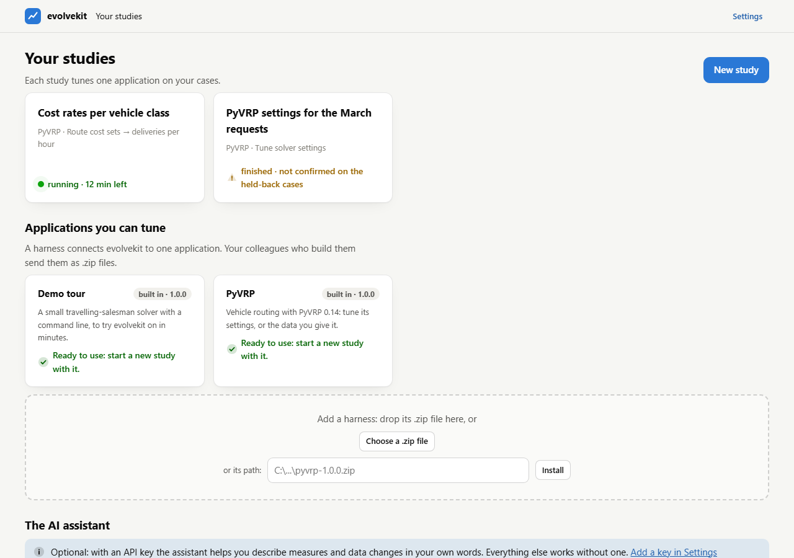
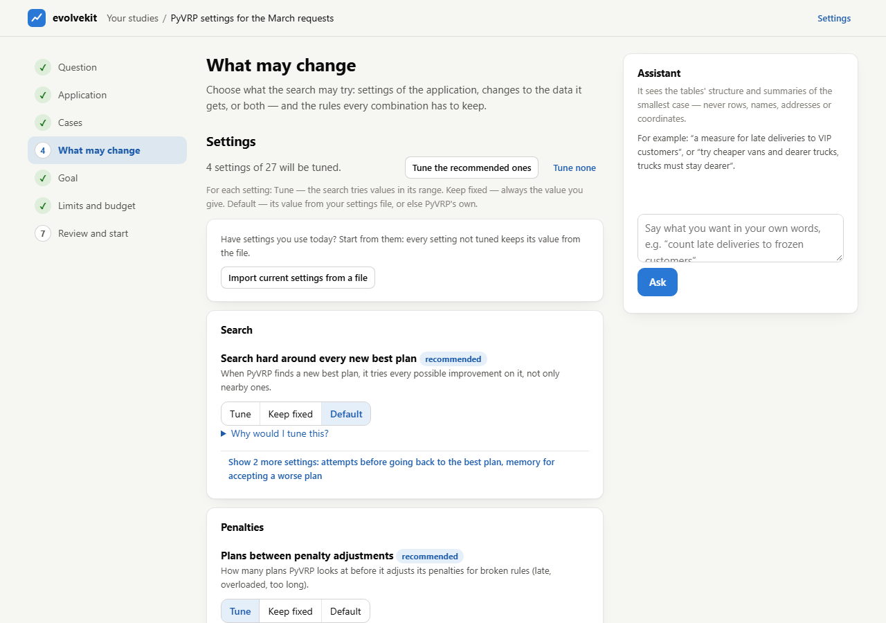
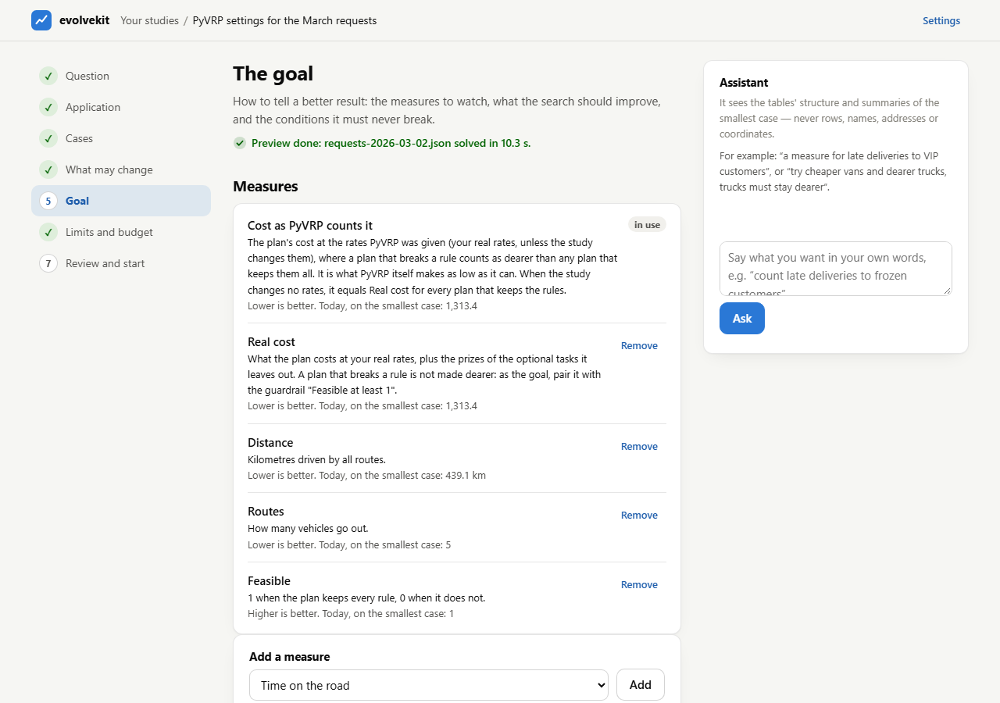
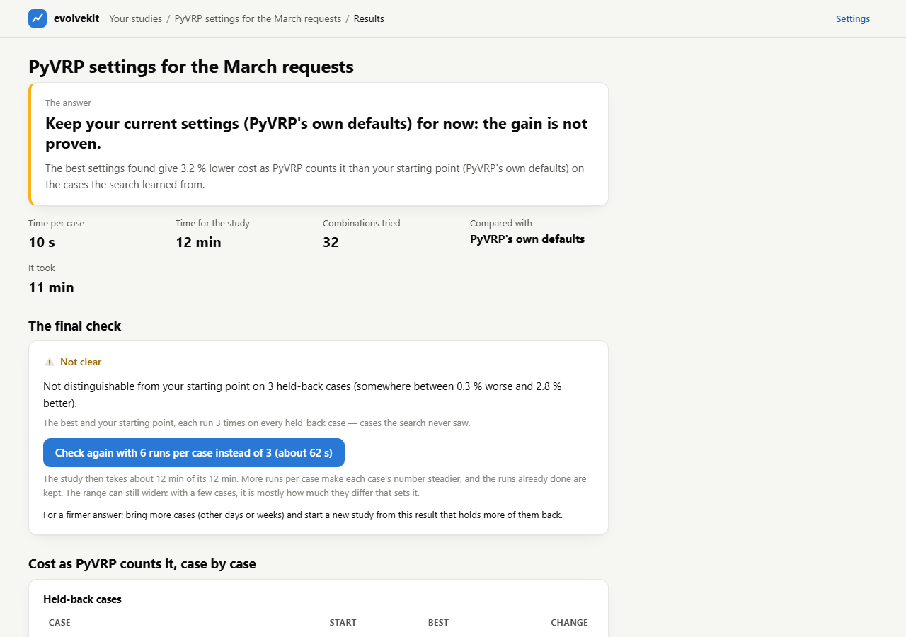
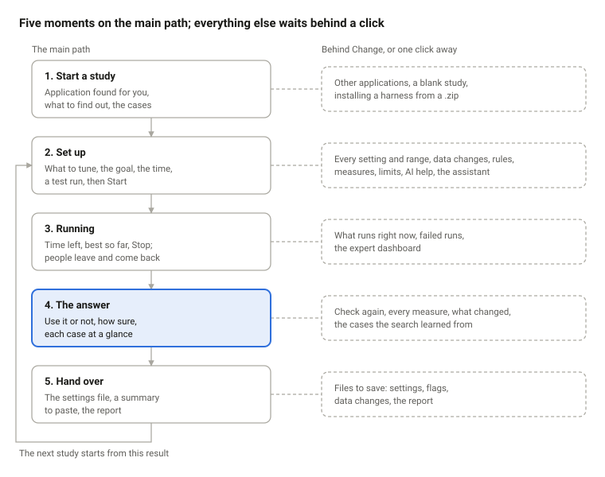

# evolvekit app: redesign handoff

27 September 2026 · saved from the Claude Doc of the same name

The app works end to end and passed its usability gate at 8/10, but it reads like a manual: every screen is long, wordy and plain. Claude Design: sketch five different approaches, let the user pick one, then make that one in full, with far fewer words, a clear hierarchy and a look of its own. That design then drives a new implementation of the page.

## The ask

Five sketches first, then the favourite made in full, then the build.

1. **Sketch five approaches.** Five truly different directions, each as a few mid-fidelity screens with the real numbers from Real data:
   - Set up, Running and Results at 1280 px, and Results at 390 px;
   - a name, the idea in one sentence, and what it gives up.
2. **The user picks one**, side by side. A mix is fine ("the results of B with the set-up of D").
3. **Make the chosen one in full:**
   - screens at 1280 px and 390 px, light and dark: Home, New study, Set up, Running, Results, Settings, the assistant panel;
   - every state in the Screens table;
   - components and tokens, named so the build maps them one to one;
   - a clickable prototype of the main path: New study, then Start, then Results.
4. **Build it** in the app (not Claude Design): see the last section.

Out of scope throughout: the search engine, the JSON API behind the page, and the expert dashboard.

## The product in a minute

evolvekit finds better settings for a program like PyVRP, a route planner, on the user's own cases, and says honestly whether they are really better.

- **Who:** planners, analysts and interns. They know their routes, costs and time windows; they are not programmers or statisticians. They read literally and stop at jargon.
- **The one job:** "Find settings that do better on our data, in the time I have, and tell me if I can trust them."
- **What they take away:** use it or not, how much better, how sure, and the settings file to hand over.
- **How it runs:** a local web app on their own computer, opened in the browser. A study runs 30 minutes to a few hours; people set it up, press Start, leave, and come back to the answer.
- **How it decides:** it learns on most cases and holds a few back. At the end it checks the winner on the held-back cases it never saw. Only that check says "better".

## What is wrong today

Three words sum it up: wordy, crowded, plain.

- **Wordy.** Almost every item carries one to four sentences of help. The goal step explains five measures at length, each followed by "Lower is better. Today, on the smallest case: 1,313.4". The results headline alone is 26 words.
- **Crowded.** Setup is 3 questions and 7 steps of long forms, though most studies keep the defaults. The results page stacks nine sections: answer, facts, final check, two per-case tables, all measures, what changed, hand-over and next steps.
- **Plain.** A system font, grey cards on beige and blue buttons give a generic admin look. What matters most (the verdict, how sure it is, the search moving) is told in sentences and tables, never shown.

Keep what works: the verdict comes first and is honest, the words are plain, the step rail, dark mode, the phone layout.

## Design direction

Show the answer, hide the explanation: pictures for what matters, words only where a picture cannot say it.

**Principles**

1. **One screen, one question.** Its answer is the heading; everything else waits behind a click.
2. **Show, don't tell.** A mark, a strip, a dot or a bar before any sentence.
3. **Defaults first.** The main path is three choices; everything else sits behind "Change".
4. **Few words.** Labels of up to 3 words, sentences of up to 12, help behind an (i).
5. **Calm, alive where it is live.** One accent colour; motion only while a study runs.

**Personality:** a precise instrument with a warm voice. Confident and exact, never alarming. The name suggests evolution (generations, lineage, variation): a motif for the logo mark, the running screen and empty states, used sparingly.

**Look:** each approach takes its own. All of them share tabular figures for numbers, one accent colour instead of the default blue, and a dark mode designed for itself, not inverted.

**Signature elements:** pictures every approach needs, each drawn its own way.

| Element | What it shows | What it replaces |
| --- | --- | --- |
| Verdict mark | Three states (better, confirmed · not proven · worse) and one line | A 26-word headline and an amber sentence |
| Interval strip | A bar through 0 %: the likely range as a band, the estimate as a dot | "somewhere between 0.3 % worse and 2.8 % better" |
| Case dots | One row per case: start and best as two dots, joined, coloured by which way it went | Two per-case tables |
| Run timeline | Rounds as segments, the best so far above them, the final check last, "done around 17:40" | Four fact tiles, a progress bar and a chart |
| Plan bar | The total time split into search and final check, rounds ticked off | "about 6 rounds, about 42 combinations tried, a final check on 3 held-back cases (≈ 2 min); done around 02:49." |

## Five approaches to sketch

Five starting points that differ in how the app is organised and how it feels. Claude Design may swap any of them for a better idea, as long as the five stay far apart.

|  | Approach | The idea | Setting up feels like | The result looks like |
| --- | --- | --- | --- | --- |
| A | Instrument | A precise lab instrument: dark first, one signal colour, readouts and tabular numbers | A control panel with three dials: what to tune, the goal, the time | The verdict as a big readout, the interval strip like a meter |
| B | Report | An editorial page read top to bottom: large headlines, generous white space | A short questionnaire, one question per section | A one-page brief: the answer as the headline, charts like a magazine's |
| C | Conversation | The assistant is the interface: the study is set up in a dialogue, each decision a card | Answering questions in a chat, confirming cards | The answer as a message, the strip and the settings file attached |
| D | Map | The study as one canvas of connected stations: cases, search, check, answer; the search drawn as a growing lineage | Filling in stations on a map | The last station lights up; zoom into any case |
| E | Cards | One full-screen card at a time, big type, thumb-sized buttons, phone first | Three cards, then Start | One card with the answer; swipe for the details |

Every sketch uses the same content, words and principles, so the five compare like for like.

## The main path

Today the path is 11 screens: home, new study, seven setup steps, running and results. Every approach should need five moments, with everything else one click away.

The order is fixed: an answer needs cases, a goal and a time before Start. How the moments are laid out (pages, one canvas, a chat, cards) is each approach's own choice.

## Screens

Seven screens, or their equivalents in each approach. Each answers one question, and that answer is its heading.

| Screen | Its question | Always visible | One click away | States to design |
| --- | --- | --- | --- | --- |
| Home | Your studies | Study cards: name, state (running with time left; finished with its verdict mark); New study | Installed applications, adding a harness, the library folder | First run with no studies; a study running |
| Start a study | What do you want to find out? | The application (found for you), the kind of study (settings or data), the cases (drop a folder), a suggested name | Other applications, a blank study, file formats, per-file details | No application found; a file that cannot be read; too few cases |
| Set up | Ready to start? | Three summaries with Change: what to tune (4 of 27 settings), the goal, the time (20 s a case, 30 min, done around 17:40); the test run; Start | Each setting and its range, data changes, rules, measures, held-back cases, runs per case, AI help, the assistant | Preview running (values arrive); something missing (named, with a jump to it); plan thin or impossible (with fixes); test run failed |
| Running | Searching, 12 min left | The time bar with rounds; best so far, marked "not checked yet"; Stop | What runs now, failed runs, the expert dashboard | Starting; final check; stopping; stopped; failed; computer busy |
| Results | The verdict, in one sentence | Verdict mark, interval strip, held-back cases as dots, the settings file (copy, save), Check again | Every measure, what changed, the cases it learned from, the report, the summary text, a new study from here | Confirmed; not proven; worse; one held-back case only; nothing beat the start; check stopped |
| Settings | The AI assistant | Provider, key (set or not), Test | Models, the library folder | No key; key refused; model gave no answer |
| Assistant panel | Ask in your own words | The conversation, proposal cards with Apply and Dismiss | The cost so far, earlier answers | Thinking (up to a minute); no answer, with Ask again; no key |

## Words

A third of today's words, each doing a job: the heading is the answer, labels are nouns, help waits behind an (i).

- **Length:** labels up to 3 words, sentences up to 12, one sentence visible per block.
- **Order:** the number first, then what it means, then what to do.
- **Never on screen:** KPI, seed, generation, instance, config, baseline, SQL (outside the expert box).

**One name per idea**

| Say | Meaning | Not |
| --- | --- | --- |
| study | One search for better settings or data, from set-up to answer | experiment, run |
| case | One input the program solves, such as one day's requests | instance, request file |
| held-back case | A case the search never sees, kept for the final check | test set |
| starting point | What is used today: the program's defaults or a settings file | baseline, seed |
| measure | A number that says how good a plan is (cost, km) | KPI, metric |
| goal | The measure to improve, and which way | objective |
| rule | A condition every combination or plan must keep | constraint, guardrail |
| combination | One set of values tried | candidate |
| round | A batch of combinations tried together | generation |
| final check | The comparison on held-back cases at the end | confirmation |

**Before and after**

| Today | Rewritten |
| --- | --- |
| The best settings found give 3.2 % lower cost as PyVRP counts it than your starting point (PyVRP's own defaults) on the cases the search learned from. | 3.2 % cheaper on the 5 cases it learned from |
| Not distinguishable from your starting point on 3 held-back cases (somewhere between 0.3 % worse and 2.8 % better). | The interval strip, and: Not proven on 3 new cases |
| Keep your current settings (PyVRP's own defaults) for now: the gain is not proven. | Keep PyVRP's defaults (verdict mark: not proven) |
| About 42 combinations for 8 things to tune is thin: the search may find a better combination, but it will likely miss the best one. | Thin plan: 5 tries per setting. \[Tune the top 4\] \[Allow 1 h\] |
| For each setting: Tune: the search tries values in its range. Keep fixed: always the value you give. Default: its value from your settings file, or else PyVRP's own. | A Tune · Fixed · Default switch, a tooltip per option |
| Other programs kept this computer busy during the study. A run with a time limit then finds a little less than it would alone, so close heavy programs while a study runs. | Computer busy: results may be a little worse (i) |

## Components and tokens

Name everything: the build turns each token into a CSS variable and each component into one small function, one to one.

**Tokens:** colour (surface layers, three ink levels, one accent, good / warning / critical with their tints, focus ring), type (5 or 6 sizes, tabular figures), spacing on a 4 px grid, radius, at most two elevations, motion (durations, easing, reduced motion). Light and dark for each.

| Component | Used on | States |
| --- | --- | --- |
| Verdict mark | Results, Home | Confirmed, not proven, worse, nothing better |
| Interval strip | Results | Above 0, across 0, below 0, no range (one case) |
| Case dots | Results | Better, worse, the same, did not finish |
| Time bar with rounds | Running | Running, final check, stopped, failed |
| Best-so-far line | Running | Empty, rising, flat |
| Plan bar | Set up | Fits, thin (with fixes), impossible |
| Summary row with Change | Set up | Complete, something missing, open |
| Drawer | Set up, Results | Open, closed, full screen on a phone |
| Setting row with a Tune · Fixed · Default switch | Set up drawer | Each mode, recommended, range edited |
| Number with unit | Set up | Normal, invalid, both decimal marks read |
| Kind-of-study choice | Start a study | Selected, hover, focus |
| Drop zone for cases | Start a study | Empty, dragging, reading, read, a file refused |
| Study card | Home | Draft, running, finished (by verdict), stopped, failed |
| Notice | Anywhere | Info, warning, error: one line and an action |
| Chat bubble and proposal card | Assistant | You, assistant, no answer; proposed, applied, dismissed, not expressible |
| Toast | Anywhere | Done, error |
| App bar with where you are | Every screen | Wide, phone |
| Empty state with the motif | Home, Running | First run, nothing yet |

## Constraints

The design has to work offline on one computer, in both themes, down to a phone's width.

- **Local and offline.** A Python process on the user's computer serves the page and a JSON API on 127.0.0.1. Nothing loads from the internet: fonts, icons and images ship with the app.
- **A plain web page.** HTML, CSS and JavaScript with no build step. Today it is one file of about 1,900 lines; the new one may be a few static files. No framework unless a tiny one earns its place.
- **Light and dark.** It follows the computer's setting; `?theme=light` or `?theme=dark` forces one.
- **Widths.** From 360 px to a wide desktop; the phone layout starts below 760 px.
- **Accessible.** WCAG 2.2 AA contrast, everything reachable by keyboard, visible focus, screen-reader labels, reduced motion respected.
- **Live, and slow in places.** The running screen refreshes every 2.5 s; the preview takes about 10 s; the assistant up to a minute. Each wait needs a calm state.
- **Honest.** Nothing says "better" before the final check does, and every estimate shows its range.

## Real data to design with

Use these numbers from a real 12-minute PyVRP study on eight days of delivery requests. They make a good test: all three held-back cases got cheaper, yet the honest answer is "not proven".

**Results**

- **Answer:** not proven. "Keep PyVRP's own defaults for now."
- **Learned from 5 cases:** 3.2 % lower cost, one run each.
- **Final check on 3 held-back cases, 3 runs each:** 1.3 % lower on average; likely between 0.3 % worse and 2.8 % better.
- **Set-up:** 10 s per case, 12 min in total, 32 combinations tried, took 11 min; compared with PyVRP's own defaults.
- **What changed:** plans between penalty adjustments 500 → 71; highest penalty 100,000 → 7,259.29; share of plans that keep the rules 0.65 → 0.629; swap two tasks with one: on → off.
- **Other measures, held-back cases:** distance 677.1 → 689.0 km; routes 7.0 → 6.7; every plan kept every rule.

**Cases, for the case dots** (cost in the request's currency)

| Case | Kind | Start | Best | Change |
| --- | --- | --- | --- | --- |
| 2026-03-05 | held back | 1,418.3 | 1,399.5 | 1.3 % lower |
| 2026-03-09 | held back | 1,892.8 | 1,880.5 | 0.6 % lower |
| 2026-03-10 | held back | 2,518.8 | 2,470.9 | 1.9 % lower |
| 2026-03-02 | learned from | 1,326.6 | 1,286.8 | 3.0 % lower |
| 2026-03-03 | learned from | 1,139.6 | 1,140.6 | 0.1 % higher |
| 2026-03-04 | learned from | 1,842.9 | 1,794.7 | 2.6 % lower |
| 2026-03-06 | learned from | 1,736.8 | 1,662.0 | 4.3 % lower |
| 2026-03-11 | learned from | 1,786.4 | 1,679.0 | 6.0 % lower |

**Running** (a data study, 3 minutes in): 3 min used, 12 min left, done around 04:52, round 1 of about 6. No combination has beaten the starting point yet; 7 tried, the closest within 1.6 %. Right now: round 2, 7 combinations on 5 cases, 12 of 35 runs done.

**Set up:** 8 cases of 78 to 192 stops, 3 held back; 4 of 27 settings tuned; goal: cost as PyVRP counts it, lower is better; 20 s per case, 30 min in total; about 6 rounds and 42 combinations, final check about 2 min, done around 17:40.

**Home:** two studies. "PyVRP settings for the March requests": finished, not confirmed. "Cost rates per vehicle class": running, 12 min left.

## What comes back, and the build

The build replaces the page, not the app behind it, and starts only once the chosen approach is designed in full.

**From Claude Design:** the five sketches and the chosen design (screens as images, a link, the prototype); tokens as a list (name, light value, dark value); components with sizes and states; assets (logo mark, icons, fonts with their licences).

**The build**, a new pull request after the three open ones:

1. Tokens become CSS variables; fonts and icons ship with the app.
2. The page follows the chosen structure. The JSON API stays, gaining a field only where a screen needs one.
3. Each component becomes one small function with its states.
4. The words follow the word rules; long help moves behind (i).
5. Everything the app can do today stays reachable, checked against a list drawn from today's screens.

**How we check it:**

- `python tasks.py check`, and screenshots in light, dark and at phone width, compared with the design screen by screen.
- A word budget: no screen shows more than 100 words before a click. Today Results shows 563, the goal step 736, What may change 504, Home 179.
- The intern review again: a fresh reviewer, the same task, passing at 8/10 with no blocker.

**Open questions:**

- A brand colour or logo to keep?
- Can the seven set-up steps become one Set up screen?
